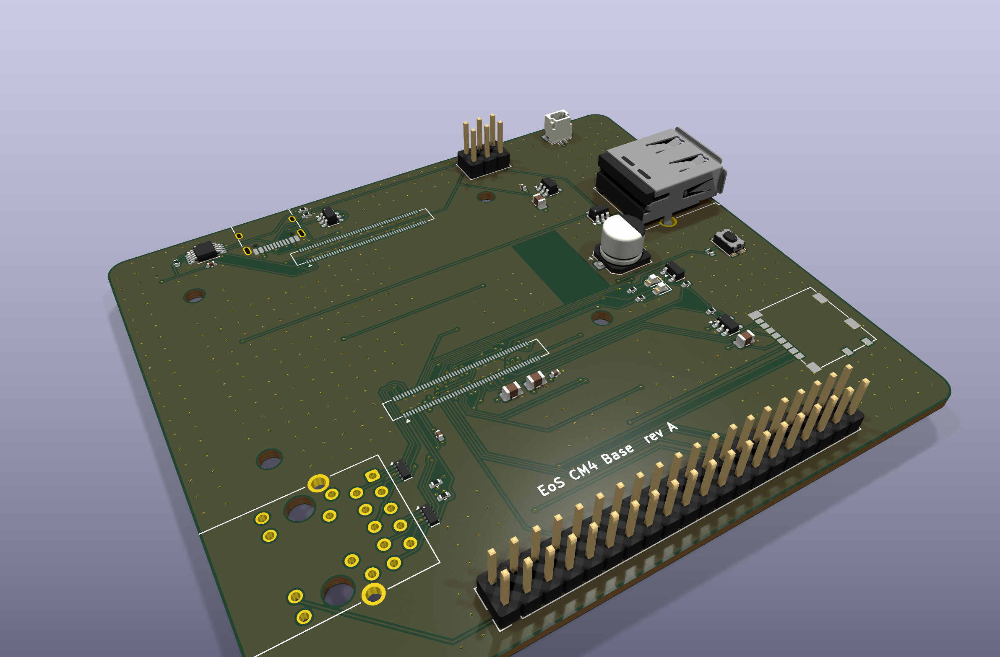
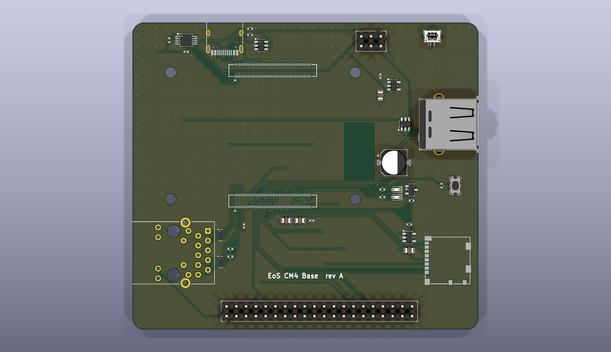
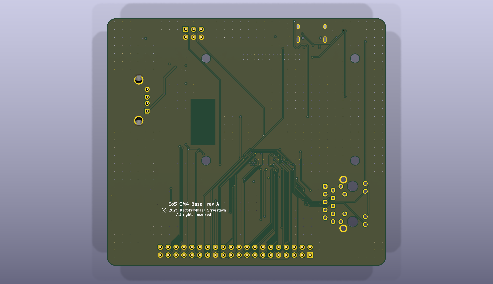

# EoS CM4 Base

A carrier board for the Raspberry Pi Compute Module 4, 90 × 80 mm, four layers. Designed by
Kartikeydheer Srivastava. All rights reserved: not open source, and not under this repository's MIT licence.
Anyone may view it, clone this repository and run its tests; anything more needs
Kartikeydheer Srivastava's written permission (kartikeydheer@gmail.com). EmbeddedOS (EoS) Research Foundation has a limited, revocable
permission. See [LICENSE.txt](LICENSE.txt) and [the licence summary](../README.md#licence).

A board for the same job as Raspberry Pi's CM4 IO Board; an original design, not a copy: no file
of that board was used. It is EoS CM5 Base's layout, changed where the CM4 differs.



| | |
|---|---|
|  |  |

## The module fits, to the nanometre

The CM4 plugs in through two 100-pin Hirose DF40C-100DS-0.4V connectors, giving 1.5 mm
stacking (CM4 datasheet, section 3.1).

**Where the connectors and holes go.** Figure 4 of the CM4 datasheet and Figure 4 of the CM5
datasheet show the same module:
- the same 55 × 40 mm outline;
- M2.5 holes inset 3.5 mm;
- connectors 3 mm from the long edges;
- the same wireless cut-out.

The CM5 datasheet (section 1.2) also says CM5 fits existing CM4 carrier boards. So the connector
pads and holes sit where `tools/eos_boards/reference/cm5_carrier.json` puts them.

**Which net each pin carries** comes from the CM4 datasheet's pinout (section 4). It is recorded
in `tools/eos_boards/reference/cm4_pins.json` by `extract_cm4.py`, with the datasheet's SHA-256.

`tests/unit/test_eos_boards.py` checks, at KiCad's 1 nm resolution:
- all 200 pads and the four holes;
- every ground, 5 V, 3.3 V and GPIO pin's net;
- that HDMI, camera, display, PCIe, 1.8 V and reserved pins stay unconnected.

## What is on it

| Block | How |
|---|---|
| Power in | **USB-C, 5 V.** VBUS feeds the module's six +5V pins (4.75–5.25 V). The CM4 does not negotiate USB-C power, so CC1 and CC2 each have 5.1 kΩ to ground (a USB-C sink). They also go to AnalogIP1 and AnalogIP0, which the datasheet says are "typically connected to CC pin of Type C power connector". |
| USB 2.0 | **One port, two connectors.** The CM4 has one USB 2.0 port. USB_OTG_ID is pulled up inside the module, which makes it a USB device; grounded by a jumper, the CM4 becomes a host. A TI TS3USB30E switch, selected by the same line, routes the port: to the USB-C connector in device mode (rpiboot flashing, gadget mode), and to the USB-A connector in host mode. TI's truth table: S low, D = D1; S high, D = D2. The USB-A port's 5 V comes through a TPS2041B, whose enable is active low, so it is powered only in host mode. It has 0.1 µF at its input and 150 µF at its output, after TI's application circuit (USB asks 120 µF per port). Both connectors have USBLC6-2SC6 ESD protection. |
| Gigabit Ethernet | As EoS CM5 Base: a TRXCOM TRJG0926HENL MagJack, pairs 0–3 to TRD0–3, centre tap through 100 nF, activity and speed LEDs (Ethernet_nLED3, nLED2) through 470 Ω, and two flow-through TPD4EUSB30 for ESD. The CM4 uses the same pins. |
| microSD (CM4 Lite) | As EoS CM5 Base: direct to SD_CLK, SD_CMD and SD_DAT0–3. The card's 3.3 V comes through an RT9742GGJ5 switch enabled by SD_PWR_ON. |
| 40-pin GPIO | The standard Raspberry Pi header. GPIO_VREF is tied to CM4_3.3V, as the datasheet requires for 3.3 V GPIO. |
| Controls and LEDs | **Reset:** RUN_PG can be "driven low (via a 220Ω resistor) to reset the CM4 CPU", so a reset button goes through 220 Ω. **Power LED:** PI_LED_nPWR "needs to be buffered", so a BSS84 P-MOSFET drives it. **Activity LED:** Pi_nLED_Activity sinks its LED directly (20 mA max). **Jumpers:** nRPIBOOT (USB boot), EEPROM write protect, USB host mode. **Fan:** a plain 5 V fan connector. |
| Antenna | **No copper on any layer under the module's PCB antenna.** The CM4 datasheet (section 3.1) says there must be no metal there, ground planes included, and a ground-plane cut-out of at least 6.5 × 11 mm, ideally 8 × 15 mm. The board keeps the larger area clear on every layer, where Figure 4 puts the antenna. A test checks it. |

## Not on this board

HDMI, PCIe, and the camera and display (MIPI CSI and DSI) interfaces are left off on purpose.
Each needs impedance-controlled, length-matched differential pairs. This generator routes nets
one at a time and cannot match or verify such pairs.

The CM4 has no RTC battery input and no fan-controller pins, so this board has no coin cell and
no fan speed control. Raspberry Pi's CM4 IO Board adds those with chips on I2C; this board does
not.

## Fabrication

4 layers (signal / GND plane / 5 V plane / signal), 1.6 mm thick.

- **Vias:** 0.45 mm with a 0.2 mm drill, as on EoS CM5 Base.
- **Tracks:** 0.15 mm; 0.5 mm on 5 V.
- **Under the module:** nothing on the top side, because 1.5 mm stacking leaves no room. There is
  no copper at all under the antenna.

The Ethernet pairs, the USB pair from the module to the switch, and SD_CLK are routed first, in
a set order, before the autorouter.

## What has not been done

- **No board has been made or tested.**
- **No signal-integrity simulation.** The Ethernet and USB 2.0 lines are short, but their
  impedance has not been calculated or simulated.
- **The switch's effect on the USB eye** has not been measured. TI publishes a 480 Mb/s eye
  diagram through the TS3USB30E.

## Rebuild

```
python3 tools/eos_boards/build.py eos_cm4_base
```

The design file is [tools/eos_boards/boards/eos_cm4_base.py](../../../tools/eos_boards/boards/eos_cm4_base.py).
