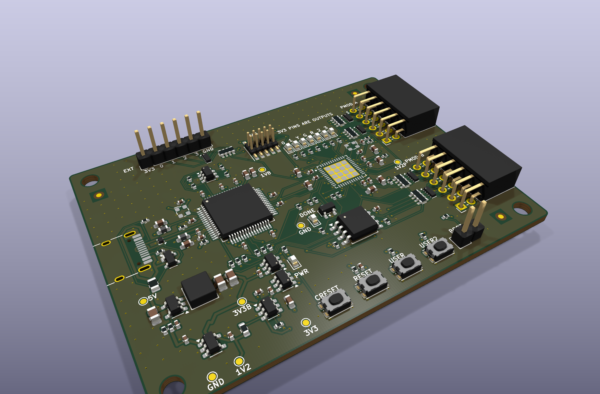
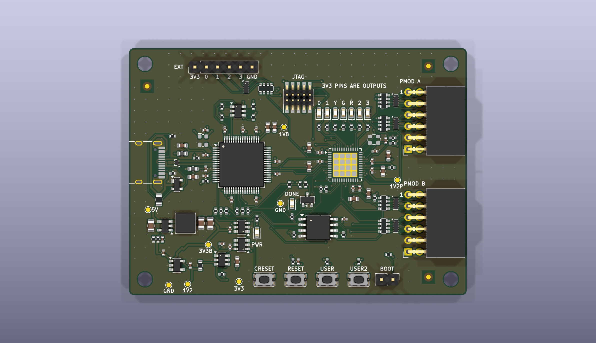
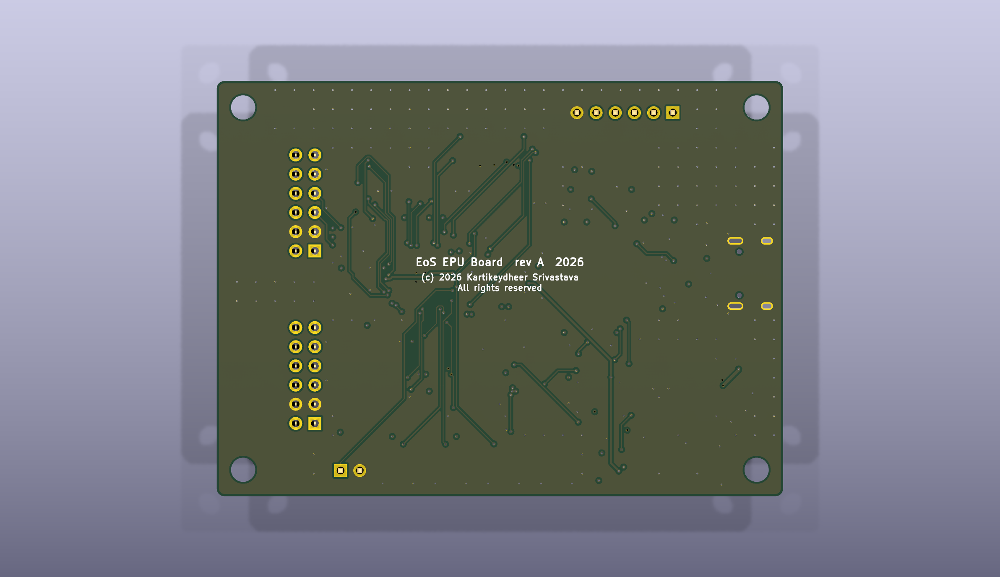

# EoS EPU Board

An original iCE40UP5K FPGA board for EPU, EmbeddedOS's RISC-V SoC: 75 × 55 mm, four layers.
Designed by Kartikeydheer Srivastava.
All rights reserved: not open source, and not under this repository's MIT licence.
Anyone may view it, clone this repository and run its tests; anything more needs
Kartikeydheer Srivastava's written permission (kartikeydheer@gmail.com). EmbeddedOS (EoS) Research Foundation has a limited, revocable
permission. See [LICENSE.txt](LICENSE.txt) and [the licence summary](../README.md#licence).

A board for the same job as a bought iCE40UP5K development board; an original design, not a copy:
no file of any vendor's board was used. No schematic, layout, CAD, Gerber or BOM of Lattice's
evaluation or breakout boards, of any other iCE40 board (iCEBreaker, UPduino, pico-ice) or of an FTDI
module was opened. The circuit comes from the chips' data sheets and application notes, the
FT2232H pin roles from the source code of the open-source programmers that use them (iceprog and
openFPGALoader), and the Pmod ports from Digilent's published Pmod Interface Specification.



| | |
|---|---|
|  |  |

One USB-C cable powers the board, programs the FPGA's configuration flash and carries EPU's serial
console. The FPGA pins are laid out for EPU's FPGA top (`epu/fpga/ice40/epu_ice40_top.v`); the
[pin table](#pin-table) maps every one of the FPGA's 39 user pins, and EPU's pin file is written from it.
EPU's source is not yet published.

## What is on it

| Block | Parts, values and source |
|---|---|
| FPGA | Lattice iCE40UP5K-SG48I (5,280 LUTs, 1 Mbit SPRAM, QFN-48 7 × 7 mm, industrial). Pins from Lattice's iCE40UP5K pinout file (Revision 1.1); everything else from the [iCE40 UltraPlus Family Data Sheet](https://www.latticesemi.com/view_document?document_id=51968) FPGA-DS-02008-2.4 ("DS") and the iCE40 Hardware Checklist FPGA-TN-02006-2.4 ("HC"). 100 nF at every supply pin and 4.7 µF per supply group (HC Table 2.2). The exposed paddle is the only ground (pinout file) and has four vias into the ground plane. |
| Power-up order | DS 4.5 and HC 2.3 ask for VCC (1.2 V) and VCCPLL first, then SPI_VCCIO1, then VPP_2V5, each after the previous one reaches 0.5 V; DS Table 4.3 asks for 0.6–10 V/ms ramps. A TI TPS22917 load switch makes the board's 3.3 V rail from the buck's output and its ON pin is the FPGA's 1.2 V rail (ON high at 1.0 V, TI SLVSDW8B), so every 3.3 V part (all FPGA banks and VPP_2V5, the flash, the FT2232H, the two oscillators) comes up after VCC: 1.2 V rises in the LDO's 550 µs start-up (≈ 2.2 V/ms), 3.3 V about 2 ms later at 1.9 V/ms (CT = 1 nF: TI SLVSDW8B 7.6). VPP_2V5 is on 3.3 V: allowed for configuration from SPI flash (2.30–3.46 V, DS Table 4.2), not for NVCM programming (≤ 3.0 V), which this board never does. QOD discharges 3.3 V through 100 Ω when 1.2 V falls, so a quick re-plug repeats the order. |
| VCCPLL | 100 Ω from VCC, 4.7 µF (HC Table 2.2's value; 100 Ω × 4.7 µF = 0.47 ms) and 100 nF at pin 29, laid as one line pin → 100 nF → 4.7 µF → 100 Ω (iCE40 sysCLOCK PLL guide FPGA-TN-02052-1.4, 5.2 and Figure 5.4; HC Table 2.2). Fitted "even if the PLL is not utilized". The SG48 has no separate PLL ground. |
| Configuration | SPI master mode from the flash. CRESET_B: 10 kΩ pull-up (it has none inside: iCE40 Programming and Configuration FPGA-TN-02001-3.5 ("TN1") 5.1) and no capacitor. DS 4.6 asks for CRESET_B low until every supply is valid, and the FPGA's own power-on reset trips far below its operating minimums (DS Table 4.4: VCC 0.79 V, SPI_VCCIO1 1.50 V), so two TI TPS3808 supervisors ([SBVS050N](https://www.ti.com/lit/ds/symlink/tps3808.pdf)) hold it low, chained as TI's Figure 7-3: U11 (TPS3808G12) watches the 1.2 V rail and holds U10's MR low; U10 (TPS3808G33) watches the 3.3 V rail and drives CRESET_B through its open-drain output. Both run from the buck's 3.3 V, which is up before either rail they watch. CRESET_B goes high 12–28 ms (CT open) after both rails are valid, and low again within about 20 µs if either sags: a brown-out reconfigures the FPGA (see [Supervisor thresholds](#supervisor-thresholds)). The CRESET button is U10's MR, so one press gives one clean, debounced pulse. CDONE: 2.2 kΩ pull-up, from TN1's `R ≤ 1 / (2 × f_config × C_CDONE)` with the default configuration clock (≤ 17 MHz, DS Table 4.24) and about 10 pF. SPI_SS_B and SPI_SCK: 10 kΩ pull-ups (HC Table 3.1; SS high selects master mode, TN1 9.3). The green DONE LED lights when CDONE is high (a 2N7002 whose gate hangs off CDONE through 10 kΩ). |
| Flash | Winbond W25Q128JVSIQ, 16 MB, SOIC-8 208 mil ([W25Q128JV data sheet](https://www.winbond.com/resource-files/w25q128jv%20revf%2003272018%20plus.pdf) Revision F). It answers the 0x0B Fast Read, 0xAB and 0xB9 commands the iCE40 uses (TN1 9.2). IQ parts have QE = 1 (7.1.4): pins 3 and 7 are IO2/IO3, held high by 10 kΩ. The bitstream (104,161 bytes, TN1 Table 9.2) sits at address 0; EPU's firmware can follow it (EPU backlog B-14). The FPGA may leave the flash in deep power-down after configuration (TN1 9.4), and iceprog powers it down after every write unless run with `-k`: **EPU's firmware must send 0xAB (release power-down) before it reads the flash.** |
| FPGA clock | X1, ECS-2520MV-120-BN-TR 12 MHz CMOS oscillator, ±50 ppm, −40 to +85 °C ([ECS-2520MV](https://ecsxtal.com/store/pdf/ECS-2520MV.pdf)), on pin 35 (IOT_46b_G0): a global input, and the GPLL pin that a PLL would use (FPGA-TN-02052 5.1.1). EPU divides it to 6 MHz. |
| USB bridge | FTDI FT2232HL ([DS_FT2232H](https://ftdichip.com/wp-content/uploads/2020/07/DS_FT2232H.pdf) Version 2.6), bus powered as its Figure 6.1: ferrite + 4.7 µF + 100 nF on VPHY and on VPLL (Table 3.2 asks for an LC filter), two 4.7 µF on VREGOUT (at least 3.3 µF, kept to −30 °C on the small-signal DC-bias curve), 100 nF on each VCORE and VCCIO pin, 12 kΩ 1 % on REF, RESET# pulled up through 1 kΩ, TEST to ground. Its 12 MHz clock is a CMOS oscillator into OSCI with OSCO open, the alternative FTDI's 6.3 gives to a crystal: X2, ECS-2520MVLC-120-CN-TR ([ECS-2520MVLC](https://ecsxtal.com/store/pdf/ECS-2520MVLC.pdf), Rev. 2022), ±25 ppm including tolerance, temperature, supply, load and reflow, plus ±3 ppm aging in the first year: ±28 ppm from −40 to +85 °C, inside FTDI's 12 MHz ± 30 ppm (Table 6.1), with no load-capacitor pulling to add (±28 ppm is the first-year figure: ECS gives aging for the first year
only). FTDI's OSCI input range is 2.97–3.63 V (Table 6.1); ECS guarantees an output high of at least
0.9 × VDD at 15 pF, which is 2.84–3.04 V on the 3.3 V rail's 3.16–3.38 V worst-case range, so a strict reading
can fall up to 0.13 V short. X2 drives one input pin through 2.7 mm of track, far below 15 pF, where a CMOS
output sits near VDD (Inferred); bring-up step 6 measures it. A crystal would also need its pullability for the budget; the stocked ±10 / ±10 ppm 12 MHz crystal (CTS 403C11A12M00000, CL 10 pF) does not publish it and is rated −20 to +70 °C only. It is a fixed-function USB bridge, not a vendor debug probe running proprietary firmware. |
| Channel A: programming | Wired as Project IceStorm's iceprog drives it (iceprog/mpsse.c and iceprog.c, commit e86829e): ADBUS0 SCK, ADBUS1 MOSI to the flash's DI, ADBUS2 MISO from the flash's DO, ADBUS4 CS, ADBUS6 CDONE (input), ADBUS7 CRESET, interface A, 6 MHz. openFPGALoader's `ice40_generic` board uses the same pins: pin-compatible, **untested** until a board passes bring-up step 9. openFPGALoader sends its first flash commands right after it pulls CRESET low, with no wait (`src/ice40.cpp` and `src/spiFlash.cpp`, commit cdfe87a); with no capacitor on CRESET_B the node falls with a time constant of about (1 kΩ ∥ 10 kΩ) × 20 pF ≈ 20 ns, far inside even one USB transfer (≥ 125 µs), and iceprog waits 250 ms anyway (`iceprog.c`). Each of these lines meets the FPGA/flash nets through 1 kΩ: when no programmer is running, channel A is in its default UART mode and drives TXD, RTS# and DTR# onto SCK, MISO and CS, which the FPGA and the flash also drive; 1 kΩ holds any such clash to 3.3 mA. **Never open channel A as a serial port; EPU's console is channel B.** An open port asserts DTR#, which pulls SPI_SS_B to 0.3 V; if the FPGA is then reconfigured (CRESET, or a brown-out) it waits as an SPI target for a bitstream from the host, and DONE stays off until the port is closed and CRESET pressed again. No passive part can prevent it: iceprog's chip select is the same low level. Once the EEPROM is programmed, setting channel A to the D2XX driver only (FTDI section 7, "Load VCP Driver" off) stops Windows from making a COM port for it. |
| Channel B: UART | BDBUS0 (TXD) to EPU's `uart_rx`, BDBUS1 (RXD) from `uart_tx`; 115,200 baud. |
| EEPROM | Microchip 93LC56BT-I/OT (DS21794G), with the pull-ups and the 2.2 kΩ of FTDI's Table 3.4 and Figure 6.1. It ships blank: the FT2232H then uses its default descriptors (VID 0403, PID 6010, both channels UART: FTDI section 7), which iceprog and openFPGALoader look for. Programmed later (FT_PROG or ftdi_eeprom), it gives the board a serial number, so several boards on one host can be told apart. |
| USB-C and protection | HRO TYPE-C-31-M-12 as a 5 V sink, 5.1 kΩ Rd on CC1 and CC2 (USB Type-C specification). TI TPD2EUSB30 on D+/D− (0.7 pF, IEC 61000-4-2 level 4, diodes to ground only: TI SLVSAC2G), low enough in capacitance for the FT2232H's high-speed lines; Littelfuse SP0503BAHTG on CC1, CC2 and VBUS (diodes to ground only). Littelfuse 0805L075WR polyfuse: 0.75 A hold at 20 °C (0.57 A at 50 °C), 1.50 A trip, R1max 0.35 Ω (0805L data sheet). VBUS carries only the buck's 4.7 µF at attach (USB 2.0 7.2.4.1: at most 10 µF). Everything is powered from VBUS, so the FT2232H is not back-powered and its D+ pull-up does not come on without VBUS **as long as no supply is fed into the 3.3 V pins of the Pmod, EXT or JTAG headers. Those pins are outputs only** (silkscreen: "3V3 PINS ARE OUTPUTS"): the load switch blocks reverse current (TI SLVSDW8B 1), so 3.3 V fed into one would run the FT2232H and the FPGA's I/O banks without VBUS and without the FPGA's 1.2 V core, against the power-up order of DS 4.5. Never power the board through them. |
| 3.3 V buck | TI TLV62569DBV (SLVSDG1C), 2 A: 2.2 µH Coilcraft XAL4020-222MEC and two 10 µF out (Table 4's 2.2 µH with 10–47 µF; two so the small-signal DC-bias value stays above TI's 5 µF minimum down to −30 °C, see [Parts](#parts-lifecycle-and-capacitor-dc-bias)), 4.7 µF in. Laid out as TI's Figure 20 (10.1): see [Layout](#layout). 45.3 kΩ / 10 kΩ 0.1 % set 0.6 V × (1 + 4.53) = 3.318 V (Equation 2); 68 pF feed-forward keeps TI's R1 × C3 for its 6.8 pF with 453 kΩ. |
| 1.2 V | TI TLV75512PDBV (SBVS320D), 1 % accuracy, 1 µF in and out (at least 1 µF, 0.47 µF effective), fed from the buck's 3.3 V. R5, a 0 Ω 0603 link, joins it to the FPGA's VCC (BENCH-READY C2); with R5 out, the load switch's ON pin sees no 1.2 V, so 3.3 V stays off. |
| User I/O | Four green user LEDs on EPU's `gpio[0]`–`gpio[3]` (680 Ω, 2.1 mA); three LEDs (red, green, yellow) on the FPGA's RGB sinks through 100 Ω; USER button on `gpio[4]`, USER2 on a spare pin; RESET (EPU's `rst_btn_n`, 10 kΩ and 100 nF); CRESET (U10's MR: reconfigures the FPGA); BOOT jumper on `boot_sel` (open = 1, fitted = 0). Buttons C&K KMR221G LFS; LEDs Kingbright APTD1608 series. |
| Pmod ports | Two 12-pin host ports on the right edge, Samtec SSW-106-02-G-D-RA right-angle sockets 0.9 in apart, pins 1–6 the row away from the edge, as Digilent's [Pmod Interface Specification](https://digilent.com/reference/_media/reference/pmod/pmod-interface-specification-1_3_1.pdf) (revised October 28, 2020) Figure 5 shows. 3.3 V on pins 6 and 12, at most about 100 mA per port (section 3). 200 Ω in series with every signal (Bourns CAY16-201J4LF; section 2), and on the socket side of the 200 Ω a TI TPD4E05U06 ESD array per two socket rows ([SLVSBO7O](https://www.ti.com/lit/ds/symlink/tpd4e05u06.pdf): 0.5 pF, VRWM 5.5 V, IEC 61000-4-2 ±12 kV contact, diodes to ground only; BENCH-READY D1); each line crosses its array, entering one pad and leaving by the pad opposite, TI's straight-through routing. Pmod A is Type 6A (I²C on pins 3 and 4 with 4.7 kΩ pull-ups on the host, section 2), Pmod B Type 2A (EPU's SPI master on pins 1–4, with 10 kΩ on its chip select). |
| JTAG | Samtec FTSH-105-01-L-DV-K, the Arm 10-pin 1.27 mm layout (VTref, TMS, TCK, TDO, TDI, nRESET), for EPU's planned JTAG debug port (EPU backlog B-15). nRESET is EPU's reset. Its lines go straight to FPGA pins 44–47 and the RESET net, with **no series resistor and no ESD array** (see [Not on this board](#not-on-this-board)). VTref is the 3.3 V rail: an output. |
| EXT | 1 × 6 2.54 mm header: 3.3 V (an output), four spare FPGA pins through 200 Ω with a TPD4E05U06 ESD array on the header side, ground. |
| Test pads | 1 mm pads, labelled on the silkscreen: 5V (after the fuse), 3V3B (buck), 1V2 (LDO), 3V3, 1V8 (FT2232H core), 1V2P (VCCPLL), and two GND (BENCH-READY C1). |

### Supervisor thresholds

Worst case over −40 to +85 °C: threshold ±1.25 % and hysteresis 1–2.5 % (TI SBVS050N 6.5); rails from
the regulators' data sheets.

| Rail | Rail range | Trips (falling) | Releases (rising), at most | The chips' minimum |
|---|---|---|---|---|
| +1V2 (VCC, VCCPLL), U11 TPS3808G12 | 1.188–1.212 V (TLV75512P, ±1 %) | 1.106–1.134 V | 1.162 V | VCC 1.14 V (DS Table 4.2) |
| +3V3 (banks, VPP_2V5, flash, FT2232H), U10 TPS3808G33 | 3.25–3.38 V at the buck (VFB 0.588–0.612 V), less the load switch's drop | 3.03–3.11 V | 3.19 V | VCCIO 3.14 V for LVCMOS33 (DS Table 4.2); FT2232H VCCIO 2.97 V; flash 2.7 V |

- **A good rail always releases the FPGA.** +1V2's release point is 26 mV under the LDO's minimum. +3V3's
  is 60 mV under the buck's minimum with no load, and still under the rail while the board draws up to
  about 0.45 A before the FPGA has configured (the load switch's 0.14 Ω at 85 °C); the design maximum
  of 0.61 A is reached only with both Pmod ports fully loaded and the FPGA running.
- **What a sag does.** Below the trip point CRESET_B goes low within about 20 µs (glitches shorter than
  20 µs are ignored, SBVS050N 6.6), and the FPGA reloads from the flash once the rails are back and
  12–28 ms have passed. Between the trip point and the chips' minimum (1.134–1.14 V on VCC, 3.11–3.14 V
  on the banks) a sag is out of the FPGA's range but not caught: these are the fixed thresholds TI
  makes for 1.2 V and 3.3 V rails (SBVS050N Table 4-1), and a higher one could hold a good rail in reset.
- **EPU's own reset is not on the supervisors.** While CRESET_B is low the FPGA is not configured, so EPU
  does not exist; after configuration it starts from its own reset.

## Pin table

Every FPGA user pin, by package pin. The EPU signal is the port name in `epu/fpga/ice40/epu_ice40_top.v`;
"reserved" pins are wired for EPU's next features (JTAG debug, I²C, more GPIO) and are free for any bitstream.
Banks (pinout file): pins 2–4 and 44–48 are bank 2 (VCCIO_2), 6 and 9–21 bank 1 (SPI_VCCIO1), 23, 25–28, 31, 32 and 34–43 bank 0 (VCCIO_0); all on 3.3 V.

| Pin | Lattice name | Net | EPU signal | Goes to |
|---|---|---|---|---|
| 2 | IOB_6a | `EXT1` | reserved: GPIO | EXT header J5 pin 3 via 200 ohm |
| 3 | IOB_9b | `EXT2` | reserved: GPIO | EXT header J5 pin 4 via 200 ohm |
| 4 | IOB_8a | `UART_TX` | `uart_tx` | FT2232H BDBUS1 (channel B RXD) |
| 6 | IOB_13b | `UART_RX` | `uart_rx` | FT2232H BDBUS0 (channel B TXD) |
| 9 | IOB_16a | `RST_N` | `rst_btn_n` | RESET button SW2, JTAG J2 pin 10; 10 kohm pull-up, 100 nF |
| 10 | IOB_18a | `BOOT_SEL` | `boot_sel` | BOOT jumper JP1 (open = 1, fitted = 0); 10 kohm pull-up |
| 11 | IOB_20a | `BTN0` | `gpio[4]` | USER button SW3; 10 kohm pull-up |
| 12 | IOB_22a | `EXT3` | reserved: GPIO | EXT header J5 pin 5 via 200 ohm |
| 13 | IOB_24a | `BTN1` | reserved: GPIO | USER2 button SW4; 10 kohm pull-up |
| 14 | IOB_32a_SPI_SO | `FLASH_MOSI` | `spi_mosi` | flash DI; Pmod B pin 2 via 200 ohm; FT2232H ADBUS1 via 1 kohm |
| 15 | IOB_34a_SPI_SCK | `FLASH_SCK` | `spi_sck` | flash CLK; Pmod B pin 4 via 200 ohm; FT2232H ADBUS0 via 1 kohm |
| 16 | IOB_35b_SPI_SS | `FLASH_CS` | `spi_cs_n[0]` | flash /CS; FT2232H ADBUS4 via 1 kohm; 10 kohm pull-up |
| 17 | IOB_33b_SPI_SI | `FLASH_MISO` | `spi_miso` | flash DO; Pmod B pin 3 via 200 ohm; FT2232H ADBUS2 via 1 kohm |
| 18 | IOB_31b | `PMODB_10` | reserved: GPIO (Pmod CS3) | Pmod B pin 10 via 200 ohm |
| 19 | IOB_29b | `PMODB_9` | reserved: GPIO (Pmod CS2) | Pmod B pin 9 via 200 ohm |
| 20 | IOB_25b_G3 | `PMODB_8` | `gpio[6]` | Pmod B pin 8 (RESET) via 200 ohm |
| 21 | IOB_23b | `PMODB_7` | `gpio[5]` | Pmod B pin 7 (INT) via 200 ohm |
| 23 | IOT_37a | `PMODB_1` | `spi_cs_n[1]` | Pmod B pin 1 (CS) via 200 ohm; 10 kohm pull-up |
| 25 | IOT_36b | `PMODA_10` | reserved: GPIO | Pmod A pin 10 via 200 ohm |
| 26 | IOT_39a | `I2C_SDA` | reserved: I2C SDA | Pmod A pin 4 via 200 ohm; 4.7 kohm pull-up |
| 27 | IOT_38b | `PMODA_9` | reserved: GPIO | Pmod A pin 9 via 200 ohm |
| 28 | IOT_41a | `I2C_SCL` | reserved: I2C SCL | Pmod A pin 3 via 200 ohm; 4.7 kohm pull-up |
| 31 | IOT_42b | `PMODA_8` | reserved: GPIO | Pmod A pin 8 via 200 ohm |
| 32 | IOT_43a | `PMODA_2` | reserved: GPIO | Pmod A pin 2 via 200 ohm |
| 34 | IOT_44b | `PMODA_7` | reserved: GPIO | Pmod A pin 7 via 200 ohm |
| 35 | IOT_46b_G0 | `CLK12` | `clk` | 12 MHz oscillator X1 (global input, GPLL pin) |
| 36 | IOT_48b | `PMODA_1` | `gpio[7]` | Pmod A pin 1 (INT) via 200 ohm |
| 37 | IOT_45a_G1 | `LED3` | `gpio[3]` | LED D6 (green) |
| 38 | IOT_50b | `LED2` | `gpio[2]` | LED D5 (green) |
| 39 | RGB0 | `RGB0_K` | reserved: LED sink | red LED D7 via 100 ohm (SB_RGBA_DRV or SB_IO_OD) |
| 40 | RGB1 | `RGB1_K` | reserved: LED sink | green LED D8 via 100 ohm |
| 41 | RGB2 | `RGB2_K` | reserved: LED sink | yellow LED D9 via 100 ohm |
| 42 | IOT_51a | `LED1` | `gpio[1]` | LED D4 (green) |
| 43 | IOT_49a | `LED0` | `gpio[0]` | LED D3 (green), boot ROM heartbeat |
| 44 | IOB_3b_G6 | `JTAG_TCK` | reserved: JTAG TCK | JTAG J2 pin 4 (a global input) |
| 45 | IOB_5b | `JTAG_TMS` | reserved: JTAG TMS | JTAG J2 pin 2 |
| 46 | IOB_0a | `JTAG_TDI` | reserved: JTAG TDI | JTAG J2 pin 8 |
| 47 | IOB_2a | `JTAG_TDO` | reserved: JTAG TDO | JTAG J2 pin 6 |
| 48 | IOB_4a | `EXT0` | reserved: GPIO | EXT header J5 pin 2 via 200 ohm |

Supply and configuration pins: 1 VCCIO_2, 5 and 30 VCC (1.2 V), 7 CDONE, 8 CRESET_B, 22 SPI_VCCIO1, 24 VPP_2V5, 29 VCCPLL, 33 VCCIO_0, paddle (49) GND. SPI_SO (pin 14) is the FPGA's output to the flash's DI and SPI_SI (pin 17) its input from the flash's DO (TN1 9.4), hence `spi_mosi` on 14 and `spi_miso` on 17. The RGB pins (39–41) take `SB_RGBA_DRV` or `SB_IO_OD` only, not EPU's `SB_IO` GPIO cells.

## Not on this board

- **SRAM programming (`iceprog -S`).** In SPI target mode the iCE40 receives on SPI_SI, which here is the
  flash's DO line; Lattice's checklist (HC section 3) swaps MOSI and MISO for that mode. This board
  programs the flash, which the FPGA then loads; iceprog's normal mode does that.
- **NVCM programming.** VPP_2V5 is on 3.3 V, above the 3.0 V NVCM programming limit (DS Table 4.2).
- **JTAG through the FT2232H.** Channel B is EPU's UART; EPU's future JTAG port has its own 10-pin
  header for an external probe.
- **5 V on the Pmod ports.** The full Pmod specification lets a host switch the power pins between
  3.3 V and 5 V; this board gives 3.3 V only, the reduced subset the specification allows (section 3).
- **ESD protection and series resistors on the JTAG header** (BENCH-READY D1, named exception for this
  one header). The Pmod ports and the EXT header have 200 Ω and an ESD array on every signal, and the
  USB-C port is protected; J2's five lines go straight to the FPGA. J2 is a keyed 1.27 mm header for a
  debug probe's ribbon cable, not a socket for modules or hand wiring, and nothing on EPU drives these
  pins yet (EPU backlog B-15); the probe works at the board's own 3.3 V (VTref), so there is no level
  clash for a resistor to limit. The risk this leaves: a discharge into J2 reaches the FPGA's own pin
  protection, whose rating Lattice does not publish (DS 4.8, "ESD Performance: Please contact
  Lattice"). Touch a grounded point before plugging a probe. Revisit this when EPU's JTAG port exists.
- **A blue LED** on the RGB sinks: from 3.3 V a blue LED (VF about 3 V) leaves the sink less than its
  0.5 V headroom (LED driver guide FPGA-TN-02021 section 6), so the three LEDs are red, green and
  yellow.

## Layout

Measured from the routed board file, `hardware/eos-epu-up5k.kicad_pcb` (full build 10, 1 November 2026), with
pure-Python scripts kept outside this repository.

- **Placement.** USB-C on the left edge with the FT2232H beside it, its DM/DP pins level with the
  receptacle's pair, and its 12 MHz oscillator X2 at its top-left corner; the FPGA to its right, with
  its configuration-SPI side (pins 13–24) toward the flash below it; the Pmod ports on the right edge,
  each pair of socket rows with its 200 Ω array and its ESD array in a column beside it; LEDs, JTAG and
  EXT (with its ESD array) along the top; buttons and the BOOT jumper along the bottom; the buck, LDO,
  load switch and the two supervisors in the bottom-left corner. All parts are on the top side.
- **3.3 V buck, as TI SLVSDG1C Figure 20.** C1 beside VIN: 2.0 mm of 0.6 mm track (pad centres
  2.01 mm apart). C1's ground pad is joined to U3's GND pin on the top layer, 4.69 mm of 0.5 mm track
  under the body; U3's GND pin has a ground via under the body (1.09 mm, centre to centre) and C1's
  ground pad one 1.15 mm away. Switch node: 2.37 mm of 0.6 mm track on the top layer from pin 3 to L1,
  no via. L1 to C2 and C43 on 0.6 mm track. Feedback node: 3.75 mm on the top layer, no via, at least
  2.21 mm (edge to edge) from any switch-node copper. EN reaches VBUS_F through two vias (a DC line).
- **USB pair.** From the receptacle's B-row contacts through the TPD2EUSB30 to FT2232H pins 7 and 8,
  0.3 mm wide, on the top layer with no via: D+ 14.2 mm, D− 15.1 mm (0.9 mm apart in length). The
  A-row contacts are joined to the B-row ones on the top layer. The two lines run 0.50–1.50 mm apart
  centre to centre (median 0.70 mm; 79 % of D+'s length within 1.0 mm of D−) over the solid ground
  plane In1. On JLC04161H-7628 (0.2104 mm prepreg, εr 4.4) a 0.3 mm line is about 55 Ω single-ended
  (Hammerstad–Jensen with Wadell's thickness correction), and two of them at the median 0.40 mm gap
  about 100 Ω differential (IPC-2141 edge-coupled approximation); computed, not field-solved or
  measured. USB 2.0 asks for 90 Ω ± 15 %. The pair is not routed as a coupled pair (the generator
  routes single lines); at 15 mm it is short against high-speed USB's edges.
- **FT2232H clock.** X2's output to OSCI (pin 2): 2.7 mm on the top layer, no via; OSCO (pin 3) is
  open. Its nearest other-net tracks are +3V3_PHY (0.81 mm edge to edge) and FT_REF (0.90 mm). No
  other net's track or via is in X2's area on either layer (the bottom layer there is a router keep-out).
- **FPGA clock.** CLK12 runs 3.7 mm on the top layer from X1 to pin 35, no via. Its nearest other
  tracks are Pmod A's lines at the neighbouring pins 36 and 34 (0.27 and 0.37 mm edge to edge). Under
  X1 the bottom layer is a router keep-out and carries no other track; on the top layer Pmod A's
  lines PMODA_1 and PMODA_2 cross X1's area (six segments), PMODA_1 being the neighbouring pin's line
  above.
- **ESD arrays.** Each of the 20 Pmod and EXT lines runs from its 200 Ω through its array's diode pad
  (1, 2, 4 or 5) and across to the no-connect pad opposite (0.77 mm), to its connector pin. With the
  diode pad and the copper touching it removed, no line's resistor still reaches its connector
  (`esdpath.py`, adapted from the verification's own check; the verification's script gives the same
  result on this board). The crossings are laid first as fixed routes, the EXT lines are fixed routes
  on the top layer with no bottom-layer copper allowed round their array. Diode pad to connector pin,
  along the copper: 3.2–6.6 mm on the Pmod ports, 4.0–10.8 mm on EXT. The EXT array's ground pads
  reach the plane through the top pour, the nearest ground via 2.6 mm away (the Pmod arrays' 0.83 mm):
  a via closer to it left no room for the EXT lines to reach the array from their own sides.
- **VCCPLL.** One line from pin 29 to its 100 nF (2.50 mm), on to the 4.7 µF and the 100 Ω, top layer,
  as FPGA-TN-02052 5.2 asks; 14.9 mm of `+1V2_PLL` copper in all, including the branch to TP6.
- **Decoupling, supply side.** 25 of the 26 decoupling capacitors measured (FPGA, FT2232H, flash, both
  oscillators, supervisors, LDO, buck input) have a top-layer track to their pin: 1.10–3.37 mm, 2.0 mm
  for the buck's input capacitor C1. C32 (VPP_2V5, pin 24) reaches its pin through the 3.3 V plane:
  0.25 mm from the pin to its via, 0.55 mm from the capacitor to its via.
- **Decoupling, ground side.** Their ground pads have a ground via 0.72–0.73 mm away along the top
  copper (C12 0.90 mm, C1 1.15 mm); C40's ground pad joins the top-layer ground pour, whose nearest
  via is 1.42 mm from it.
- **Core supply (+1V2).** 71.7 mm of 0.25 mm track (two 0.19 mm necks, 3.1 mm) with 5 vias, from the
  R5 link to VCC pins 5 and 30, their capacitors, the VCCPLL filter, the load switch's ON pin and U11's
  SENSE pin.
- **Ground.** Ground is poured on both outer layers and is the whole of In1; every outer-layer ground
  fragment contains a ground via or a plated ground pin (`frag.py`, run on this board). The FPGA's
  paddle has four vias (a 2 × 2 array at 1.2 mm) into the ground plane.
- **Pmod sockets.** KiCad's `PinSocket_2x06_P2.54mm_Horizontal` checked against Samtec's published
  drawing SSW-1XX-XX-XXX-X-XX-XXX-XX (revision CD): the body's rear face 1.524 mm from the near pin
  row and its depth of 8.51 mm put the mating face 12.57 mm from the far row, as the footprint draws
  it, so with the far row at x = 62.0 mm the face is 0.43 mm inside the 75 mm edge (±0.26 mm). Samtec's
  body is 15.75 ± 0.25 mm long against KiCad's 15.24 mm, still inside the footprint's courtyard.

## Build results

The numbers below are from `build-report.json` and `drc.json` in this folder.

| Check | Result |
|---|---|
| Schematic ERC | 0 violations |
| DRC errors | 0 |
| Unconnected items | 0 |
| Schematic ↔ board parity | 0 differences |
| DRC warnings | 2: silkscreen within the board-edge clearance, the outline of J1 (USB-C), which sits at the board edge |

## Fabrication

Four layers, 1.6 mm FR-4: signal / ground plane / 3.3 V plane / signal, ground also poured on both
outer layers. The board file carries JLCPCB's standard four-layer stack-up JLC04161H-7628:

| Layer | Use | Copper | Dielectric below it |
|---|---|---|---|
| F.Cu | signals, USB pair, ground pour | 0.035 mm | prepreg 7628, 0.2104 mm, εr 4.4 |
| In1.Cu | ground plane | 0.0152 mm | core 1.065 mm, εr 4.6 |
| In2.Cu | 3.3 V plane | 0.0152 mm | prepreg 7628, 0.2104 mm, εr 4.4 |
| B.Cu | signals, ground pour | 0.035 mm | — |

Measured from the board file:

- **Narrowest track:** 0.09 mm (three segments, 0.9 mm in all: 0.75 mm of the 3.3 V link between
  VPP_2V5's capacitors C32 and C33, and 0.15 mm at a USB-C CC contact); 0.0952 mm on 59 more. In all 62 segments on 22 nets, 42.2 mm,
  are necked below 0.127 mm where the router passes between pads: mostly the Pmod sockets' outer-row
  lines between the inner-row pads, and at the EEPROM's SOT-23-6, the CC contacts, the LED and
  DONE resistors and the ESD arrays. The generator's minimum track on four layers is 0.09 mm
  ("standard 4-layer capability", `build.py`); choose a fab process that allows it.
- **Tracks:** 0.127 mm for signals; 0.25 mm for the supplies that enter the QFN and LQFP pads (+1V2,
  +1V2_PLL, +1V8, the FT2232H's VPHY/VPLL rails); 0.3 mm for the USB pair and the 3.3 V and 1.2 V
  regulator rails; 0.4 mm for VBUS and the buck's output; 0.5 and 0.6 mm for the buck's input loop,
  switch node and output capacitors (TI SLVSDG1C 10.1: "direct and wide").
- **Clearance:** 0.127 mm; 0.15 mm around the USB, supply and power nets (their net classes).
- **Vias:** 0.45 mm with a 0.2 mm drill (365 vias).
- **Smallest drill:** 0.2 mm, in the vias.
- **Plated slots:** the USB-C receptacle's four shell holes, 0.6 × 1.2 mm and 0.6 × 1.7 mm (two of
  each): tell the fab the board has plated slots. Unplated: the receptacle's two 0.65 mm pegs and the
  four 3.2 mm mounting holes.
- **Finish ENIG** (BENCH-READY A5: a QFN and 0.5 mm pitch), IPC class 2, green solder mask, white
  silkscreen; one-sided assembly (every part on the top); three fiducials on the top side.

The four vias in the FPGA's paddle sit in its paste openings: order them filled and capped (or
plugged), so solder does not wick down them. Pmod pin 1 is marked "1" on the silkscreen at the top
end of each port; the footprint's own square pad (KiCad's pad 1) is the port's pin 6 (3.3 V), because
the socket is drawn turned to face the edge.

## Bench bring-up

No board has been built, so every step below is NOT RUN; fill in the table at the end.

1. **Look before power.** Under a magnifier: U8 (iCE40, QFN-48) and U6 (FT2232H, LQFP-64) pin 1 at
   their marks and no bridges between pins; the paddle of U8 soldered (X-ray if available); U9's pin 1
   mark; Q1, U1–U5, U7, U10–U16, X1 and X2 the right way round; every LED's cathode mark; J1 seated flat.
2. **Resistance to ground, unpowered** (meter on the test pads, ground lead on a GND pad): 5V, 3V3B,
   1V2, 3V3, 1V8 and 1V2P each well above 10 Ω (3V3B reads about 55 kΩ through the buck's feedback
   divider once the input capacitors have charged; the others depend on the chips). Anything below
   10 Ω is a short: stop.
3. **First power from a current-limited supply:** 5.0 V into the USB-C port (a USB power meter on a
   charger, or a bench supply through a USB-C breakout), limit 200 mA. Expected idle current without a
   USB host: about 40–120 mA (estimate: FT2232H unconfigured, FPGA unconfigured or running EPU, LEDs).
   USB 2.0 allows one unit load (100 mA) before the host configures the device (7.2.1): with Pmod
   modules fitted the board may draw more, and it has no suspend mode (see
   [What has not been done](#what-has-not-been-done)).
4. **Rails** (nominal and limits from the regulators' data sheets):

   | Test pad | Rail | Expect |
   |---|---|---|
   | 5V | VBUS after the fuse | 4.75–5.25 V less up to 0.2 V across the fuse |
   | 3V3B | buck output | 3.25–3.38 V (0.588–0.612 V reference, TI SLVSDG1C; 0.1 % divider) |
   | 1V2 | LDO output | 1.188–1.212 V (±1 %, TI SBVS320D) |
   | 3V3 | main 3.3 V rail | 3V3B minus at most 0.1 V (load switch, ≤ 140 mΩ at 85 °C) |
   | 1V8 | FT2232H core (its own regulator) | 1.71–1.89 V (FTDI Table 5.2) |
   | 1V2P | FPGA VCCPLL | 1V2 minus a few mV (100 Ω, small PLL current) |

   **Power-up order:** with a scope on 1V2, 1V2P and 3V3, triggered on 1V2 rising at plug-in:
   1V2 must pass 0.5 V before 3V3 leaves 0 V (expected about 2 ms apart), and each must rise at
   0.6–10 V/ms (expected about 2.2 and 1.9 V/ms). 1V2P follows 1V2 through 100 Ω × 4.7 µF
   (0.47 ms) and must be above 1.14 V before CRESET_B rises.
   **Buck load step:** with an electronic load stepping between 0.1 and 0.5 A on the 3V3 pad (rise time
   about 1 µs), 3V3B on a scope settles within a few cycles of its ringing, with no sustained oscillation; the
   board's total output capacitance is above TI's stated 47 µF (see
   [Parts](#parts-lifecycle-and-capacitor-dc-bias)), so this is the check that stands in for TI's matrix.
   **Supervisor release:** move one probe to CRESET_B (R19's FPGA-side pad): it stays low until both
   rails are up, then rises 24–56 ms after 1V2 is up: U11's 12–28 ms on 1V2, then U10's 12–28 ms
   (TI SBVS050N 6.6); 3V3 is up about 2 ms after 1V2, well inside U11's delay.
5. **Rail isolation (C2):** with R5 removed, 1V2 still reads 1.2 V and 3V3 stays at 0 V (the load
   switch's ON pin is on the FPGA side of R5). To measure the FPGA core current, bridge R5's pads with
   an ammeter.
6. **Clocks:** a scope or counter on X1's output (pin 35 side): 12.0000 MHz ± 50 ppm (11.9994–12.0006
   MHz), 3.3 V CMOS. On X2's output (FT2232H pin 2 side): 12.0000 MHz ± 28 ppm (11.99966–12.00034 MHz),
   swinging to at least 2.97 V (FTDI Table 6.1).
7. **USB:** plug into a computer: the host lists FTDI 0403:6010 ("Dual RS232-HS", no serial number while
   the EEPROM is blank) and two serial ports (on macOS `/dev/cu.usbserial-…A` and `…B`). Pass: both
   ports appear. **Do not open `…A`** (channel A, the programming port) with a terminal or any tool
   that opens every port: it pulls SPI_SS_B low, and a CRESET while it is open leaves the FPGA
   waiting for a bitstream from the host (see [What is on it](#what-is-on-it), channel A). The
   console is always `…B`.
8. **Flash and CDONE:** `iceprog -t` reads the flash ID (Winbond EF 40 18); pass if it does. Before
   any bitstream is written, CDONE is low and the DONE LED off.
9. **First bitstream:** build a blink design for the iCE40UP5K-SG48 that toggles pin 43 (LED 0) at
   1 Hz, then `iceprog blink.bin`. Pass: `VERIFY OK`, `cdone: high`, the DONE LED lights and LED 0
   blinks. Then the same file through openFPGALoader, `openFPGALoader -b ice40_generic -f --verify
   blink.bin` (options from its `src/main.cpp`, commit cdfe87a). Pass: the write and the verify
   succeed and LED 0 blinks again; until this passes on a built board, openFPGALoader support is
   pin-compatible but untested.
   **Brown-out:** with the blink running, lower the supply into the USB-C port slowly from 5.0 V. Pass:
   the DONE LED goes out when 3V3 falls below 3.03–3.11 V (the buck is then in dropout; 1V2 stays up),
   and when the supply is raised again DONE lights once U10's 12–28 ms and the FPGA's configuration
   have passed, and LED 0 blinks: the FPGA reloaded.
10. **EPU** (EPU's source is not yet published; steps 10 and 11 apply once it is): in the epu repository,
    `make fw && PCF=<this board's pin file> bash fpga/ice40/build.sh`,
    then `iceprog build/fpga/ice40/epu.bin`. Open channel B (`…B`, never `…A`) at 115,200 8N1. Pass: after the DONE LED
    lights, the console prints `EPU boot ROM v0.1 chip=0x45505500 reset=0x00000001` then `ready`, and
    LED 0 (`gpio[0]`) blinks at 2 Hz. RESET prints the banner again; CRESET reloads the FPGA (DONE goes
    out while it is held and for 12–28 ms after release) and the banner follows. When EPU's flash boot
    (not yet implemented) reads the flash, it must first send 0xAB (the flash may be in deep power-down).
11. **EPU demo:** `python3 scripts/epu_load.py /dev/cu.usbserial-<B> build/fw/demo.bin --monitor`.
    Pass: `OK`, then `EPU demo v0.1`; LEDs 0–3 run as a chaser; typed text comes back in upper case.
12. **Buttons and strap** (with EPU or a test bitstream): USER reads 0 on `gpio[4]` while pressed;
    USER2 reads 0 on pin 13; BOOT reads 1 open and 0 with the shunt fitted (EPU's `SYSCTRL.BOOT_MODE`).
13. **Pmod, EXT, RGB LEDs:** a test bitstream that walks a 1 across every Pmod and EXT signal; pass if
    each connector pin follows (through its 200 Ω) and no neighbour moves. The RGB LEDs light with
    `SB_RGBA_DRV` at 4 mA. I²C: with a Pmod I²C module, a bus scan finds its address.
14. **JTAG:** continuity only, until EPU has a JTAG port: header pins 2, 4, 6, 8 to FPGA pins 45, 44,
    47, 46; pin 10 to the RESET button.

| Step | Result (V, mA, MHz, pass/fail) | Notes |
|---|---|---|
| 1 Visual | | |
| 2 Resistance | | |
| 3 Idle current | | |
| 4 Rails, order, ramps, CRESET_B release | | |
| 5 R5 isolation, core current | | |
| 6 Clocks (X1, X2) | | |
| 7 USB | | |
| 8 Flash ID, CDONE | | |
| 9 Blink (iceprog, openFPGALoader), brown-out | | |
| 10 EPU banner | | |
| 11 EPU demo | | |
| 12 Buttons, BOOT | | |
| 13 Pmod, EXT, RGB, I²C | | |
| 14 JTAG continuity | | |

## Temperature range

The board's honest operating range is **−30 to +80 °C**, set by the HRO TYPE-C-31-M-12 receptacle
(the EoS boards' parts survey, 24 October 2026). Every other part is rated at least −40 to +85 °C: FT2232HL, W25Q128JVSIQ,
93LC56B-I, ECS-2520MV-BN and ECS-2520MVLC-CN (the two oscillators), TPD2EUSB30, SP0503BAHTG, 0805L075,
Kingbright APTD1608 LEDs, C&K KMR2; the iCE40UP5K-SG48I is an industrial part (junction −40 to
+100 °C); the TI regulators, supervisors (TPS3808) and ESD arrays (TPD4E05U06), and the 2N7002, are
rated −40 to +125 °C or wider; the Coilcraft, Bourns and Samtec parts are rated −40 °C or lower to
+105 °C or higher. Capacitance at the cold end: see [Parts](#parts-lifecycle-and-capacitor-dc-bias). A GCT USB4105-GF-A receptacle (−40 to
+85 °C, the swap that survey proposes for the other boards) would take the board to −40 to +85 °C (footprint change, rev B).
No board is industrially or otherwise certified.

## Parts: lifecycle and capacitor DC bias

**Lifecycle (BENCH-READY B1)**, read on 31 October 2026 for every line new to this board (the parts it
shares with other EoS boards were checked in the EoS boards' parts survey, 24 October 2026). Labels: Verified = the
maker's page or API read; Observed = a distributor page or search result only (FTDI, Microchip,
Bourns, Coilcraft, Samtec, Littelfuse and Panasonic refuse scripted access). The full record,
with its sources, is kept outside this repository.

| MPN | Status (label) | Temperature | Fallback (compatibility) |
|---|---|---|---|
| FT2232HL-REEL (FTDI) | Active (Observed: DigiKey, lead time 34 weeks) | −40 to +85 °C | FT2232HL-TRAY: same part, tray (pin-for-pin). FT2232HQ is QFN-64: not footprint-compatible. Single source |
| ICE40UP5K-SG48I (Lattice) | Active (Observed: DigiKey, 40 weeks); not on Lattice's discontinued list (Verified) | TJ −40 to +100 °C | ICE40UP5K-SG48ITR50: same part, 50-piece reel. Single source |
| 93LC56BT-I/OT (Microchip) | Active (Observed) | −40 to +85 °C | 93AA56BT-I/OT: same data sheet and pinout, 1.8–5.5 V (pin-for-pin). Not 93C56B (5 V only) |
| ECS-2520MV-120-BN-TR (ECS), X1 | Active (Observed); stock at Arrow, DigiKey, Mouser (ECS lookup, 31 Oct) | −40 to +85 °C | Abracon ASDMB-12.000MHZ-LC-T, 2.5 × 2.0 mm, ±50 ppm (pinout Inferred) |
| ECS-2520MVLC-120-CN-TR (ECS), X2 | Active (Observed); DigiKey 14,651, Mouser 4,886 (ECS lookup, 31 Oct); lead time 9 weeks | −40 to +85 °C | Abracon ASDMB-12.000MHZ-XY-T: MEMS, ±10 ppm, −40 to +105 °C, 2.5 × 2.0 mm (Observed: DigiKey Active; output and enable pins Inferred, pads not compared) |
| TPD2EUSB30DRTR (TI) | ACTIVE (Verified) | −40 to +85 °C | TPD2EUSB30ADRTR: same data sheet and pins, VRWM 3.6 V (no margin over USB 2.0's 3.6 V) |
| TLV75512PDBVR (TI) | ACTIVE (Verified) | −40 to +125 °C | Diodes AP2112K-1.2TRG1: same SOT-23-5 pin order (Verified), ±1.5 % |
| TPS3808G33DBVR, TPS3808G12DBVR (TI) | ACTIVE (Verified) | −40 to +125 °C | TPS3808G33QDBVRQ1, TPS3808G12QDBVRQ1: same pins and thresholds (Verified). Single source |
| TPD4E05U06DQAR (TI) | ACTIVE (Verified) | −40 to +125 °C | onsemi ESD7104MUTAG: same pin map and 2.5 × 1.0 mm package (Verified), pads not compared |
| CAY16-201J4LF (Bourns) | Active (Observed) | −55 to +125 °C | Yageo YC164-JR-07200RL, 4 × 200 Ω convex 3.2 × 1.6 mm (land Inferred) |
| XAL4020-222MEC (Coilcraft) | Active (Observed: search results only); packaging code C replaces B (Coilcraft Doc 806-1, Verified) | −40 to +125 °C | Coilcraft XGL4020-222MEC (Observed) |
| GRM21BR71A106KA73L (Murata), C2 and C43 | In production (Verified) | −55 to +125 °C | Samsung CL21B106KPQNNNE |
| GRM21BR71A475KE51L (Murata), C1 | In production (Verified): Murata's named replacement for GRM21BR71A475KA73L, which is "to be discontinued" | −55 to +125 °C | Samsung CL21B475KAFNNNE (25 V) |
| 0805L075WR (Littelfuse), F1 | Active (Observed). The draft's 0805L075YR is not an orderable code (0805L data sheet) | −40 to +85 °C | Bourns MF-PSMF075X-2 (land Inferred) |
| SSW-106-02-G-D-RA (Samtec) | Active (Observed) | −55 to +125 °C | Sullins PPPC062LJBN-RC: same grid, body not compared (not a verified drop-in) |
| TYPE-C-31-M-12 (HRO) | Unknown: no maker data; LCSC 362,645 in stock (Observed) | −30 to +80 °C | GCT USB4105-GF-A (−40 to +85 °C): needs a footprint change |
| ERA-2AEB4532X, ERA-2AEB103X (Panasonic) | Active (Observed) | −55 to +155 °C | Vishay TNPW040245K3BEED, TNPW040210K0BEED (0.1 %) |
| GRM1555C1H680JA01D, GRM1555C1H102JA01D (Murata) | In production (Verified) | −55 to +125 °C | Samsung CL05C680JB5NNNC, CL05C102JB5NNNC |

FT2232HL, iCE40UP5K, 93LC56B, TPS3808, TPD2EUSB30 and XAL4020 have only same-maker fallbacks: no
other maker's pin-compatible part was found.

**Capacitor DC bias (BENCH-READY B2)**, from Murata's published DC-bias curves (SimSurfing, read
31 October 2026): effective capacitance of the nominal part at the working DC voltage on the small-signal
curve (0.01 Vrms), the basis BENCH-READY B2 uses, over the board's whole range of −30 to +80 °C; −10 %
part tolerance shown on top. Where one part fell short in the cold, a second one is fitted in parallel.

| Position | Parts | Bias | Need | −30 °C | 0 °C | 25 °C | 80 °C | Worst, with −10 % | Result |
|---|---|---|---|---|---|---|---|---|---|
| Buck output | C2 + C43, 2 × GRM21BR71A106KA73L (10 µF X7R 0805) | 3.3 V | ≥ 5 µF effective (TI SLVSDG1C Table 4 note 2) | 9.06 µF | 10.38 µF | 11.18 µF | 12.19 µF | 8.15 µF (−30 °C) | PASS |
| FT2232H VREGOUT | C12 + C44, 2 × GRM188R61C475KE11D (4.7 µF X5R 0603) | 1.8 V | ≥ 3.3 µF (FTDI DS_FT2232H pin table: "3.3uF filter capacitor") | 5.62 µF | 6.49 µF | 7.08 µF | 7.20 µF | 5.06 µF (−30 °C) | PASS |
| LDO in, out | C4, C5, CL05A105KA5NQNC (1 µF X5R 0402) | 3.3 V, 1.2 V | ≥ 0.47 µF effective (TI SBVS320D) | — | — | 0.73 µF, ≥ 0.91 µF | — | 0.62 µF (C4: 0.69 µF at its worst temperature, less 10 %; the parts survey) | PASS on Samsung's one published curve (no small-signal curve published) |
| Buck input | C1, GRM21BR71A475KE51L | 5.25 V | none stated (TI: 4.7 µF) | — | — | 2.66 µF | — | 2.03 µF (−40 °C, before tolerance) | no minimum to meet |
| VCCPLL | C34, GRM188R61C475KE11D | 1.2 V | none stated (HC Table 2.2: 4.7 µF) | 2.92 µF | — | 3.71 µF | 3.80 µF | 2.63 µF (−30 °C) | no minimum to meet |

One capacitor at each of C2 and C12 fell short on this basis (4.53 µF at −30 °C against 5 µF; 2.81 µF at
−30 °C against 3.3 µF), so each now has a twin in parallel. On Murata's rated-AC curves (1 or 0.5 Vrms) every
position passes with more margin (10 µF: 7.20 µF at 3.3 V and 25 °C; 4.7 µF at 1.8 V: 3.59 µF worst over
−40 to +85 °C).

**The buck's total output capacitance.** TI states that the TLV62569 "is designed to operate with an output
capacitor of 10 µF to 47 µF, as outlined in Table 4" (SLVSDG1C 8.2.2.5). With the load switch on, the buck's
output also carries every capacitor on the 3.3 V rail and, through the FT2232H's two ferrite beads, its VPHY and
VPLL capacitors:

| Where | Parts | Nominal | Effective at 3.3 V, 0.01 Vrms: −30 / 25 / 80 °C |
|---|---|---|---|
| At the converter (+3V3_BUCK) | C2, C43 (10 µF), C4 (1 µF), C40, C41 (100 nF) | 21.2 µF | 9.9 / 12.1 / 13.1 µF |
| Behind the load switch (+3V3) | C7, C24, C29, C31, C33 (4.7 µF), twelve 100 nF | 24.7 µF | 13.1 / 15.7 / 15.9 µF |
| Behind ferrites FB1, FB2 | C8, C10 (4.7 µF), C9, C11 (100 nF) | 9.6 µF | 5.0 / 6.0 / 6.1 µF |
| Total | | **55.5 µF** | **28.1 / 33.9 / 35.1 µF** |

Effective values from Murata's curves (GRM21BR71A106KA73L 4.53 / 5.59 / 6.09 µF, GRM188R61C475KE11D 2.41 /
2.92 / 2.96 µF, GRM155R71C104KA88D 0.092 / 0.096 / 0.091 µF; C4 0.69–0.73 µF from Samsung's one curve), read
1 November 2026. **The nominal total is above TI's 47 µF, so TI's matrix no longer demonstrates stability.** What
the data sheets still support (Inferred, not shown by TI): the effective total, 28–35 µF over −30 to +80 °C, lies
inside the span TI's range covers once its own Table 4 note 2 tolerance (−50 % / +20 %) is applied (5–56 µF);
the 10–13 µF at the converter is TI's recommended pair; and the rest sits behind the load switch's 90–140 mΩ
(SLVSDW8B, 3.6 V) or the beads' ≤ 0.1 Ω DC resistance (Murata BLM18PG221SN1D), which adds damping. Bringing
the nominal under 47 µF means removing 8.5 µF: C7, the only one no data sheet asks for, gives 4.7 µF (50.8 µF);
the rest would have to come from Lattice's 4.7 µF per supply group (HC Table 2.2), FTDI's 4.7 µF on VPHY and VPLL
(Figure 6.1) or the C2/C43 pair the DC-bias minimum needs, so it was not done. Bring-up step 4 checks the buck's
response to a load step.

## What has not been done

- **No board has been made or tested.** These are design files that pass KiCad's electrical and
  design rule checks; no hardware has been built, powered, programmed or measured. Only a built
  board, bench-tested with the steps above, can show that it works.
- **Not certified** for EMC, safety or any sector standard; that needs lab tests on built hardware.
- **No signal-integrity, power or thermal simulation.** The regulators' temperatures below are
  computed from data-sheet thermal resistances, not measured:
  - buck TLV62569DBV: at the 0.61 A design maximum on 3.3 V (FT2232H 0.215 A by its regulator and PHY
    ratings, two Pmods 0.2 A, RGB LEDs 0.045 A, flash 0.025 A, FPGA I/O and LEDs 0.03 A, EXT 0.05 A
    allowed, oscillator 0.006 A, the 1.2 V LDO's input) and an assumed 90 % efficiency (TI's curves
    are for 1.8 V out), about 0.2 W × 188 °C/W = +38 °C;
  - LDO TLV75512P: (3.38 − 1.2) V × 50 mA (a core budget; Lattice gives only the 12 mA start-up peak)
    × 231 °C/W = +25 °C;
  - load switch TPS22917: 0.61² × 0.14 Ω × 183 °C/W = +10 °C.
  At 50 °C ambient all stay well under their 125 °C limits.
- **USB budget.** At that 0.61 A design maximum the board draws about 0.48 A from a 4.75 V port,
  inside USB 2.0's 500 mA and the fuse's 0.57 A hold at 50 °C (0.53 A at 60 °C). Typical use (no
  Pmod modules) is far lower; not measured. **Not USB-suspend compliant:** nothing switches the
  board's load off in suspend (USB 2.0 7.2.3 asks 2.5 mA), and with Pmod modules fitted it may draw
  more than one unit load (100 mA, 7.2.1) before the host has configured it.
- **openFPGALoader** is pin-compatible (the same channel A pins as iceprog) but untested; bring-up
  step 9 tests it.
- **Values without a data-sheet number:** 100 nF at the flash and the oscillators (neither data sheet
  gives one), the 50 mA core budget, the buck efficiency at 3.3 V out, and the CRESET_B node's
  capacitance (about 20 pF, estimated).
- **The supervisors' 3.3 V window:** a sag between 3.11 V and 3.14 V is below the FPGA banks' minimum
  but above U10's threshold (see [Supervisor thresholds](#supervisor-thresholds)).
- **The ESD arrays' land pattern** is KiCad's USON-10 2.5 × 1.0 mm footprint (pads 0.55 × 0.3 mm,
  rows 0.77 mm apart), the footprint KiCad's own TPD4E05U06DQA symbol names; TI's DQA0010A example
  (SLVSBO7O) uses 0.565 × 0.2 mm pads (0.4 mm wide for the two ground pins) with rows 0.835 mm apart.
  Not compared on an assembled board.
- **No ESD on the JTAG header** (see [Not on this board](#not-on-this-board)).
- **EPU on this board:** EPU has been placed and routed with this board's pin file (nextpnr: 4,925 of
  5,280 logic cells, EPU's system clock up to 10.62 MHz against the 6 MHz it runs at), but not run on
  hardware. EPU's source and its pin file are not yet published; bring-up steps 10 and 11 apply once they are.

## Rebuild

```
python3 tools/eos_boards/build.py eos_epu_up5k
```

The autorouter's result can change from one build to the next (builds 6 and 7 of this board, from nearly the
same design, each needed more than one router run, and build 7 ended with one line open), so a rebuild may not pass the
checks first time. The files in this folder are from build 10, which passed.

The design file is [tools/eos_boards/boards/eos_epu_up5k.py](../../../tools/eos_boards/boards/eos_epu_up5k.py).
