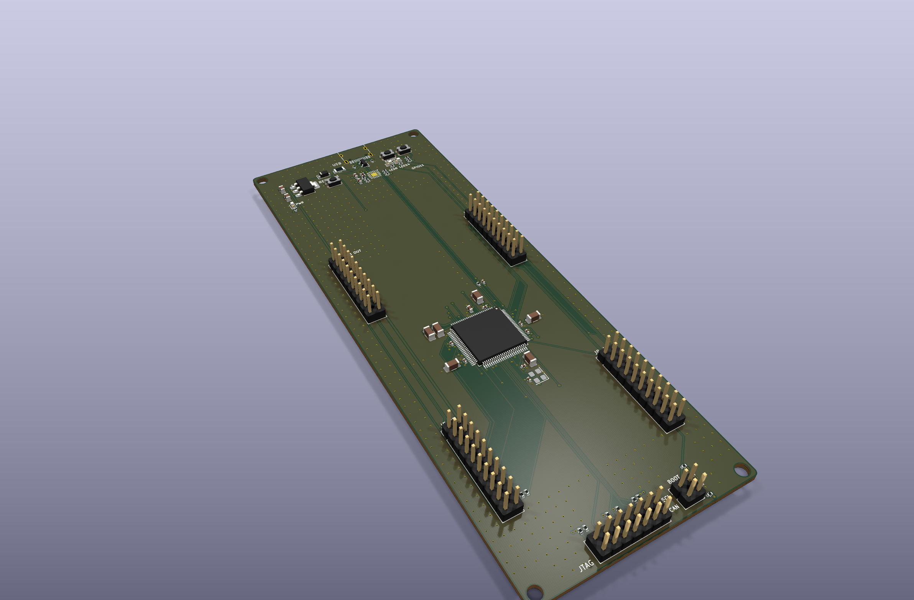
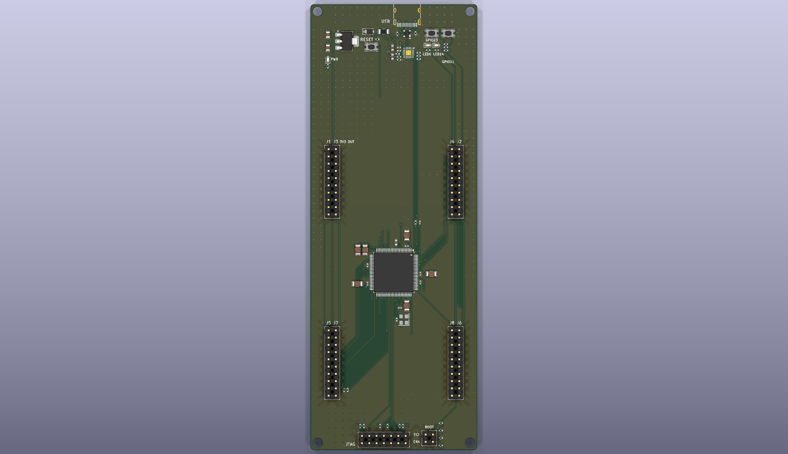
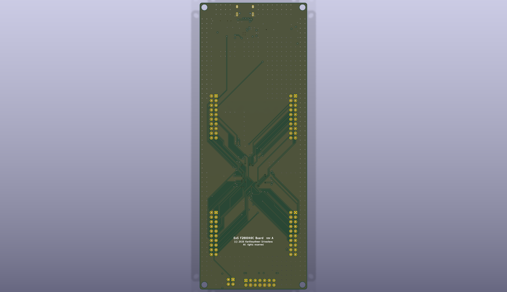

# EoS F280049C Board

A development board for the TI TMS320F280049C (C2000 real-time MCU, LQFP-100) with two
BoosterPack-compatible (40-pin) sites, 58.42 × 156.21 mm, four layers.
Designed by Kartikeydheer Srivastava. All rights reserved: not open source, and not under this repository's MIT licence.
Anyone may view it, clone this repository and run its tests; anything more needs
Kartikeydheer Srivastava's written permission (kartikeydheer@gmail.com). EmbeddedOS (EoS) Research Foundation has a limited, revocable
permission. See [LICENSE.txt](LICENSE.txt) and [the licence summary](../README.md#licence).

A board for the same job as TI's LAUNCHXL-F280049C LaunchPad; an original design, not a copy: no
file of the vendor's was used. "BoosterPack" names TI's plug-in module format to say which modules
fit (nominative use); this board is not a TI product. No design file of the vendor's was used; the header positions come from TI's BoosterPack Pinout Standard (updated Sept 1, 2013) and the 40-pin figure of TI's
BoosterPack Standards and Design Guide (processors.wiki.ti.com, archived 2017-11-03). TI's design
guide SPRACZ9A reproduces one circuit of the LaunchPad (its Figure 3-5, a CAN transceiver); that
figure was not used, and this board has no CAN transceiver. Every circuit value comes from the
chip makers' data sheets listed below.



| | |
|---|---|
|  |  |

## What is on it

| Block | What and why | Source |
|---|---|---|
| TMS320F280049C | C28x at 100 MHz with FPU, TMU and CLA, 256 KB flash, three 12-bit ADCs, LQFP-100 (PZ). KiCad's `LQFP-100_14x14mm_P0.5mm` footprint: TI's PZ0100A drawing gives a 14 × 14 mm body, 15.8–16.2 mm across the leads, 0.5 mm pitch, 1.6 mm maximum height (JEDEC MS-026) and 1.5 × 0.3 mm example pads on a 15.4 mm row pitch; KiCad's 1.6 × 0.3 mm pads on 15.35 mm cover that land. Turned 270° so its analog pins face both sites' analog header pins and its GPIO sides face the right-hand headers and the bottom. | TI SPRS945H (data sheet), Table 5-1, Figure 5-1, PZ0100A |
| Core supply | Internal VREG: VREGENZ tied straight to VSS, so a single 3.3 V supply runs the chip; the guide calls this the cost-effective choice for a small board. The internal DC-DC is not used (it needs a 2.2 µH inductor and 20 µF on VDDIO_SW, costs GPIO22/23, and the guide warns of ADC noise). 4.7 µF X7R 25 V 1206 (Murata GRM31CR71E475KA88L) at each of the four VDD pins: 18.8 µF nominal, with the modeled effective-capacitance margin described below; CVDD = 12–27 µF total and 0.1–6.75 µF per pin ("Configuration 1"); each VDD pin with its capacitor is its own net, which the data sheet allows in internal VREG mode. | SPRS945H 6.9.1.2.4–6.9.1.2.6, 6.9.1.3.1.2, 6.9.1.4.1, 6.9.1.5.1; TI SPRACZ9A 3.4.3 |
| 3.3 V pins | VDDIO, VDDA and VDDIO_SW on one 3.3 V rail, the inner layer 2 plane ("strongly recommended"; a separate VDDA "typically offers minimal benefits"). 0.1 µF at each VDDIO pin and at VDDIO_SW, 2.2 µF at each VDDA pin to VSSA. VSS_SW to VSS. | SPRS945H 6.9.1.4.1, 6.9.1.5.1, Table 5-1 |
| ADC references | Internal reference mode: 4.7 µF X7R 25 V 1206 (GRM31CR71E475KA88L) from VREFHIA (pin 25) to VREFLOA (pin 27) and from VREFHIB/C (pin 24) to VREFLOB/C (pin 26), at the chip's corner, each joined to both pins before the autorouter runs. Nothing else loads VREFHI. One ground plane (inner layer 1) for VSS and VSSA, since the analog lines arrive from header pins and a clean split is not possible. | SPRS945H Table 5-1; SPRACZ9A 3.3.3, 4.5 |
| 20 MHz clock | SiTime SiT8008BI-22-33N-20.000000E, a 3.3 V CMOS oscillator (±25 ppm with aging and temperature, 45–55 % duty, ≤ 2 ns rise/fall), into X1 in single-ended mode, X2 open, 0.1 µF at its supply. X1 accepts 2–20 MHz from an oscillator with ≤ 6 ns edges and 45–55 % duty. Not the internal oscillators: ±3 % over voltage and temperature, where the guide asks for an external source for CAN and for better than 1 %. Not a crystal: the data sheet asks for a crystal rated ≥ 1 mW of drive (or a damping resistor to be evaluated with the crystal), ESR ≤ 45–50 Ω and a 6–12 pF load at 20 MHz; the stocked SMD crystals with that ESR and load are rated 100 µW, and the 1 mW HC-49 parts are stocked with an 18 pF load, which would need 26–30 pF per side against the 24 pF limit. | SPRS945H 6.9.3.2.1, 6.9.3.4.4, 6.9.3.4.7, 6.9.3.5.1, Figure 6-17, Table 5-10; SPRACZ9A 3.2.4, 3.6.1; SiT8008B data sheet rev 1.08 |
| Reset | 2.2 kΩ pull-up and 100 nF on XRSn (2.2–10 kΩ, ≤ 100 nF so the watchdog can still pull it low in 512 clock cycles), a reset button straight to ground; also on J2.16 and J6.56. | SPRS945H 6.9.2, Figure 6-12, Table 5-1; SPRACZ9A 3.5 |
| Boot mode | GPIO24 (boot pin 1) and GPIO32 (boot pin 0) each have a 10 kΩ pull-up and go to JP1: a shunt on 1-2 pulls GPIO24 to ground through 1 kΩ (0.3 V, under VIL = 0.8 V), on 3-4 GPIO32. No shunt: flash; 1-2: SCI boot through the USB bridge (SCIA on GPIO28/29); 3-4: CAN; both: parallel I/O. Both pins are site B chip selects, which a BoosterPack does not drive, as the guide asks of a boot pin used "as outputs whose state is irrelevant during boot". | SPRS945H Tables 7-13, 7-18, 6.6; SPRACZ9A 3.2.5 |
| JTAG (J10) | TI 14-pin header, 2 × 7 at 0.1 in with pin 6 as the key, in place of TI's on-board XDS110, whose firmware is TI's: 1 TMS (2.2 kΩ pull-up), 3 TDI and 7 TDO (10 kΩ pull-ups; their internal pull-ups are off by default), 11 TCK, 9 RTCK looped to TCK, 4 TDIS and 8/10/12 to ground with no resistor, 5 PD to 3.3 V through 100 Ω, 2 TRST open (the chip has no TRSTn pin), 13/14 EMU0/EMU1 pulled up with 4.7 kΩ. Any XDS-class probe connects here; the header is under 6 in from the chip, so no buffers. | TI XDS Target Connection Guide; TI SPRU655I Figure 4, Table 13; SPRS945H Table 5-1; SPRACZ9A 3.7.1, Figure 3-16 |
| USB-UART (J9) | CP2102N-A02-GQFN20 on SCIA (GPIO28 RX, GPIO29 TX), the default SCI boot pins, on the board's 3.3 V with its regulator unused, so it is powered whenever the MCU is and neither drives an unpowered chip. 4.7 µF + 0.1 µF on VREGIN and on VDD, each 0.1 µF at its pin; 1 kΩ RSTb pull-up; 1 kΩ in TXD and RXD; 10 kΩ pull-up on SCIA_RX. VBUS sense: the self-powered figure's 22.1 kΩ / 47.5 kΩ divider from the fused VBUS plus a 5.1 kΩ bleed, so the pin stays under VIL = 0.6 V unless more than 185 µA is pushed into VBUS; the Schottky's reverse leakage is 0.8 µA typical at 25 °C and about 0.1 mA typical at 85 °C. A guaranteed hot-leakage limit is not supplied, so unplug detection with externally supplied 5 V still needs a temperature test. The main USB pair runs from the receptacle's A6/A7 contacts through the ESD part's pads straight down into the CP2102N's D+/D− pins, on the top layer, laid before the autorouter; the duplicate B6/B7 contacts join afterward, with two vias in the B7 branch. | Silicon Labs CP2102N Rev. 1.5, Figures 2.3, 2.6, section 2.3, Tables 3.2, 3.7, 3.10; SPRS945H Table 7-18; SPRACZ9A 3.2.4; Nexperia PMEG6010CEH v.4 |
| USB ESD, USB-C | Littelfuse SP0503BAHTG at the connector: three TVS diodes to ground on VBUS, D+ and D−, 5.5 V standoff, ≤ 100 nA at 5 V, 30 pF; it has no path from D+/D− into VBUS, so a D+ pull-up left on cannot hold VBUS up after a host leaves. USB-C as a 5 V sink: 5.1 kΩ Rd on CC1 and CC2. | Littelfuse SP05xxBA; CP2102N Figure 2.5; TI SLYY228 p. 54 |
| Power | USB VBUS → 500 mA polyfuse (0.42 A hold at 40 °C) → PMEG6010CEH Schottky → +5V, which feeds both sites' 5 V pins and the AP7361C-33 LDO (1 A, current limit ≥ 1.1 A, 4.7 µF in, 10 µF out). The Schottky stops a BoosterPack that drives 5 V into J3.21 or J7.61 from back-feeding the USB host; that BoosterPack then powers the board. Design allowance for the 3.3 V load: the MCU's 113 mA + 30 mA (IDDIO + IDDA maxima with the internal VREG), the CP2102N 14 mA, the oscillator 4.5 mA, LEDs and pull-ups about 12 mA: about 175 mA, 263 mA with the guide's 1.5 margin, well inside the LDO's 1 A; its minimum current limit exceeds the VREG's 650 mA typical turn-on inrush. Startup under this load has not been measured: the LDO's 150 µs typical startup figure uses a different load and capacitance, so it does not establish the board's ramp rate. Green power LED at 2.1 mA. | SPRS945H 6.5.2, 6.9.1.5.1–6.9.1.5.2; SPRACZ9A 3.4.5; Diodes DS37274 Rev. 5-2; Littelfuse 1206L; Nexperia PMEG6010CEH v.4; Kingbright DSAO7432 |
| Shared power budget | The LDO may carry 300 mA: at 5.25 V in it dissipates 0.59 W, 64 °C above ambient at 110 °C/W. So the BoosterPacks may take 125 mA from the 3.3 V pins (J1.1 and J5.41 together). In all, the board takes up to 0.38 A from USB: 175 mA for itself, 200 mA for the BoosterPacks' 3.3 V and 5 V pins together (no more than 125 mA of it on 3.3 V), 1 mA for the bleed: under the polyfuse's 0.42 A hold at 40 °C and a configured 500 mA USB supply. This thermal budget does not establish USB attach or suspend compliance. At 0.38 A and 4.75 V from the host, the fuse (0.70 Ω) and Schottky (≤ 0.53 V) leave ≥ 3.95 V on +5V: the LDO keeps regulating, but the 5 V pins carry 3.95–4.9 V, not a regulated 5 V. The Schottky then dissipates ≤ 0.2 W, 66 °C above ambient on its standard footprint. J1.1 and J5.41 are outputs only. | DS37274 (p. 4 absolute maximum, p. 5 θJA, dropout); Littelfuse 1206L derating table; PMEG6010CEH Tables 5–7 |
| User LEDs, buttons | Red LED on GPIO6 (J4.40) and yellow on GPIO14 (J4.39), both PWM outputs, through 680 Ω: 2.3 and 2.1 mA. Buttons on GPIO23 (J2.11/J6.51, 10 kΩ pull-up because of its 45 µA leakage) and GPIO11 (J2.17/J6.57, internal pull-up), each through 1 kΩ because the pins also reach the BoosterPacks; a reset button. | Kingbright DSAO7433, DSAO7434; SPRS945H 6.6, Table 5-1 |
| I2C pull-ups | 2.2 kΩ on SDA and SCL: above RP(min) = 0.97 kΩ, fast mode up to 161 pF. | SPRACZ9A 3.2.4; TI SLVA689A Eq. 1, 6, Table 2-1 |
| BoosterPack headers | Samtec SSW-110-23-F-D, female with long male leads, so the board stays usable under a stack of BoosterPacks. | TI BoosterPack Pinout Standard (Sept 1, 2013) p. 2 |

### BoosterPack pin map

Each site follows TI's 40-pin standard: 0.1 in grid, outer headers 1.8 in apart, inner 1.6 in,
pin-1 rows level. The sites sit one above the other, 2.5 in (63.50 mm) apart, so two BoosterPacks fit at once
(each reaches 350 mil above its pin 1 and 0.15 in below its last row). Site B's headers are named
J5 (as J1), J7 (as J3), J8 (as J4) and J6 (as J2), with pins numbered 40 above site A's. The chip
has 35 GPIOs free for 50 digital positions, so the sites share the buses the standard says can be
shared (SPI and I2C) and some GPIO positions; a shared position joins site A pin n to site B pin
n + 40. Each site keeps its own UART, PWMs and chip selects. Mux positions from data sheet Table 5-6.

| Pin | Standard | Site A | | Pin | Standard | Site B |
|---|---|---|---|---|---|---|
| J1.1 | 3.3 V | +3V3 (output) | | J5.41 | 3.3 V | +3V3 (output) |
| J1.2 | analog | B3 | | J5.42 | analog | B4/C8 |
| J1.3 | UART RX (into the MCU) | GPIO59 / LINA_RX | | J5.43 | UART RX | GPIO13 / SCIB_RX |
| J1.4 | UART TX | GPIO22 / LINA_TX | | J5.44 | UART TX | GPIO12 / SCIB_TX |
| J1.5 | GPIO | GPIO33, shared | | J5.45 | GPIO | GPIO33, shared |
| J1.6 | analog | C0 | | J5.46 | analog | C3 |
| J1.7 | SPI CLK | GPIO56 / SPIA_CLK, shared | | J5.47 | SPI CLK | GPIO56, shared |
| J1.8 | GPIO | GPIO16, shared | | J5.48 | GPIO | GPIO16, shared |
| J1.9 | I2C SCL | GPIO27 / I2CA_SCL, shared | | J5.49 | I2C SCL | GPIO27, shared |
| J1.10 | I2C SDA | GPIO26 / I2CA_SDA, shared | | J5.50 | I2C SDA | GPIO26, shared |
| J3.21 | 5 V | +5V | | J7.61 | 5 V | +5V |
| J3.22 | GND | GND | | J7.62 | GND | GND |
| J3.23–J3.28 | analog | A2, A3, C4, C2, A1/DACB_OUT, A0/DACA_OUT | | J7.63–J7.68 | analog | A9, A8, A4, A5, C1, C5 |
| J3.29, J3.30 | reserved | not connected | | J7.69, J7.70 | reserved | not connected |
| J4.40 | PWM | GPIO6 / EPWM4A (red LED) | | J8.80 | PWM | GPIO3 / EPWM2B |
| J4.39 | PWM | GPIO14 / EPWM8A (yellow LED) | | J8.79 | PWM | GPIO2 / EPWM2A |
| J4.38 | PWM | GPIO9 / EPWM5B | | J8.78 | PWM | GPIO0 / EPWM1A |
| J4.37 | PWM | GPIO5 / EPWM3B | | J8.77 | PWM | GPIO7 / EPWM4B |
| J4.36, J4.35 | timer capture | GPIO31, GPIO17 (eCAP through the Input X-BAR), shared | | J8.76, J8.75 | timer capture | shared |
| J4.34–J4.31 | GPIO | GPIO4, GPIO58, GPIO57, GPIO25, shared | | J8.74–J8.71 | GPIO | shared |
| J2.20 | GND | GND | | J6.60 | GND | GND |
| J2.19 | PWM | GPIO15 / EPWM8B | | J6.59 | PWM | GPIO1 / EPWM1B |
| J2.18 | SPI CS (wireless) | GPIO34 | | J6.58 | SPI CS (wireless) | GPIO40 |
| J2.17 | GPIO** | GPIO11, shared (button SW3) | | J6.57 | GPIO** | shared |
| J2.16 | RST | XRSn | | J6.56 | RST | XRSn |
| J2.15 | SPI MOSI | GPIO8 / SPIA_SIMO, shared | | J6.55 | SPI MOSI | shared |
| J2.14 | SPI MISO | GPIO10 / SPIA_SOMI, shared | | J6.54 | SPI MISO | shared |
| J2.13 | SPI CS (display) | GPIO39 | | J6.53 | SPI CS (display) | GPIO24 (boot pin 1, 10 kΩ pull-up) |
| J2.12 | SPI CS (other) | GPIO30 | | J6.52 | SPI CS (other) | GPIO32 (boot pin 0, 10 kΩ pull-up) |
| J2.11 | GPIO | GPIO23, shared (button SW2) | | J6.51 | GPIO | shared |

Notes for firmware and BoosterPack designers:

- **Clock:** the 20 MHz oscillator drives X1 single-ended: set XTALCR.SE = 1 (data sheet
  Figure 6-17). Keep GPIO19 in input mode with its pull-up disabled (Table 5-1). The chip starts on INTOSC2.
- **Site A's UART is LIN-A** in its SCI-compatible mode (the data sheet lists it as a
  "UART-Compatible Local Interconnect Network"); site B's is SCI-B. SCI-A is the USB bridge.
- **GPIO22** comes out of reset in DC-DC mode: clear its GPAAMSEL bit, with DCDCCTL.DCDCEN left
  at 0, before using it as LINA_TX (Table 5-1).
- **GPIO23** has about 100 pF of internal capacitance and up to 45 µA of leakage (Table 5-1,
  section 6.6): it suits the button and slow signals, not fast edges.
- **Boot pins:** a BoosterPack must not pull J6.53 (GPIO24) or J6.52 (GPIO32) low at reset, or the
  chip boots in another mode. The 10 kΩ pull-ups keep both chip selects high until firmware runs.
- **Shared positions:** a shared GPIO, capture input or bus line reaches both sites; two
  BoosterPacks must not both drive one.
- **The buttons** need GPIO11's internal pull-up enabled (GPIO23 has its own 10 kΩ).
- **Power on the 3.3 V pins (J1.1, J5.41):** outputs only, 125 mA for both sites together; never
  feed them. The 5 V pins may be fed by a BoosterPack (the Schottky keeps that 5 V off USB).
- The analog pins A6, B2/C6, A10, B0, C14 and the PGAx_IN-only pins are not connected
  (Table 5-10 allows it); the five PGAx_GND pins are tied to VSSA.

## Not on this board

- **TI's on-board XDS110 debug probe.** Its firmware is TI's, so it is replaced by the standard TI
  14-pin JTAG header (J10) for an external XDS110, XDS200 or similar probe, and a separate USB-UART
  bridge (CP2102N) for the serial port and SCI boot.
- **A CAN transceiver, and any other interface transceiver.** The CAN lines are free GPIOs; a
  BoosterPack with a transceiver can use CAN-A or CAN-B through the pin mux.
- **A crystal.** An oscillator drives X1 instead (see the clock row above).
- **External 1.2 V supply and the internal DC-DC.** The internal LDO VREG makes the core supply.
- **An external ADC reference.** The chip's internal reference drives VREFHI; the guide's
  external-reference circuit (REF3030 plus an op-amp) is not fitted.
- **Pull resistors on the PWM outputs and on four of the six chip selects.** SPRACZ9A 3.2.1 says
  PWM lines and chip selects "should have external pull-resistors to enforce a state during
  power-up", since the GPIOs float until firmware runs; only GPIO24 and GPIO32 (boot pins, site B
  chip selects) have them here. A BoosterPack whose PWM or chip-select inputs must be held at
  power-up brings its own.
- **ESD parts on the BoosterPack lines:** the headers are a board-to-board connection.
- The vendor schematic, PCB, Gerber and BOM files were not opened. SPRUII7B was used only for published mechanical facts (Table 1 and Figure 12).

## Mechanical compatibility

The outline is 58.42 × 156.21 mm (2300 × 6150 mil), with 1.27 mm (50 mil) corner radii,
from TI SPRUII7B Table 1 and Figure 12. Coordinates below are measured from the upper-left
corner; internal component placement and electrical routing are independently designed.

| Feature | Position |
|---|---|
| Outer BoosterPack columns | x = 6.35 and 52.07 mm (250 and 2050 mil) |
| Inner columns | x = 8.89 and 49.53 mm (350 and 1950 mil) |
| Site A first row | y = 50.80 mm (2000 mil) |
| Site B first row | y = 114.30 mm (4500 mil); 63.50 mm between sites |
| Four mounting-hole centres | 2.54 mm (100 mil) from their two adjacent edges |
| Mounting-hole drill | 3.2 mm non-plated M3 clearance; intentionally 0.152 mm larger than the published 120 mil (3.048 mm) nominal |

The two header patterns and overall footprint match those published dimensions. This is not
an enclosure-fit or plug-stack qualification: the USB-C connector replaces micro-USB, debug
and boot connectors are independently placed, and no physical fit has been tested. The
mounting holes are unplated; M3 heads/washers can overhang the edge, as the 2.54 mm corner
centre offset is smaller than a typical screw-head radius.

## Core and reference capacitor margin

C10/C17/C20/C22 (core) and C14/C15 (references) use Murata GRM31CR71E475KA88L,
4.7 µF ±10 %, X7R, 25 V, 1206. Murata's public SimSurfing model was sampled on 2026-10-15
at 10 mVrms, −40 to +125 °C in 5 °C steps. The core sweep from 0 to 1.375 V gives
4.022–4.562 µF; the more conservative reference sweep from 0 to 3.625 V gives at least
3.898 µF. Applying −10 % initial tolerance and a further 10 % design reserve yields at least
3.258 µF per core pin (13.03 µF total, above the required 12 µF) and 3.157 µF per reference
(above the required 2.2 µF). On the high side, nominal capacitance ×1.10 tolerance ×1.15
X7R variation is 5.946 µF per core pin and 23.78 µF total, below 6.75/27 µF.

These are manufacturer-model results with explicit engineering reserve, not guaranteed
production minima or qualification of the board over that temperature range. Verify the
procured capacitors at operating DC bias, small AC amplitude, temperature and age before
production; the extra 10 % reserve is not a manufacturer aging specification. The internal
reference's settling time with 4.7 µF also needs bring-up verification. VDDA's C13/C16 remain
2.2 µF nominal: SPRS945H 6.9.1.5.1 gives CVDDA as **typical**, whereas Table 5-1 explicitly
requires **at least** 2.2 µF at VREFHI. The earlier 0603 core and nominal 2.2 µF reference
choices were replaced because they did not demonstrate the required effective minimum.

## Build results

The numbers below are from `build-report.json` and `drc.json` in this folder.

| Check | Result |
|---|---|
| Schematic ERC | 0 violations |
| DRC errors | 0 |
| Unconnected items | 0 |
| Schematic ↔ board parity | 0 differences |
| DRC warnings | 2: silkscreen within the board-edge clearance, the outline of J9 (USB-C), which sits at the board edge |

## Fabrication

4 layers, 1.6 mm thick: top signal, inner 1 ground, inner 2 3.3 V, bottom signal; ground also
poured on both outer layers. TI's guide: "A 4-layer board or more is often the best choice for
C2000 devices. This enables the designer to include a clean ground plane and split power plane"
(SPRACZ9A 4.1.3), and it asks for an unbroken ground plane (4.4). Here the analog lines run from
header pins and need that return under them, and 80 header pins plus the LQFP-100's 18 supply
pins on four sides would leave no clean ground on two layers. Design rules: 0.15 mm clearance;
0.15 mm tracks, 0.4 mm on VBUS and 5 V, 0.3 mm on 3.3 V, the four VDD core nets and the
references (they enter 0.5 mm-pitch pads), 0.2 mm on USB; vias 0.6 mm with a 0.3 mm drill,
which is the smallest drill.

The USB-C receptacle (HRO TYPE-C-31-M-12) sits where HRO's recommended layout puts it: its origin
3.19 mm from the top edge, so the shell stands about 0.46 mm proud of the edge and a plug's
overmold meets the shell, not the board.

## What has not been done

- **No board has been made or tested,** and no firmware is included: the duties above (X1
  single-ended, GPIO22's analog mode, LIN-A as a UART, button pull-ups) are not implemented anywhere.
- **The TMS320F280049CPZ symbol is new.** KiCad 10's MCU_Texas and DSP_Texas libraries have no
  F28004x part, so U1 uses EoS_MCU:TMS320F280049CPZ, drawn from data sheet Table 5-1 (100 PZ
  column) and checked pin for pin against Figure 5-1; its check confirms pins 1–100 appear once
  each.
- **Not verified:** production capacitance at bias/temperature/age beyond the model-based
  core/reference margins above; effective VDDA capacitance at 3.3 V, especially C16 (2.2 µF,
  0402); the
  oscillator's lifecycle and that SiTime programs this exact code on demand at distributors; the
  USB pair's impedance; a 3D check of a plug in the receptacle and of a BoosterPack stack over the
  tallest parts; J10's KiCad generic footprint against Samtec's land pattern, and that pin 6 is
  pulled for the key on assembly; distributor stock for every part.
- **Thermal margins are from data-sheet figures only:** the LDO's 110 °C/W and the Schottky's
  330 K/W are for minimum or standard pads; the four-layer board's planes should do better, by an
  amount not known.
- **USB attach, enumeration and suspend current are not qualified.** Behind VBUS sit 4.7 µF on 5 V and about 32 µF on 3.3 V. The MCU supply is always on, and the CP2102N suspend outputs are unused. Its factory maximum-power descriptor is only 100 mA (Rev. 1.5 Table 4.5); the calculated 380 mA full-board budget needs a matching descriptor and a host allocation. No descriptor image, current gating or suspend firmware is supplied. Use a current-monitored bench source for initial bring-up; do not treat this board as a USB-compliance-qualified peripheral.
- **The supply ramp and transient response** need measurement at both MCU supply domains with the chosen capacitors and a loaded BoosterPack. The nominal startup time does not prove the MCU slew-rate requirement. Abrupt removal of power or a load step can exceed the 100 mV/µs limit; this is a high-priority bring-up check, not a guaranteed operating condition.
- **Ground and supply plane continuity** around the MCU must be checked on the routed board. Three core decoupling connections (VDD4, VDD46, VDD87) currently use two vias each; their impedance has not been characterized.

## Sources

Only chip/part documentation and published connector facts were used. The design file cites the relevant sections beside the values.

| Source | Used for |
|---|---|
| [TI SPRS945H](https://www.ti.com/lit/ds/symlink/tms320f280049c.pdf) | MCU pins, supplies, boot modes, clock, reset, pin mux and package |
| [TI SPRACZ9A](https://www.ti.com/lit/an/spracz9a/spracz9a.pdf) | MCU support and layout guidance; its vendor-board CAN circuit was not used |
| [TI SPRU655I](https://www.ti.com/lit/ug/spru655i/spru655i.pdf) and [XDS connector guide](https://software-dl.ti.com/ccs/esd/documents/xdsdebugprobes/emu_jtag_connectors.html) | JTAG connector facts and electrical guidance |
| [TI BoosterPack Pinout Standard](https://e2e.ti.com/cfs-file/__key/communityserver-discussions-components-files/968/pin_5F00_info.pdf) | Header positions, signal assignments and stacking facts |
| [Silicon Labs CP2102N Rev. 1.5](https://www.silabs.com/documents/public/data-sheets/cp2102n-datasheet.pdf) | USB bridge, bypassing, VBUS divider, reset and power descriptor |
| [Diodes AP7361C, DS37274](https://www.diodes.com/datasheet/download/AP7361C.pdf) | LDO pins, capacitors, current limit and thermal estimate |
| [Nexperia PMEG6010CEH](https://assets.nexperia.com/documents/data-sheet/PMEG6010CEH.pdf) | Diode limits, voltage drop and leakage estimates |
| [Littelfuse 1206L](https://www.littelfuse.com/~/media/electronics/datasheets/resettable_ptcs/littelfuse_ptc_1206l_datasheet.pdf.pdf) | Fuse limits and temperature derating |
| [Littelfuse SP05](https://www.littelfuse.com/~/media/electronics/datasheets/tvs_diode_arrays/littelfuse_tvs_diode_array_sp05_datasheet.pdf.pdf) | ESD array pinout and characteristics |
| [SiTime SiT8008B](https://www.sitime.com/datasheet/SiT8008) | Oscillator pinout, clock limits and bypassing |
| [Kingbright green](https://www.kingbrightusa.com/images/catalog/SPEC/APTD1608LCGCK.pdf), [red](https://www.kingbrightusa.com/images/catalog/SPEC/APTD1608LSURCK.pdf), [yellow](https://www.kingbrightusa.com/images/catalog/SPEC/APTD1608LSYCK.pdf) | LED voltage and current calculations |
| [TI SLVA689A](https://www.ti.com/lit/an/slva689/slva689.pdf) | I2C pull-up calculations |
| [TI SPRUII7B, Table 1 and Figure 12 only](https://www.ti.com/lit/ug/spruii7b/spruii7b.pdf) | Published outline, corner radii, header locations and mounting-hole centres; no electrical design pages used |
| [TI SLYY228](https://www.ti.com/lit/SLYY228) | p. 54: 5.1 kΩ Rd on each CC pin |
| [Murata SimSurfing: GRM31CR71E475KA88](https://ds.murata.com/simsurfing/mlcc.html?partnumbers=%5B%22GRM31CR71E475KA88%22%5D) | Nominal specification and effective capacitance vs DC bias/temperature, 10 mVrms; model-based margins above |
| [Murata GRM155R61A225KE01D](https://www.murata.com/en-us/products/productdetail?partno=GRM155R61A225KE01D) | C16 nominal value, tolerance, rating and package; effective capacitance remains unverified |

## Rebuild

```
python3 tools/eos_boards/build.py eos_f280049c_board
```

The design file is [tools/eos_boards/boards/eos_f280049c_board.py](../../../tools/eos_boards/boards/eos_f280049c_board.py).
