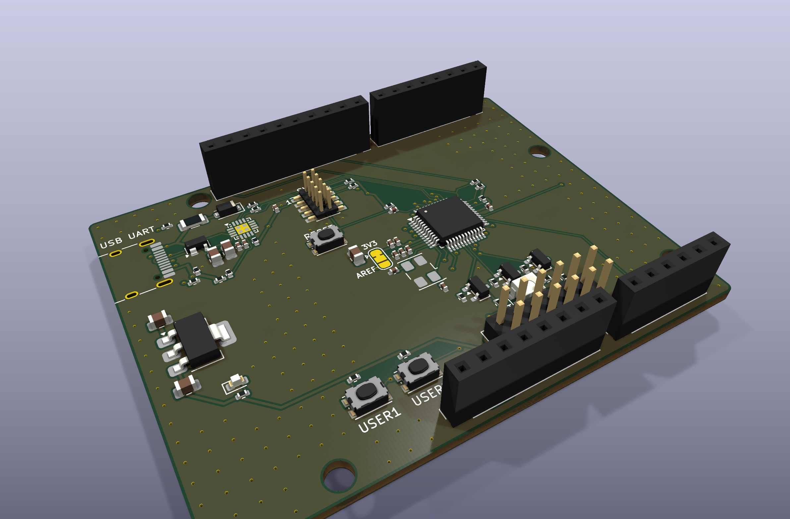
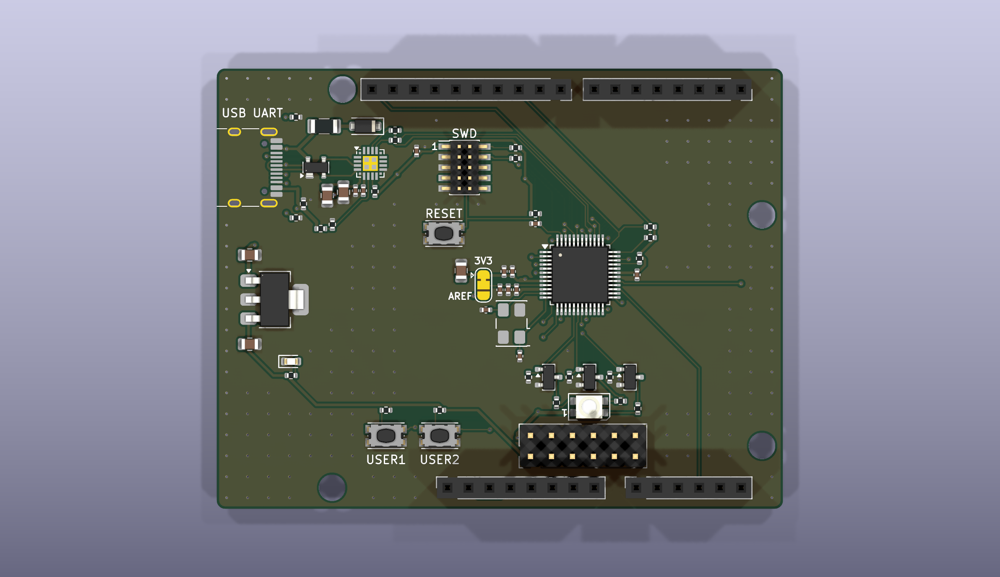
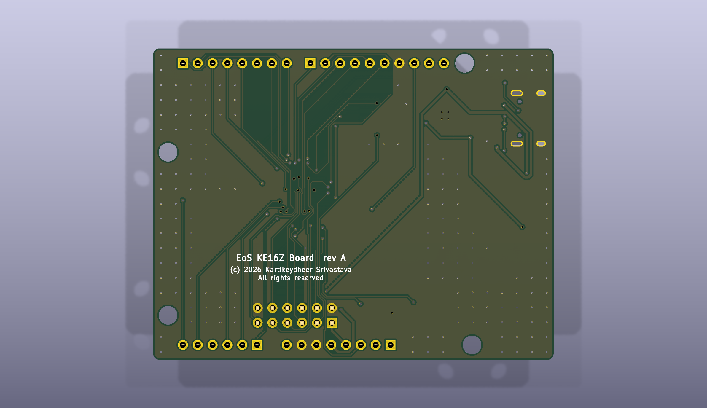

# EoS KE16Z Board

An NXP Kinetis KE16Z (MKE16Z64VLF4, LQFP-48) development board that fits Uno R3 shields, 68.58 × 53.34 mm, two layers.
Designed by Kartikeydheer Srivastava. All rights reserved: not open source, and not under this repository's MIT licence.
Anyone may view it, clone this repository and run its tests; anything more needs
Kartikeydheer Srivastava's written permission (kartikeydheer@gmail.com). EmbeddedOS (EoS) Research Foundation has a limited, revocable
permission. See [LICENSE.txt](LICENSE.txt) and [the licence summary](../README.md#licence).

A board for the same job as NXP's FRDM-KE16Z; an original design, not a copy: no file of the vendor's was used.
No design file of the vendor's was used; the header positions come from Matthew Beckler's "Arduino Uno R3"
dimension drawing v1.05 and the mounting holes from Arduino's UNO R3 product reference manual (A000066),
section 5.4. The circuit comes from the chip makers' data sheets and NXP's KE1xZ data sheet and reference manual.



| | |
|---|---|
|  |  |

A USB-C port with a CP2102N USB-UART bridge on LPUART1 (the D0/D1 pins, as on the Uno), an
8 MHz crystal, an RGB LED, reset and two user buttons, a power LED, and an Arm Cortex 10-pin
SWD header in place of OpenSDA. The I/O runs at 3.3 V: IOREF is 3.3 V, and the KE16Z's pins
take at most VDD + 0.3 V (data sheet Table 23).

**Use only 3.3 V shields, or shields that follow IOREF: 5 V on any I/O pin can damage the KE16Z
and the CP2102N.** Every KE16Z pin is clamped to its 3.3 V supply (data sheet Table 24 note 1), so
a 5 V output on a shield pushes current into the 3.3 V rail, which the LDO cannot sink and which
also feeds the CP2102N (4.2 V absolute maximum, its Table 3.10). **Never feed the 3V3 or IOREF
pins from a shield:** they are the LDO's output, whose absolute maximum is its input + 0.3 V
(Diodes DS37274).

## What is on it

Sources: **DS** = NXP KE1xZP48M48SF0 data sheet Rev. 3 (06/2020); **RM** = NXP KE1xZP48M48SF0RM
reference manual Rev. 3 (06/2020). Both are the Wayback Machine copies of nxp.com's PDFs, since
nxp.com refused the download.

| Block | What it is, and where each value comes from |
|---|---|
| MCU | MKE16Z64VLF4: Cortex-M0+ at 48 MHz, 64 KB flash, 8 KB SRAM, MSCAN, LQFP-48. KiCad's own MCU_NXP_Kinetis:MKE16Z64VLF4 symbol, whose 48 pins match DS section 4.1 pin for pin. KiCad's LQFP-48_7x7mm_P0.5mm footprint (JEDEC MS-026 BBC), checked against NXP's package drawing 98ASH00962A rev. H (SOT313-3): 7 × 7 mm body, 9.0 mm across the leads, 0.5 mm pitch, 0.17–0.27 mm leads with a 0.5–0.7 mm foot; the 0.30 × 1.475 mm pads cover each foot. |
| MCU supply | 3.3 V (DS Table 24: 2.7–5.5 V; VDDA within 0.1 V of VDD, so VDDA is tied to the 3.3 V rail). DS Figure 8 and Table 26: 100 nF CDEC at VDD pin 7, at VDDA pin 8 and at VDD/VSS pins 31/30. DS 6.1.2: 10 µF bulk where 3.3 V reaches the chip. 3.3 V rather than 5 V because the CP2102N's I/O supply is at most 3.6 V. |
| VREFH | 100 nF CREF from VREFH to VREFL (DS Figure 8, Table 26), with the 10 nF X7R and 1 nF C0G in parallel that Table 26 note 1 recommends for ADC performance. JP1 takes VREFH from the 3.3 V rail as delivered, or from the AREF pin (cut and re-bridge; DS Table 50: 2.5 V to VDDA + 0.1 V). |
| Clock | The chip boots from its 48 MHz FIRC (RM 14.4.1; ±1 %, DS Table 42), so no crystal is needed to run. The crystal is for MSCAN: RM 42.5.5.2 asks for "up to 0.4%" oscillator tolerance and recommends the oscillator clock. 8 MHz ECS-80-10-30B-CWN-TR (ECS ECX-53B: CL 10 pF, ±10 ppm, ±15 ppm, ESR ≤ 100 Ω, C0 ≤ 5 pF, ≤ 100 µW; active at Digi-Key, 2026-10-13; any 8 MHz 10 pF ECX-53B code would meet CAN's 0.4 %) in low-power mode: DS Table 40 note 3, RF is internal "and must not be attached externally", and RS = 0. 11 pF C0G on each pin: C = 2 × 10 pF − 9 pF of strays (AN3208 section 5; 7 pF pin capacitance assumed, the digital-pin maximum of DS Table 31, which refers EXTAL/XTAL to the oscillator tables, which give none; about 2 pF of board from AN1706 3.1.1). Gain margin (ST AN2867 section 3.4, at least 5): gmcrit = 0.227 mA/V against DS Table 40's minimum gm of 2.2 mA/V, a margin of 9.7. Drive level (AN3208 Eqn. 1): 28 µW at the low-power mode's 1.0 V peak-to-peak, but 310 µW at a full 3.3 V swing, so **firmware must use low-power mode (HGO = 0)**. |
| Reset, NMI | RESET_b: 10 kΩ pull-up and 100 nF (DS 6.1.4, Figure 27: "4.7 kΩ to 10 kΩ", "0.1 µF"), and a reset button. NMI_b (PTD3): 10 kΩ pull-up, no capacitor (DS Figure 29: "Do not add a pull-down resistor or capacitor"). PTD3 is not on a header, so a shield cannot fire the NMI. |
| Debug | Arm Cortex 10-pin 1.27 mm SWD header (J2): PTA4 SWD_DIO, PTC4 SWD_CLK, RESET_b, VTref 3.3 V. DS Figure 30: 10 kΩ pull-up on SWD_DIO, 10 kΩ pull-down on SWD_CLK, 0.1 µF at the header. The chip has no SWO pin, and it boots only from flash (DS 2.1.5; no ROM, RM Table 11-1), so there is no ISP button. |
| Power path | USB-C as a 5 V sink (5.1 kΩ Rd on CC1 and CC2; USB Type-C specification, sink termination), Littelfuse SP0503BAHTG ESD protection on D+, D− and VBUS (SP05xxBA data sheet: 5.5 V standoff, ≤ 100 nA leakage at 5 V, 30 pF; three diodes to GND, none between the lines; the part CP2102N Figure 2.5 shows), a Littelfuse 1206L050 PTC fuse (0.50 A hold, 1.00 A trip), and a Nexperia PMEG6010CEH Schottky to the 5 V rail, so 5 V fed into the 5V pin cannot reach the USB host. The 5V pin is that rail. The shield VIN pin is not connected: there is no 7–12 V input. |
| 3.3 V | AP7361C-33 LDO (Diodes DS37274 Rev. 5-2): 2.2–6.0 V in, 1 A, at least 1 µF in and 2.2 µF out; 4.7 µF each, as in its typical application. Its 150 µs typical start-up (about 22 V/ms) is well under the KE16Z's 500 V/ms ramp limit (DS Table 25 note 1). |
| USB-UART | Silicon Labs CP2102N-A02-GQFN20 (data sheet Rev. 1.5) on LPUART1 (PTC6 RX, PTC7 TX), through 1 kΩ to D0/D1. It runs from the board's 3.3 V with its own regulator unused (Figure 2.3), so it is powered whenever the KE16Z is and is never back-powered. 4.7 µF + 0.1 µF at VREGIN and at VDD, 1 kΩ RSTb pull-up (section 2.1). VBUS sense through the 22.1 kΩ / 47.5 kΩ divider (Figure 2.6), plus a 5.1 kΩ bleed: with the board fed from the 5V pin, the Schottky's leakage would otherwise lift VBUS, and the bleed keeps the VBUS pin under its 0.6 V VIL (Table 3.7) for up to 185 µA. So the bridge's D+ pull-up comes on only with a host present. |
| RGB LED | Wurth 150141M173100, common anode on the 5 V rail (green and blue need up to 3.6 V), one AO3400A low-side switch per colour (VGS(th) ≤ 1.45 V, RDS(on) < 48 mΩ at 2.5 V). About 4.7–4.8 mA each: 560 Ω red, 300 Ω green and blue, from Wurth's VF (2.0 / 3.2 / 3.2 V typ) and a 4.65 V rail. 100 kΩ holds each gate low while the pins are analog after reset (RM 17.2.2). |
| Power LED | Kingbright APTD1608LCGCK (DSAO7432: VF 1.9 V at 2 mA) through 680 Ω from 3.3 V: 2.1 mA. |
| Buttons | C&K KMR2: reset, and two user buttons on PTD5 and PTE3 with 10 kΩ pull-ups (their ports' pulls are off at reset, DS Table 6). |
| Headers | Uno R3 positions (Beckler drawing v1.05; holes also from A000066 section 5.4), checked against KiCad's Arduino UNO R3 footprint pad by pad. Pin order from A000066 section 5. 4.7 kΩ pull-ups to 3.3 V on SDA/SCL (TI SLVA689A Eq. 1 and 6, with the KE16Z's 2.4 mA at 0.8 V sink rating from DS Table 25). J7, 2×6, brings out the rest of the chip's pins (below). |

### Pin map

PWM on D3, D5, D6, D9, D10 and D11, as on the Uno. Every port pin can interrupt (DS 2.2.13).

| Header pin | KE16Z pin | Functions used (DS 4.1) |
|---|---|---|
| D0 | PTC6 | LPUART1_RX (bridge TXD through 1 kΩ) |
| D1 | PTC7 | LPUART1_TX (bridge RXD through 1 kΩ) |
| D2 | PTD2 | GPIO |
| D3 | PTA1 | FTM1_CH1 |
| D4 | PTD4 | GPIO |
| D5 | PTC1 | FTM0_CH1 |
| D6 | PTC0 | FTM0_CH0 |
| D7 | PTA0 | GPIO (also ADC0_SE0) |
| D8 | PTE6 | GPIO |
| D9 | PTD0 | FTM0_CH2 |
| D10 | PTB5 | FTM0_CH5, LPSPI0_PCS1 |
| D11 | PTB4 | FTM0_CH4, LPSPI0_SOUT |
| D12 | PTE1 | LPSPI0_SIN |
| D13 | PTE0 | LPSPI0_SCK |
| SDA, SCL | PTA2, PTA3 | LPI2C0_SDA, LPI2C0_SCL |
| A0–A5 | PTB3, PTB2, PTB1, PTB0, PTA7, PTA6 | ADC0_SE7, SE6, SE5, SE4, SE3, SE2 |
| AREF | — | to VREFH only when JP1 is re-bridged |
| IOREF, 3V3 | — | 3.3 V |
| 5V | — | the 5 V rail (USB VBUS through the fuse and Schottky) |
| RESET | PTA5 | RESET_b |
| VIN | — | not connected |

On the board: the RGB LED on PTD1 (red, FTM0_CH3), PTC2 (green) and PTC3 (blue); user buttons on
PTD5 and PTE3. Green and blue sit on the alternate pins of FTM0_CH2 and FTM0_CH3, so they can be
dimmed only when firmware moves those channels off D9 or the red LED: the two FlexTimers have
eight channels (DS Figure 1), the Uno PWM pins and red take seven, and the eighth (FTM1_CH0) is
only on A1 and SWD_CLK.

J7 (2×6, 2.54 mm): 1 3V3, 2 GND, 3 PTE4 (CAN0_RX), 4 PTE5 (CAN0_TX), 5 PTD6 (LPUART2_RX),
6 PTD7 (LPUART2_TX), 7 PTE10 (CLKOUT), 8 PTC5 (RTC_CLKOUT), 9 PTE8 (ACMP0_IN3), 10 PTE11
(PWT_IN1, LPTMR0_ALT1), 11 PTE2, 12 GND. All 42 of the chip's port pins are used.

**A4 and A5 are analog inputs only, not SDA/SCL as on the Uno.** The KE16Z's I2C pins (PTA2/PTA3,
or PTB6/PTB7, which are the crystal's) carry no ADC channel, so a shield that uses A4/A5 for I2C
must use the SDA/SCL pins instead. Pull-ups on a shield must go to 3.3 V (IOREF), not 5 V.

Power the board from the USB-C port, or with 5 V on the 5V pin.

- **Shields: 250 mA in all, from the 5V and 3V3 pins together** (IOREF is the 3V3 rail too). The
  5V pin may supply all 250 mA; the 3V3 pin at most 200 mA of it. Both come from the USB port
  through the fuse F1 and the Schottky D1, together with the board's own draw, under 50 mA
  (estimated: the KE16Z at most 10.2 mA at 48 MHz with every peripheral clock on, DS Table 29;
  the CP2102N 13.7 mA at 3 Mbaud, its Table 3.2; the RGB LED 14.3 mA with all three colours on;
  the power LED 2.1 mA; about 30 mA of it on 3.3 V). So F1 and D1 carry 300 mA at most:
  - **USB port:** 300 mA is within a USB 2.0 port's 500 mA.
  - **Fuse:** the 1206L050 holds 0.50 A at 20 °C, 0.42 A at 40 °C and 0.35 A at 60 °C ambient
    (1206L hold-current table), so 300 mA does not trip it up to 60 °C. It drops at most 0.21 V
    (R1max 0.70 Ω).
  - **Schottky:** at most 0.53 V (PMEG6010CEH Table 7's maximum at 500 mA, used as a bound at
    300 mA; about 0.43 V typical, between its 0.35 V at 100 mA and 0.46 V at 500 mA), so at most
    0.16 W, a 53 °C rise at its 330 K/W (Table 6, standard footprint).
  - **5V pin:** 4.26 V or more from a 5.0 V port, 4.0 V or more from a 4.75 V one, and about
    4.4–4.5 V typically. At the low end the LDO still gets 4.01 V, above 3.3 V plus its 140 mV
    maximum dropout at 300 mA (DS37274).
  - **3V3 share:** the LDO carries the shields' 3V3 draw and the board's own 3.3 V load. At 200 mA
    from the 3V3 pin that is about 230 mA, and the LDO dissipates at most (5.25 − 3.3) V × 0.23 A
    = 0.45 W, a 49 °C rise at the 110 °C/W the datasheet gives for SOT-223 on its minimum pad,
    taking 5.25 V, the top of the 5V pin's input range, as the worst input. From a 5.0 V port the
    rail is about 4.5 V and the LDO dissipates about 0.28 W.
  - **More is not safe:** a 400 mA shield draw (450 mA in all) would mean up to a 79 °C rise in
    the Schottky and a fuse that can trip on a warm day (0.42 A hold at 40 °C); 250 mA from each
    pin at once (550 mA in all) is over the port's 500 mA and the fuse's 0.50 A hold even at
    20 °C, and would heat the Schottky about 100 °C above ambient.
- **5V pin as an input: 4.75–5.25 V, the right way round.** Nothing protects it: there is no fuse,
  reverse-polarity diode or TVS between it and the LDO (6.5 V absolute maximum, DS37274), the RGB
  LED and the Schottky's cathode. Fed this way the fuse and Schottky are out of the path, but the
  3V3 pin's 200 mA limit still applies.
- **3V3 pin: output only,** the LDO's; its share of the shield budget is above.

## Not on this board

- **OpenSDA.** NXP's on-board debug probe runs NXP's firmware. It is replaced by a standard Arm
  Cortex 10-pin SWD header (J2) for any SWD probe, and by a CP2102N bridge for the serial port.
- **The touch-sense electrodes.** Doing them properly needs NXP's TSI electrode layout guidance,
  which was not followed here, so they are left out; the TSI pins are used as GPIO.
- **The thermistor.** Left out. A divider for one needs an ADC pin, and all twelve are used
  (A0–A5, D3, D5, D6, D7 and the green and blue LEDs). The chip has its own temperature sensor on
  ADC channel 26 (DS 2.2.2.1), and an NTC divider can go on any A pin from a shield.
- **A CAN transceiver.** The MSCAN pins (PTE4/PTE5) are on J7 for an external transceiver.
- **A 7–12 V input.** VIN is not connected.
- **5 V shield logic.** The KE16Z could run at 5 V, but this board runs it at 3.3 V for the
  CP2102N, so shields must use 3.3 V logic (IOREF says so).

## Build results

The numbers below are from `build-report.json` and `drc.json` in this folder.

| Check | Result |
|---|---|
| Schematic ERC | 0 violations |
| DRC errors | 0 |
| Unconnected items | 0 |
| Schematic ↔ board parity | 0 differences |
| DRC warnings | 2: silkscreen within the board-edge clearance, the outline of J1 (USB-C), which sits at the board edge |

## Fabrication

2 layers, 1.6 mm thick, ground poured on both sides. Design rules (the generator's defaults):

- **Tracks and clearance:** 0.15 mm / 0.15 mm; 0.4 mm on VBUS, after the fuse and on the 5 V rail;
  0.3 mm on 3.3 V (it enters the 0.3 mm pads of the LQFP-48 and the CP2102N's QFN-20 at 0.5 mm
  pitch); 0.2 mm on USB D+/D−. The router narrows a track to enter a fine-pitch pad; the board's
  minimum track is set to 0.127 mm (5 mil, `rules`), so the build widens such necks to it and DRC
  enforces it.
- **Laid before the autorouter** (`priority_routes`, locked; the autorouter gives a different result on
  every run):
  - the USB pair on the top layer (NXP KLQRUG 9.6.3: "parallel ... Minimize vias and corners ... Avoid
    signal stubs"): receptacle A6/A7 → ESD pads (D+ on pin 3, D− on pin 2: the SP0503's three diodes are
    identical, and this order keeps the pair from crossing) → CP2102N. The receptacle's B7 joins A7
    behind the pads; B6 reaches A6 through two vias, the one crossing a USB-C pair needs, kept in the
    short duplicate-contact stub;
  - the crystal (NXP's Kinetis hardware guidance, KLQRUG 2.1.3.3.1: "close to the MCU. No signals of any
    kind should be routed on the layer directly below the crystal"; data sheet 6.1.5): Y1 below the VREFH
    capacitors with its courtyard 1 mm from the MCU's, turned so EXTAL reaches its far pad over the top
    and XTAL its near pad down the gap beside the MCU, so the two lines never run side by side; pin →
    crystal pad → load capacitor on the top layer, no via, and the crystal's and capacitors' grounds on
    one trace. The extra I/O header, the RGB LED and the user buttons, whose lines used to cross under
    the crystal, are now below and left of the MCU, and the VREFH jumper beside its capacitors;
  - decoupling (data sheet 6.1.2 and Table 26 note 2): VDD pins 7 and 8 joined and run to their two
    100 nF capacitors, JP1's 3.3 V side and the 10 µF bulk where 3.3 V enters; VREFH pin 9 through the
    1 nF, 10 nF and 100 nF to JP1's middle pad, with VSS pin 10 to their grounds; RESET_b's 10 kΩ and
    100 nF beside pin 47; the CP2102N's four capacitors, in one row under its VDD and VREGIN pins with the
    3.3 V line along their tops and their ground ends joined along the bottom, facing open ground (the
    VBUS-sense divider sits below them, so its line from pin 8 does not wall a ground pad in); the LDO's
    two. Each is joined to its own pin by a short top-layer route.
- **Silkscreen:** the board name, copyright and "All rights reserved" on the back, under the RGB LED's
  switches; on the front, the USB-C port, RESET, USER1, USER2, SWD with pin 1, and JP1's two sides.
  Reference designators are on the assembly (fab) layer.
- **Bill of materials:** every part has a manufacturer part number: Murata capacitors (all in production,
  checked on Murata's product pages, 2026-10-13; the 11 pF load capacitors are the GJM series, as the
  GRM 0402 11 pF is not for new designs), Yageo RC0402FR-07 resistors, Samtec headers.
- **Vias:** 0.6 mm with a 0.3 mm drill.
- **Smallest drill:** 0.3 mm (vias). The USB-C shell has 0.6 mm-wide slots and 0.65 mm locating
  holes; headers have 1.0 mm holes; the four mounting holes are 3.2 mm, unplated.

## What has not been done

- **No board has been made or tested.**
- **No bottom-layer keep-out under the crystal.** The generator has none, so keeping other lines
  away from the crystal rests on the placement and the priority routes. On the routed board no
  track or via of another net runs under Y1, C14 or C15 on either layer; a re-route can change
  that, so it has to be checked again after a rebuild.
- **The CP2102N's and VDD pins' decoupling returns are longer than the parts' placement suggests.**
  On the routed board the CP2102N's four capacitors are 1.25–2.0 mm (100 nF) and 3.2–4.75 mm
  (4.7 µF) from their pins on the 3.3 V side, but their ground ends reach the chip's GND pin and
  exposed pad only through about 13–14 mm of pour (a lower bound), round the pin row and the USB
  lines, against "as close to the pins as possible" (CP2102N Figure 2.3). C7 and C8, the 100 nF at
  VDD pins 7 and 8, are 4.3–5.8 mm from their pins along the 3.3 V line, with 4.8–5.7 mm of ground
  return to VSS pin 10 (DS 6.1.2 asks for "as close as possible"). Not changed in this revision.
- **USB inrush has not been measured.** With no soft start, about 4.7 µF on 5 V and 25 µF on 3.3 V
  charge at plug-in, about 105 µC at nominal values, against the 50 µC limit the USB-IF inrush test is
  commonly quoted with (not re-read here). The CP2102N's two 4.7 µF, the chip's 10 µF bulk and the
  LDO's 2.2 µF minimum alone come to 71 µC, so meeting that limit would need a load switch.
- **Nothing has been measured.** In particular the crystal's start-up: DS Table 40's oscillator
  transconductance and amplitude are "from simulation", so the gain margin and drive level above
  rest on simulated values, and AN3208 section 7's test (start-up with twice the crystal's
  maximum ESR in series) has not been done. The pin capacitance of EXTAL/XTAL is not given (DS
  Table 31 refers to the oscillator tables, which do not list it); the 7 pF digital-pin maximum
  was used.
- **No firmware is included.**
- **The Schottky's leakage above 25 °C** has only typical values (PMEG6010CEH Fig. 2, about
  70 µA at 5 V and 85 °C), against the bleed's 185 µA bound; no maximum is given.
- **The SP0503BAHTG's data sheet** is Littelfuse's 2005/2006 SP05xxBA edition; the current one
  could not be downloaded.
- **The crystal** (ECS-80-10-30B-CWN-TR) is active at Digi-Key but was not in stock on 2026-10-13
  (10-week lead time); a standard-stability code of the same family (ECS-80-10-30B-AGN-TR) is valid
  in ECS's numbering but no distributor listed it.

## Rebuild

```
python3 tools/eos_boards/build.py eos_ke16z_board
```

The design file is [tools/eos_boards/boards/eos_ke16z_board.py](../../../tools/eos_boards/boards/eos_ke16z_board.py).
