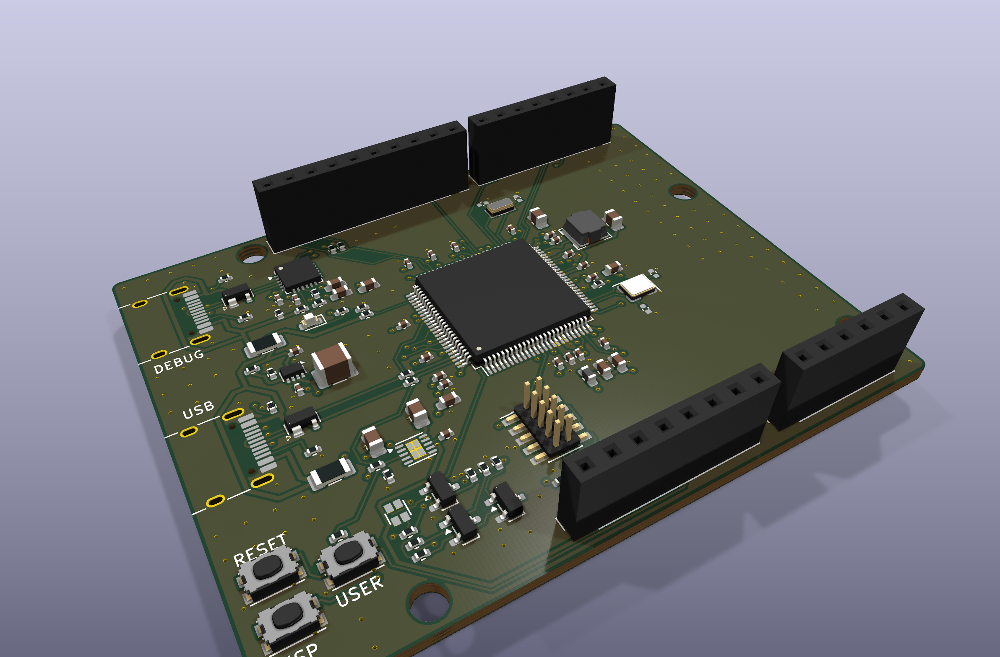
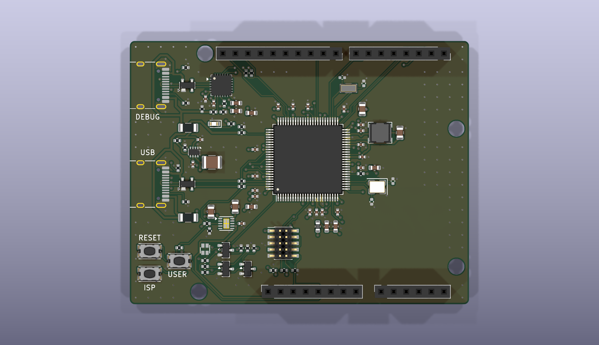
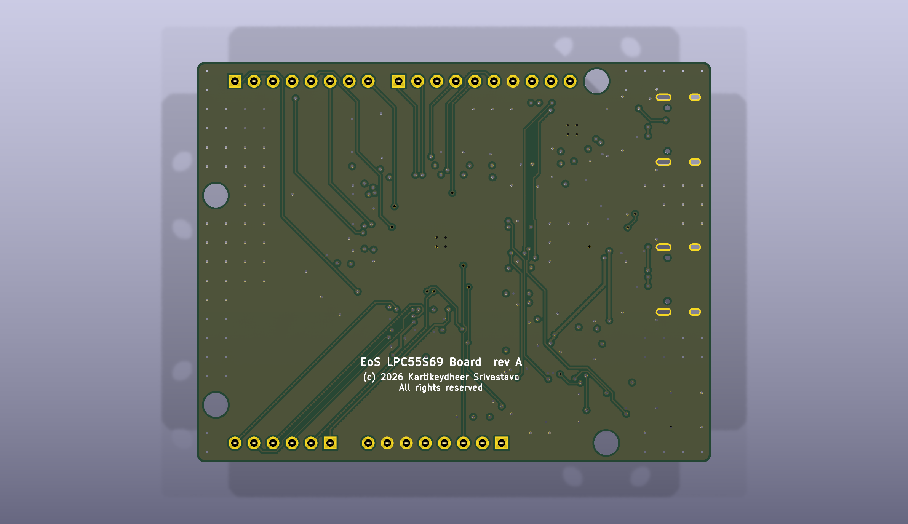

# EoS LPC55S69 Board

An NXP LPC55S69 (dual Cortex-M33, HLQFP-100) development board that fits Arduino Uno R3 shields, 68.58 × 53.34 mm, four layers.
Designed by Kartikeydheer Srivastava. All rights reserved: not open source, and not under this repository's MIT licence.
Anyone may view it, clone this repository and run its tests; anything more needs
Kartikeydheer Srivastava's written permission (kartikeydheer@gmail.com). EmbeddedOS (EoS) Research Foundation has a limited, revocable
permission. See [LICENSE.txt](LICENSE.txt) and [the licence summary](../README.md#licence).

A board for the same job as NXP's LPCXpresso55S69; an original design, not a copy: no file of the vendor's was used (no schematic, layout, CAD, Gerbers or BOM, and none of its board documentation). The header positions come from Matthew Beckler's "Arduino Uno R3" dimension drawing v1.05; the mounting holes come from Arduino's UNO R3 product reference manual (A000066), section 5.4, except the bottom-left hole's x, which that figure does not give and Beckler's drawing does. "LPCXpresso", "NXP" and "Arduino" are their owners' names; the EoS LPC55S69 Board is not an NXP or Arduino product.



| | |
|---|---|
|  |  |

## What is on it

| Block | Parts and values | Source |
|---|---|---|
| MCU | LPC55S69JBD100, HLQFP-100. The exposed pad is the chip's only VSS, so it is soldered to ground. | NXP LPC55S6x data sheet Rev. 2.5, Table 3 |
| Decoupling | 100 nF on each of the nine VDD pins and 10 µF for the VDD domain; 10 µF + 100 nF on USB0_3V3, USB1_3V3, VDDA and VREFP; 22 µF + 100 nF + 47 pF on VBAT_DCDC; 100 nF on VBAT_PMU. VDDA, VREFP, VDD_PMU and VDD pin 44 reach their 100 nF by short top-layer lines laid before the autorouter. | NXP AN13033 Rev. 2.1, Table 6, section 3.2 and Figure 2; data sheet Figure 6 |
| VDDA / VREFP filter | Bourns MH1608-221Y ferrite bead (220 Ω at 100 MHz) from 3.3 V, with the capacitors above. VREFN and VSSA go to ground. | Bourns MH1608; AN13033 Table 6 |
| DC-DC converter | LX → 4.7 µH Bourns SRN4018-4R7M (84 mΩ, Isat 2.0 A) → 22 µF; VDD_PMU tied to FB, 100 nF at VDD_PMU. FB runs to the 22 µF output capacitor on the top layer. | Data sheet section 6.1.2, Table 3 and Figure 6; AN13033 Figure 2 |
| 3.3 V supply | TI TPS7A91 LDO from the 5 V rail: R1 = 3.57 kΩ, R2 = 1.15 kΩ (3.283 V), 22 µF 10 V X5R 0805 in (C4) and 10 µF 16 V X5R 0805 out (C5). TI's 10 µF minimum allows for 50 % DC-bias loss, so it asks for 5 µF in use; by Murata's DC-bias curves C4 keeps about 8.0 µF at 5 V (7.3 µF at 5.5 V) and C5 about 6.5 µF at 3.3 V. 47 nF on NR/SS for a 4.2–9.4 ms ramp. The LPC55S69 needs VBAT_DCDC to rise in at least 2.6 ms (−40 °C). | TI SBVS282A Table 7-1, Equation 6, sections 5.3 and 7.1.3; data sheet Table 25; AN13033 section 10; Murata GRM21BR61A226ME51 and GRM21BR61C106KE15 data sheets (C-DC bias) |
| Power input | Two USB-C sinks (5.1 kΩ Rd), each with a Littelfuse 1206L050 polyfuse, into a TI TPS2116 power mux: the debug port has priority down to 3.40–4.00 V (27 kΩ / 10 kΩ on PR1, 3.7 × VREF), USB0 otherwise, with reverse blocking. The lower end keeps the LDO in regulation until the switch (3.283 V plus 44 mV of dropout at 220 mA); the upper end stays below the 4.40 V a USB 2.0 device must accept, less the fuse. 1 µF per input, 100 µF on the 5 V output. | TI SLVSFG1A sections 7.3.4, 7.6.1 and 9, Table 6.5; TI SBVS282A section 5.5; TI SLVSFJ9 section 10.3.14.2 |
| Clocks | 16 MHz ECS-160-8-33Q-JES-TR (CL 8 pF) and 32.768 kHz Abracon ABS07-32.768KHZ-7-T (CL 7 pF). The chip's internal capacitor banks provide the load, so the external load pads (11 pF and 9 pF) are DNP. Each crystal line is laid first, from the pin to its crystal pad and then on to its load pad, so the lines are short and cross nothing. | Data sheet sections 13.3 and 13.4; UM11126 chapter 12; AN13033 sections 4.1–4.4; ECS ECX-33Q; Abracon ABS07 |
| USB0 (full speed) | USB-C, 33 Ω series resistors on DP and DM, VBUS sensed on PIO0_22 through 4.7 kΩ / 6.8 kΩ (5.5 V reads 3.25 V). | Data sheet section 13.5, Figure 30, Table 24 |
| Debug UART | Silicon Labs CP2102N-A02-GQFN24 on FLEXCOMM0 (PIO0_29 RX, PIO0_30 TX: the ROM's UART ISP pins), on a second USB-C. It runs from the board's 3.3 V, so it is never unpowered while the MCU is. 0.1 µF beside VIO/VDD (pins 5, 6) and beside VREGIN (pin 7), each joined to its pins directly, with 4.7 µF behind them. VBUS sense through 22.1 kΩ / 47.5 kΩ plus a 5.1 kΩ bleed, so the bridge's D+ pull-up comes on only with a host present. | CP2102N data sheet Rev. 1.5, Figures 2.3 and 2.6, Table 3.7; UM11126 Table 169 |
| USB ESD | Littelfuse SP0503BAHTG on both ports: diodes to ground only, no path from D+ to VBUS. Pin 1 is the common node, pins 2–4 one diode each. | Littelfuse SP05xxBA data sheet (pinout); CP2102N data sheet Figures 2.5 and 2.6 |
| USB lines | Both pairs are laid whole before the autorouter, on the top layer: receptacle, SP0503BAHTG, then the CP2102N (debug) or the 33 Ω resistors and the LPC55S69 (USB0). Each line passes through its ESD pad with no stub. The two lines run 0.5 mm apart (centre to centre), part only around the ESD part, and are 1.1 mm apart between U1 and R5/R6. The receptacle's second contacts: B7 joins D− just behind A6, and B6 joins D+ through two vias in front of the pads. | CP2102N Figures 2.5 and 2.6 (ESD between the receptacle and the chip) |
| Debug and reset | Arm 10-pin Cortex Debug header (SWD) in place of the vendor's LPC-Link2 probe, whose firmware is NXP's. 10 kΩ pull-ups on SWDIO, SWO (PIO0_10) and RESETN, 10 kΩ pull-down on SWCLK. Reset and ISP buttons; ISP pulls PIO0_5 low at reset. | AN13033 section 6, Table 10, Figures 7 and 8; UM11126 Table 167 |
| User I/O | LiteOn LTST-C19HE1WT RGB LED, anode on 5 V, one Nexperia BSS138BK switch per colour (5.1 / 4.8 / 4.8 mA through 560 / 470 / 470 Ω); user button on PIO1_27 with a 10 kΩ pull-up. | LiteOn DS22-2008-0044 Fig. 2; Nexperia BSS138BK Rev. 1 |
| Power LED | Kingbright APTD1608LCGCK, 680 Ω from 3.3 V (2.1 mA). | Kingbright DSAO7432 |
| Shield headers | Uno R3 positions; 3.3 V logic (IOREF = 3.3 V). 2.2 kΩ pull-ups on SDA/SCL (PIO0_13/PIO0_14, true open-drain). | Beckler drawing v1.05; Arduino A000066 section 5.4; TI SLVA689A |

The front silkscreen names the two USB-C ports (USB, DEBUG) and the three buttons (RESET, ISP, USER).

Pin map (data sheet Table 3 functions):

| Header | LPC55S69 pin | Function |
|---|---|---|
| D0, D1 | PIO0_8, PIO0_9 | FLEXCOMM5 USART RXD, TXD |
| D2, D3, D4, D5 | PIO1_10, PIO1_22, PIO1_23, PIO1_17 | GPIO; D3 CTIMER2_MAT3, D5 SCT0_OUT4 |
| D6, D7, D8, D9 | PIO0_0, PIO0_18, PIO1_14, PIO1_19 | GPIO; D6 CTIMER0_MAT0, D9 CTIMER3_MAT1 |
| D10, D11, D12, D13 | PIO1_1, PIO0_26, PIO1_3, PIO1_2 | High-speed SPI: SSEL1, MOSI, MISO, SCK. D10 has no timer output, so no PWM there. |
| SDA, SCL | PIO0_13, PIO0_14 | FLEXCOMM1 I2C (true open-drain) |
| A0–A5 | PIO1_0, PIO0_16, PIO0_23, PIO0_15, PIO0_31, PIO1_8 | ADC0_11, ADC0_8, ADC0_0, ADC0_2, ADC0_3, ADC0_4 |
| IOREF, 3V3, 5V, RESET | 3.3 V, 3.3 V, 5 V rail, RESETN | IOREF and 3V3 are outputs (see below) |
| AREF, VIN | not connected | |

On-board: SWDIO PIO0_12, SWCLK PIO0_11, SWO PIO0_10, ISP PIO0_5, debug UART PIO0_29/PIO0_30,
USB0 VBUS sense PIO0_22, RGB LED PIO0_2 / PIO0_3 / PIO1_31 (SCT0_OUT0 / OUT1 / OUT6), user
button PIO1_27.

## Power for shields

- **3V3 and IOREF are outputs.** Shields may draw up to 150 mA from the 3V3 pin. The board
  itself is estimated at 70 mA or less (the LPC55S69 draws 6.2 mA typical at 150 MHz with only
  the core running, data sheet Table 16, and NXP gives no maximum, so 50 mA is allowed for its
  peripherals; the CP2102N 9.5 mA typical, its Table 3.2; LEDs and pull-ups about 7 mA). At
  220 mA from a 5.5 V input the TPS7A91 dissipates 0.50 W, 31 °C above ambient at TI's
  62.5 °C/W (SBVS282A section 5.4); the budget is kept low because the LDO's thermal pad has no
  vias in it (see below).
- **Do not feed 3.3 V into 3V3 or IOREF.** The TPS7A91's output may not rise more than 0.3 V
  above its input (SBVS282A section 5.1), and with no USB power the input is near 0 V.
- **5V is USB VBUS**, after a polyfuse and the power mux, not a regulated 5 V. The fuse holds
  0.50 A at 20 °C and 0.42 A at 40 °C (Littelfuse 1206L); after the board's own share (up to
  about 0.24 A for the LDO and the RGB LED), shields can take about 150 mA from 5V.
- **Hole H1** (top left) is 0.69 mm from the D8–SCL socket's end, where the Uno R3 puts them.
  Fit its screw or standoff from the bottom: a top-side M3 head (5.5 mm) hits the socket.

## Firmware cautions

- **Debug and ISP can be locked out for good.** The CMPA (UM11126 section 10.2.1) holds the
  debug access rights: with CC_SOCU_PIN set and CC_SOCU_DFLT clear for a debug domain, that
  domain is closed and debug authentication cannot open it ("the highest level of restriction",
  section 51.9.2). DEFAULT_ISP_MODE = 111 disables ISP (Table 168). Programming both can leave
  the board with no way in through the SWD header or the ISP button. Check every CMPA field
  before writing it.
- **Unused pins.** Every PIO not on a header or an on-board part is unconnected. Data sheet
  Table 4 allows that only if firmware sets each one as a GPIO output driven low, with its
  pull-up disabled.
- **Crystal load.** The crystals' load capacitors are not fitted: firmware must set the chip's
  internal capacitor banks for CL = 8 pF (16 MHz) and 7 pF (32.768 kHz) (UM11126 chapter 12),
  or C35–C38 must be fitted.

## Not on this board

- **The LPC-Link2 debug probe.** It runs NXP's firmware. The SWD header takes any CMSIS-DAP or
  J-Link probe, and the CP2102N gives the debug UART.
- **USB1 (high speed).** USB1 needs a 90 Ω differential pair. The generator cannot hold or check
  that impedance, and no impedance simulation was done, so USB1's data pins are left open and
  the port is terminated as NXP asks for an unused USB1. The LPC55S6x HLQFP-100 has no external
  USB1 resistor pin.
- **The audio codec with line in/out, the micro SD slot, the accelerometer, the PMod and
  MikroElektronika Click connectors**, which the vendor's product listing names. They are
  separate parts outside the chip's own job and would crowd an Uno-sized board.
- **The Uno's 2 × 3 ICSP header.** Shields that take SPI from it, such as some Ethernet
  shields, will not work; SPI is on D10–D13 only.
- **A4/A5 as SDA/SCL.** On an Uno, A4 and A5 are joined to SDA and SCL; here they are separate
  ADC pins, and I2C is on the SDA/SCL header pins only.
- **AREF and VIN on the shield header.** A shield could put up to 5 V on AREF, above the 3.6 V
  VREFP limit, and 7–12 V on VIN, which would reach the 5 V rail. Neither is connected.
- **5 V shield logic.** The LPC55S69's pins take at most VDD + 0.5 V, so shields must use
  3.3 V logic (IOREF tells them so).
- **The Uno outline.** The board is the full 2700 × 2100 mil rectangle with 1 mm corners, not
  the Uno's stepped and chamfered right-hand edge (A000066 section 5.4), like this repository's
  other Uno-size boards. It may not fit an Uno-shaped case or bumper.

## Build results

The numbers below are from `build-report.json` and `drc.json` in this folder.

| Check | Result |
|---|---|
| Schematic ERC | 0 violations |
| DRC errors | 0 |
| Unconnected items | 0 |
| Schematic ↔ board parity | 0 differences |
| DRC warnings | 4: silkscreen within the board-edge clearance, the outline of J1 (USB-C) and J2 (USB-C), which sit at the board edge |

## Fabrication

- 4 layers, 1.6 mm thick. Inner layer 1 is ground and inner layer 2 is 3.3 V; ground is also
  poured on both outer layers. Four layers because AN13033 section 9.3 asks for separate
  ground and supply layers, the exposed pad is the chip's only VSS and needs a plane right
  under it, and fifteen 3.3 V pins sit on all four sides of the HLQFP-100.
- Net classes: 0.15 mm track and clearance (0.09 mm minimum at fine-pitch pins); 0.2 mm on the
  USB data lines; 0.4 mm on the two USB VBUS nets up to their fuses; 0.3 mm after the fuses and
  on 5 V, 3.3 V, VDDA and the DC-DC nets (a 0.4 mm line cannot enter the TPS2116's and TPS7A91's
  0.5 mm-pitch pads). Lines narrow where they enter fine-pitch pads. Vias 0.6 mm with a 0.3 mm
  drill; smallest drill 0.3 mm.
- The HLQFP-100 land pattern is NXP's (SOT1570-3, data sheet section 15, Figures 37–39):
  0.27 × 1.45 mm pads at 7.775 mm, 3.21 mm exposed pad with four paste apertures.

## What has not been done

- **No board has been made or tested.**
- **No firmware is included**, and none has been run on this board.
- **The LDO's thermal pad has no vias in it.** TI asks for an array of plated vias in the pad
  area (SBVS282A section 7.1.4). The generator puts vias in an exposed pad only when both its
  sides exceed 2 mm, and the TPS7A91's is 1.2 × 2.0 mm, so the pad reaches the ground plane
  through the top-layer ground pour and that pour's vias. Its real thermal resistance is not
  known; the 150 mA shield budget allows for that.
- **Plug-in charge.** The 5 V rail carries about 110 µF (100 µF on the mux output and the LDO's
  10 µF input), charged through the TPS2116's soft start: by TI's Equation 1 (SLVSFG1A section
  8.2.2), about 0.3 A over its 1.7 ms typical rise. The 3.3 V and VDDA rails carry about 93 µF,
  charged through the LDO's 4.2–9.4 ms soft start. That is more than the 10 µF USB 2.0
  assumes at plug-in. The USB 2.0 text was not re-read for this board (nor for its 4.40 V
  device minimum, used for the mux threshold), and the inrush was not measured.
- **Crystal margins.** NXP gives no oscillator transconductance, so the crystals' gain margin
  is not known. Measure both oscillators on a built board.
- **Bottom-layer copper under the crystals is not kept clear.** AN13033 sections 4.2.1 and
  4.3.1 ask for no signal line under a crystal on a multilayer board. The crystal lines themselves are laid first
  on the top layer, and inner layer 1 (ground) lies between the crystals and the bottom layer,
  but the generator has no bottom-layer-only keep-out: its router keep-outs cover the top layer,
  and its copper keep-outs would also bar the crystal's own pads. On the routed board, on the
  bottom layer, D0 runs under Y1 (2.8 mm of track inside its courtyard, 1.4 mm under its body),
  D7 inside the courtyards of Y2 (2.3 mm) and C38 (0.9 mm) beside their bodies, and D4 under C37
  (1.8 mm inside its courtyard, 1.0 mm under its body); C37 and C38 are not fitted.
- **The LDO's capacitors against TI's effective minimum.** TI's 10 µF for the TPS7A91
  "account[s] for a capacitance derating of 50%" (SBVS282A section 7.1.3), so 5 µF in use. The
  input capacitor C4 is a 22 µF 10 V X5R 0805 (GRM21BR61A226ME51L, as C29 and C33), which Murata's
  C-DC bias curve (25 °C) puts at −64 % at 5 V and −67 % at 5.5 V: about 8.0 and 7.3 µF, 6.4 and
  5.8 µF at its −20 % tolerance. A 10 µF 16 V part would keep only about 4.7 µF at 5 V. The output
  capacitor C5 (GRM21BR61C106KE15L, 10 µF 16 V X5R 0805) keeps about 6.5 µF at 3.3 V (−35 %;
  5.9 µF at −10 %) and meets the minimum. Curve readings, not measurements.
- **VBAT_DCDC's 22 µF.** C29 (GRM21BR61A226ME51L, 10 V X5R 0805) keeps about 12 µF at 3.3 V by
  Murata's curve (−46 %), against the 22 µF that data sheet Figure 6 shows, which does not say
  whether it means the nominal or the in-use value. C33, on the DC-DC output at 1.0–1.2 V, keeps
  about 20 µF (−11 % at 1.2 V). Neither is changed in this revision.
- **One USB-C contact tie runs under the receptacle's shell.** With A6 and A7 carrying the pair,
  one of the two ties (B6 to A6, B7 to A7) has to cross it. B6 uses two vias in front of the
  pads; B7 goes the short way round A6's back end, 0.3 mm behind the pad row, inside the
  shell's outline.
- **3D models.** KiCad 10.0.6 ships none for the HRO TYPE-C-31-M-12 (J1, J2), the TPS7A91's
  DSK package (U4) or the LTST-C19HE1WT (D2), so the STEP file and the renders lack them; that
  is for the generator to supply.
- **J3's keying shroud.** The FTSH-105-01-L-DV-K's "-K" shroud is not in the generic 1.27 mm
  header footprint, so its clearance to R18, R19 and R21 has not been checked.
- **Part numbers.** The resistors have none, and nor do C1, C2 (1 µF X7R 0402: no listing
  confirmed one) and the DNP crystal pads. The other capacitors' part numbers were checked
  against distributor listings for value, voltage, dielectric and case, not against the
  makers' own pages, and their production status was not confirmed. The 16 MHz crystal
  (ECS-160-8-33Q-JES-TR) is in production but was on backorder at Digi-Key when checked.
- **TPS2116 reverse leakage** has only typical values, so the VBUS bleed was sized for a
  185 µA margin.
- **No impedance simulation** of the USB full-speed lines was done.

## Rebuild

```
python3 tools/eos_boards/build.py eos_lpc55s69_board
```

The design file is [tools/eos_boards/boards/eos_lpc55s69_board.py](../../../tools/eos_boards/boards/eos_lpc55s69_board.py).
