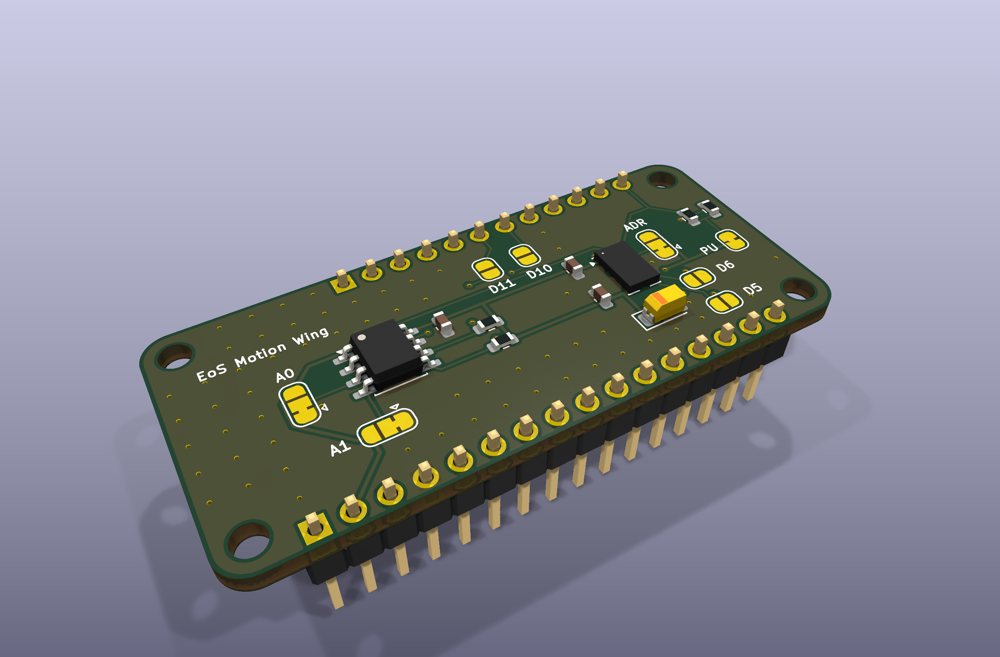
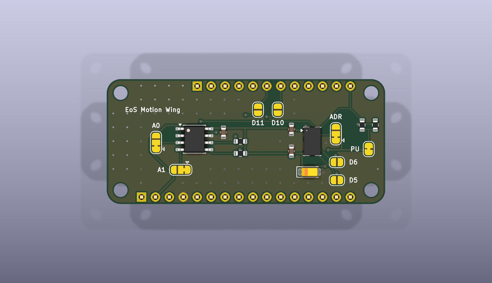
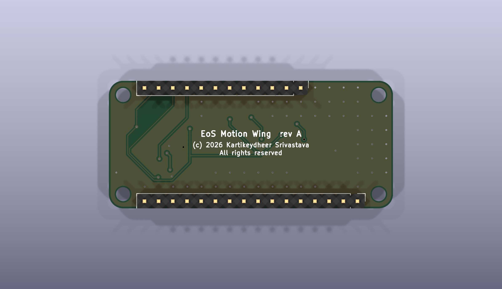

# EoS Motion Wing

An accelerometer and temperature FeatherWing, 50.8 × 22.86 mm, two layers.
Designed by Kartikeydheer Srivastava. All rights reserved: not open source, and not under this repository's MIT licence.
Anyone may view it, clone this repository and run its tests; anything more needs
Kartikeydheer Srivastava's written permission (kartikeydheer@gmail.com). EmbeddedOS (EoS) Research Foundation has a limited, revocable
permission. See [LICENSE.txt](LICENSE.txt) and [the licence summary](../README.md#licence).

A board for the same job as Adafruit's ADXL343 + ADT7410 Sensor FeatherWing; an original design, not a copy: no file of the vendor's was used.



| | |
|---|---|
|  |  |

An Analog Devices ADXL343 3-axis accelerometer and an ADT7410 16-bit temperature sensor share the
Feather's I2C bus. Both run from the Feather's 3V pin.

## What is on it

| Block | What it is, and where each value comes from |
|---|---|
| Outline, holes, headers | 0.9 × 2.0 in (22.86 × 50.8 mm) with 0.1 in holes at each corner. A 16-pin strip along the bottom edge, centred 1.0 in from the left edge, and a 12-pin strip along the top edge, centred 1.2 in from the left edge, 0.8 in apart; pin order as the spec's naming table. Source: Adafruit, [Feather Specification](https://learn.adafruit.com/adafruit-feather/feather-specification) (text and its dimension drawing, which puts the hole centres 0.1 in from each edge). The holes are KiCad's 2.5 mm unplated hole, the nearest stock size to 0.1 in. The spec gives no corner radius; 2.54 mm is used, concentric with the holes. |
| Headers | Male 1×16 and 1×12, 2.54 mm (Würth 61301611121, 61301211121), on the back: they point down into the Feather's sockets, with their plastic under the wing. |
| ADXL343 (U1) | CS tied to VDD I/O selects I2C. VS and VDD I/O share the 3V pin, as the data sheet allows for single-supply operation. Decoupling: 10 µF tantalum (C1) with 0.1 µF ceramic (C2) at VS and 0.1 µF ceramic (C3) at VDD I/O. The data sheet's base recommendation is 1 µF tantalum at VS and 0.1 µF at VDD I/O; where VS and VDD I/O cannot be separate supplies it suggests more filtering, such as 10 µF tantalum with 0.1 µF ceramic at VS. That is also the condition its Table 1 is specified under. Reserved pins 3 and 11 are left open, which Table 5 allows. Source: Analog Devices ADXL343 data sheet Rev. 0, pp. 6, 11, 16, 26 and Table 1. |
| ADT7410 (U2) | 0.1 µF ceramic at VDD (C4), as close to the pin as possible. INT and CT are open drain: 10 kΩ pull-ups to VDD (R3, R4), on the sensor side of the jumpers, so both idle high whether or not a jumper is made. Source: Analog Devices ADT7410 data sheet Rev. C, Table 4 (p. 6), p. 21 and p. 23. |
| I2C pull-ups | 10 kΩ on SDA and SCL (R1, R2) to 3.3 V through JP1. The ADT7410 data sheet recommends 10 kΩ (p. 17). See [I2C pull-ups](#i2c-pull-ups) for the limits. The Feather Specification puts I2C pull-ups on the wings, not on the Feather, so the wing carries them; cut JP1 when the Feather or another wing already provides them. |
| Address straps | ADXL343 ALT ADDRESS (JP3) and ADT7410 A0 (JP2) and A1 (JP4): 3-pad solder jumpers, low as delivered. The ADXL343 data sheet says ALT ADDRESS has no internal pull and must go to VDD I/O or GND (p. 16); the ADT7410's A0 and A1 must go to GND or VDD (Table 4). |
| Interrupts | ADXL343 INT1 and INT2 (push-pull, active high by default: data sheet p. 18) and ADT7410 INT and CT reach the Feather through 2-pad solder jumpers, open as delivered (JP5–JP8). |

Supply current is well under 1 mA: ADXL343 140 µA typical at ODR ≥ 100 Hz, ADT7410 250 µA
maximum while converting (each data sheet's Table 1), plus 0.33 mA per I2C line while it is held
low; the spec recommends that a Feather leave at least 100 mA for wings. The 3V pin may sag to
3.0 V on a flat battery (spec); both sensors still run there (ADXL343 VS 2.0–3.6 V, ADT7410
2.7–5.5 V).

### I2C addresses (7-bit)

| Chip | As delivered | Other settings |
|---|---|---|
| ADXL343 | 0x53 (JP3 1–2, ALT ADDRESS low) | 0x1D (cut 1–2, bridge 2–3: ALT ADDRESS high) |
| ADT7410 | 0x48 (JP2 and JP4 1–2, A0 = A1 = low) | 0x49 (A0 high), 0x4A (A1 high), 0x4B (both high) |

Sources: ADXL343 data sheet Rev. 0, p. 16; ADT7410 data sheet Rev. C, Table 20 (p. 17).

### Jumpers

| Jumper | Silkscreen | As delivered | To change |
|---|---|---|---|
| JP1 | PU | bridged: R1 and R2 pull the bus up | cut to take both pull-ups off the bus |
| JP3 | ADR | 1–2: ADXL343 at 0x53 | cut 1–2, bridge 2–3: 0x1D |
| JP2 | A0 | 1–2: A0 low | cut 1–2, bridge 2–3: A0 high |
| JP4 | A1 | 1–2: A1 low | cut 1–2, bridge 2–3: A1 high |
| JP5 | D5 | open | bridge: ADXL343 INT1 to D5 |
| JP6 | D6 | open | bridge: ADXL343 INT2 to D6 |
| JP7 | D10 | open | bridge: ADT7410 INT to D10 |
| JP8 | D11 | open | bridge: ADT7410 CT to D11 |

The interrupt jumpers start open so that the four GPIOs stay free: the spec expects only I2C
wings to stack. D13 is not used because the spec shares the Feather's user LED with it. The spec
also warns that the ESP8266 Feather has unusual requirements on these GPIOs: check that board's
pins before bridging JP5–JP8 on it.

### Feather pins used

| Feather pin | Header pin | On this wing |
|---|---|---|
| 3V | 16-pin, 2 | supply for both sensors and the pull-ups |
| GND | 16-pin, 4 | ground |
| SCL | 12-pin, 11 | I2C clock |
| SDA | 12-pin, 12 | I2C data |
| D5 | 12-pin, 10 | ADXL343 INT1, through JP5 |
| D6 | 12-pin, 9 | ADXL343 INT2, through JP6 |
| D10 | 12-pin, 7 | ADT7410 INT, through JP7 |
| D11 | 12-pin, 6 | ADT7410 CT, through JP8 |

Every other pin passes through unconnected.

### I2C pull-ups

- **Lower limit.** The ADT7410 data sheet specifies VOL ≤ 0.4 V for its open-drain outputs at
  1 mA at 3.3 V only (Table 1). Everything pulling up the bus must therefore add up to at least
  (3.3 − 0.4) V / 1 mA = 2.9 kΩ. With this wing's 10 kΩ in place, the other pull-ups in parallel
  must come to 4.1 kΩ or more. If they come to less, cut JP1.
- **Upper limit (rise time).** NXP UM10204 Rev. 7.0, section 7.1 and Table 10:
  Rp(max) = tr / (0.8473 × Cb). With 10 kΩ, Standard-mode (100 kHz, tr ≤ 1000 ns) holds up to
  118 pF of bus capacitance, and Fast-mode (400 kHz, tr ≤ 300 ns) up to 35 pF. The two sensors
  alone add 8 pF (ADXL343, Table 11) and up to 10 pF (ADT7410, Table 1), so 400 kHz needs a short,
  lightly loaded bus. The ADXL343 data sheet ties its output rate to the bus speed: 800 Hz at
  400 kHz and 200 Hz at 100 kHz (p. 16).

## Not on this board

None of the vendor board's files were opened, so this list covers only what this design leaves
out on purpose:

- **Power LED.** Optional in the brief; the Feather Specification says Feathers generally do not
  include one. It would draw a steady current from a battery for no function.
- **Reset button.** The Feather Specification strongly recommends one on wings, because a wing
  usually covers the Feather's own button. It was not in this board's requirements, so it is left
  out; RST (16-pin, 1) passes through.
- **SPI.** The ADXL343 also speaks SPI; here CS is tied high, so it is I2C only, like the ADT7410.
- **Qwiic / STEMMA QT connector.** Not asked for; the I2C bus is reachable only through the Feather
  headers.

## Build results

The numbers below are from `build-report.json` and `drc.json` in this folder.

| Check | Result |
|---|---|
| Schematic ERC | 0 violations |
| DRC errors | 0 |
| Unconnected items | 0 |
| Schematic ↔ board parity | 0 differences |
| DRC warnings | 5: the header outlines on the back silkscreen near the board edge: the Feather spec puts the header rows 0.05 in from the edge |

## Fabrication

2 layers, 1.6 mm thick, ground poured on both sides. Design rules as the generator sets them:

- **Tracks:** 0.15 mm, 0.25 mm on the 3.3 V net; 0.15 mm clearance.
- **Vias:** 0.6 mm with a 0.3 mm drill.
- **Smallest drill:** 0.3 mm (vias). The header holes are 1.0 mm; the four corner holes are
  2.5 mm, unplated.

The routed widths are set by the full build.

## What has not been done

- **No board has been made or tested.** Nothing here has been soldered, powered or measured.
- **ADXL343 data sheet revision.** The values come from Rev. 0 (2012). Analog Devices now publishes
  Rev. A; it could not be downloaded when this board was drawn, so the values have not been
  checked against it. The footprint is KiCad's
  LGA-14 3 × 5 mm; its pads share the inner edges of the land pattern in Rev. 0, Figure 49
  (1.05 mm and 3.05 mm apart), but are 0.95 × 0.6 mm where Figure 49 gives 1.145 × 0.55 mm.
- **Accelerometer mounting.** The ADXL343 data sheet advises mounting it near a hard mounting
  point to avoid PCB vibration errors (p. 26). U1 sits between the two header rows; how it behaves
  on a Feather stack has not been checked.
- **Pull-up limits** above are calculated, not measured on a real bus.
- **No firmware or driver** has been run against this board.

## Rebuild

```
python3 tools/eos_boards/build.py eos_motion_wing
```

The design file is [tools/eos_boards/boards/eos_motion_wing.py](../../../tools/eos_boards/boards/eos_motion_wing.py).
