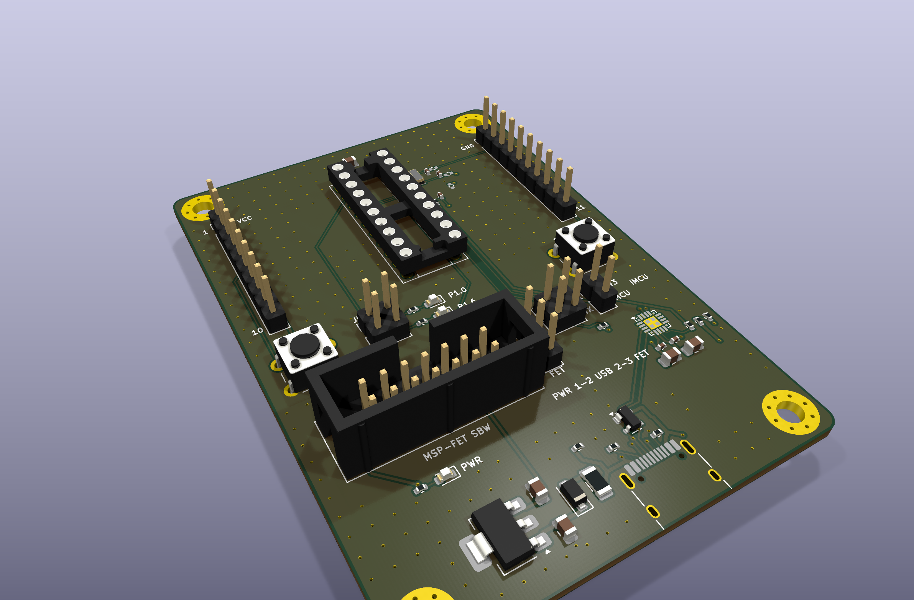
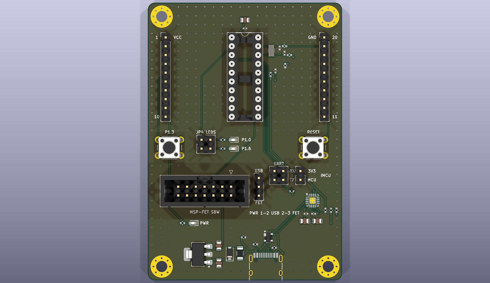
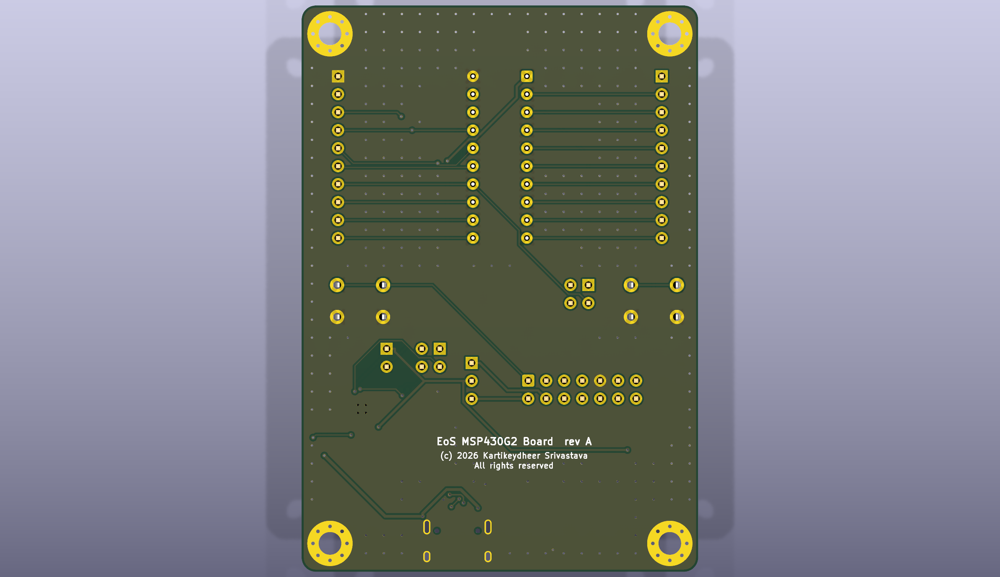

# EoS MSP430G2 Board

A BoosterPack-compatible (20-pin) MSP430G2553 board with the chip in a DIP-20 socket, 56 × 80 mm, two layers.
Designed by Kartikeydheer Srivastava. All rights reserved: not open source, and not under this repository's MIT licence.
Anyone may view it, clone this repository and run its tests; anything more needs
Kartikeydheer Srivastava's written permission (kartikeydheer@gmail.com). EmbeddedOS (EoS) Research Foundation has a limited, revocable
permission. See [LICENSE.txt](LICENSE.txt) and [the licence summary](../README.md#licence).

A board for the same job as TI's MSP-EXP430G2ET LaunchPad; an original design, not a copy: no file of the vendor's was used.



| | |
|---|---|
|  |  |

The MSP430G2553 sits in a socket, so the chip can be swapped, or programmed in this board and
moved to another. The two expansion headers follow TI's 20-pin BoosterPack standard. The
PDIP-20's two pin columns are already in BoosterPack order, so each header line runs straight
across to its pin.

Each component value below comes from the chip or part maker's document named next to it. The
user-I/O pins (red LED on P1.0, green LED on P1.6, button on P1.3) were chosen from the
BoosterPack standard's pin functions and common MSP430 practice, not from a datasheet: J1.2
(P1.0) is "Analog In", J1.5 (P1.3) is "GPIO interrupt capable", and P1.6 is a timer output
(TA0.1).

## What is on it

| Block | What it does, and where each value comes from |
|---|---|
| MSP430G2553IN20 in a DIP-20 socket | Runs at 3.3 V (its range is 1.8–3.6 V). **16 MHz needs VCC ≥ 3.3 V** (SLAS735J: 16 MHz at 3.3 V, 12 MHz at 2.7 V, linear between); the AP7361C-33 is 3.3 V ±1 % at 25 °C plus up to 1 % load regulation, so at its low limit (3.27 V) the ceiling is about 15.8 MHz. From the LDO, run at 12 MHz (CALBC1_12MHZ) for full margin, or at 16 MHz from an MSP-FET set to 3.4–3.6 V (JP1 at 2-3). 10 µF + 0.1 µF on DVCC. TI SLAS735J gives no decoupling values, so these come from TI SLAU278AH Figure 2-2 (the Spy-Bi-Wire connection for G2xx devices, C2 and C3). KiCad's `DIP-20_W7.62mm_Socket` footprint; the socket itself is listed under [Bill of materials notes](#bill-of-materials-notes). |
| BoosterPack headers J1, J2 | Two 1×10, 2.54 mm headers, 1.8 in (45.72 mm) apart, J1.1 and J2.20 level at the top. J1: VCC, P1.0, P1.1 (UART RX), P1.2 (UART TX), P1.3, P1.4, P1.5, P2.0, P2.1, P2.2. J2, top to bottom: GND, P2.6, P2.7, TEST, RST, P1.7, P1.6, P2.5, P2.4, P2.3. Source: TI's 20-pin standard, *BoosterPack Standards and Design Guide* (TI processors wiki, archived 2017-11-03). J1.1 is the board's 3.3 V rail, so a BoosterPack is outside the MCU current measurement. |
| Reset | 47 kΩ pull-up and 1 nF on RST/NMI/SBWTDIO, plus a reset button. That pin carries Spy-Bi-Wire data, so SLAU278AH Figure 2-2 note B limits the capacitor: "the upper limit for C1 is 2.2 nF when using current TI tools", typical 1.1 nF. SLAU144K Table 2-3 gives the same 2.2 nF limit. The pull-up's supply end faces away from the crystal. |
| TEST | SLAS735J gives TEST a 25–90 kΩ internal pull-down. SLAU278AH Figure 2-2 note D allows a 500 Ω–1 kΩ pull-down for noisy or ESD-prone use; R14 (1 kΩ) is that option, not fitted. |
| 32.768 kHz crystal | Abracon ABS07-32.768KHZ-6-T: CL = 6 pF, ESR 70 kΩ max (Abracon ABS07 datasheet). Load capacitors 8.2 pF C0G on XIN and XOUT. TI SLAA322D section 2.1 says to count every parasitic, PCB traces and pins included, and its Equation 3 gives CL1 = 2 × CLoad − Cparasitic. Per pin: 2 pF of bond and package (SLAS735J, note 2 to the XT1 table), plus an *estimated* 1–2 pF for the socket and the trace (7.2 mm of copper on XIN and 8.6 mm on XOUT: pin → crystal pad → load capacitor → a 0.85 mm stub to the unfitted 0 Ω link), so 3–4 pF. That gives CL1 = 12 − (3 to 4) = 8–9 pF; 8.2 pF gives a load of 5.6–6.1 pF. SLAS735J gives an oscillation allowance of 500 kΩ at CL,eff = 6 pF, 7 times the crystal's ESR: "very safe" by SLAA322D Table 2. |
| XCAPx | **Firmware must set XCAPx = 00** (BCSCTL3 bits 3-2, SLAU144K Table 5-5). Its reset value is 01 (about 6 pF), which adds to C10 and C11. Code written for boards without external load capacitors may set XCAPx = 11 (12.5 pF), which adds more. Either way the crystal sees too much load and ACLK runs slow (SLAA322D Figure 5). |
| P2.6 / P2.7 on J2 | These are the crystal pins. SLAS735J (note 1 to the XT1 table) says to keep other traces and crosstalk off XIN and XOUT, and a BoosterPack trace there would load the crystal. So J2.19 and J2.18 are joined only through two 0 Ω links (R11, R12), not fitted. To give a BoosterPack P2.6 (its "Timer Out" pin) and P2.7, remove Y1, C10 and C11 and fit the links. |
| User LEDs | Red on P1.0 and green on P1.6, each through a jumper on JP4. 680 Ω each: Kingbright APTD1608LSURCK (red, VF 1.75 V at 2 mA) and APTD1608LCGCK (green, VF 1.9 V at 2 mA) draw 2.1–2.3 mA from 3.3 V. With SLAS735J's worst-case VOH = VCC − 0.3 V they still draw 1.6–1.8 mA. **For an I2C BoosterPack, remove JP4's 3-4 shunt**: P1.6 is UCB0SCL, and the green LED would clamp the bus. |
| User button | On P1.3, to ground. SLAS735J gives every port pin a 20–50 kΩ pull-up, enabled by P1REN, so firmware enables it; there is no external pull-up. P1.3 is also BoosterPack J1.5. |
| Programming | A 14-pin MSP-FET connector (2×7 box header, J4), wired as SLAU278AH Figure 2-2: pin 1 TDO/TDI to RST/NMI/SBWTDIO, pin 7 TCK to TEST/SBWTCK, pin 9 GND. Fuse blow is not supported: following note C, TEST/VPP (pin 8) is left open and the 330 Ω R2 is not needed. Pins 2 and 4 are described under supply choice. |
| Supply choice (JP1) | One 1×3 header with one shunt feeds the board's 3.3 V rail: **1-2 "USB"**, the LDO; **2-3 "FET"**, the MSP-FET's VCC_TOOL (J4 pin 2). One shunt makes only one of those joins, so the LDO and the MSP-FET can never drive the rail together. That matters because the MSP-FET puts 3.3 V on pin 2 as soon as it powers up (TI SLAU647O Table 8). J4 pin 4, VCC_TARGET, is wired to the LDO output. It is an input in every state ("In, external VCC sense", Table 8). So at 1-2 the MSP-FET senses the board's own supply, the SLAU278AH Figure 2-2 J1 case; at 2-3 the rail meets pin 2 only. SLAU647O section 3.5: "Only pin 2 … or pin 4 … must be connected. Both connections are not supported at the same time." |
| MCU current (JP2) | JP2 joins the 3.3 V rail to the MCU's own supply (DVCC, its decoupling and the RST pull-up). Take it off and fit an ammeter to measure the MCU alone. The CP2102N, the power LED and a BoosterPack stay on the rail, outside the measurement. |
| USB serial | CP2102N-A02-GQFN20 (Silicon Labs CP2102N data sheet Rev. 1.5), from USB-C, to P1.1 (RXD) and P1.2 (TXD) through two removable jumpers (JP3). Its internal regulator is not used (Figure 2.3), so it shares the 3.3 V rail and the UART levels match. 4.7 µF + 0.1 µF on each power pin and a 1 kΩ pull-up on RSTb (section 2.1). VBUS sense through the 22.1 kΩ / 47.5 kΩ divider of Figure 2.5 (section 2.3: a divider "is required"): 3.41 V from 5 V, above its VIH of VIO − 0.6 V, the level it uses "to detect when the device is connected to a bus" (section 2.3, Table 3.7). The CP2102N stays powered without a host, so R13 keeps that pin reading "no bus" until a cable is in. |
| Why the CP2102N is never overdriven | Every supply (LDO, MSP-FET, a BoosterPack on J1.1) feeds the 3.3 V rail, and the MCU is fed only from that rail, through JP2. So the CP2102N is powered whenever the MCU is, and P1.2 never drives an unpowered CP2102N, whose UART pins are rated only VIO + 2.5 V while VIO is below 3.3 V (Table 3.10). The MCU can be unpowered while the CP2102N runs only with JP2 open. Then R10, 2.2 kΩ in the CP2102N's TXD line, holds the current into P1.1's clamp to 3.6 V / 2.2 kΩ = 1.6 mA, under SLAS735J's ±2 mA absolute maximum ("diode current at any device pin"). |
| USB ESD | Littelfuse SP0503BAHTG, the part the CP2102N data sheet shows in Figure 2.5: three diodes with a common anode to ground and their cathodes on D+, D− and VBUS (Littelfuse SP05xxBA data sheet: 5.5 V standoff, 100 nA maximum leakage at 5 V, 30 pF typical, pin 1 the common anode). It sits directly behind the receptacle, within 4.2–4.8 mm of copper of the data contacts, as ST DS4260 Rev 7 section 2.3 and TI SPMA059 section 4.1 ask ("as close as possible to the connector"). Nothing joins D+ or D− to VBUS. A steering-diode array would have diodes from D+/D− to its VBUS pin, and after a host unplugs, a still-powered CP2102N's D+ pull-up could hold VBUS up through them, so the CP2102N would never see the unplug. |
| Power from USB | USB-C as a 5 V sink (5.1 kΩ Rd on CC1 and CC2, USB Type-C specification). A Littelfuse 1206L050 polyfuse (0.50 A hold, 1.00 A trip, 6 V, R1max 0.70 Ω; 1206L series datasheet). Then a Nexperia PMEG6010CEH Schottky (PMEG6010CEH v.4: VF ≤ 400 mV at 100 mA, ≤ 530 mV at 500 mA). Then an AP7361C-33 LDO (Diodes DS37274 Rev. 5-2: input 2.2–6.0 V, at least 1 µF in and 2.2 µF out; 4.7 µF on each, as its typical application shows). A yellow power LED (APTD1608LSYCK, 680 Ω, 2.1 mA) on the 3.3 V rail. |
| Why the Schottky, and the bleed | Suppose a BoosterPack feeds the 3.3 V rail with JP1 at 1-2 and USB unplugged. The LDO output then lifts its input, and without D4 about 2.7 V would reach VBUS; a Type-C source that waits for VBUS to fall to vSafe0V might then never turn on. D4 blocks that. R13, 5.1 kΩ from VBUS to ground, sinks D4's leakage: ≤ 50 µA (at 60 V, 25 °C), 0.8 µA typical at 5 V. In parallel with the CP2102N's divider that is 4.75 kΩ, so up to 168 µA of leakage keeps VBUS under 0.8 V. A host pays 1.0 mA for it. |

Jumpers, as delivered:

| Jumper | Fitted | Removed |
|---|---|---|
| JP1 (PWR) | 1-2 "USB": the LDO powers the board, the MSP-FET senses it | 2-3 "FET": the MSP-FET powers the board (no USB cable needed) |
| JP2 (IMCU) | The 3.3 V rail reaches the MCU | Fit an ammeter across it to measure the MCU alone |
| JP3 (UART) | CP2102N TXD → P1.1, P1.2 → CP2102N RXD | P1.1 and P1.2 free for a BoosterPack |
| JP4 (LEDS) | Red LED on P1.0, green LED on P1.6 | P1.0 and P1.6 free; remove 3-4 for an I2C BoosterPack |

The front silkscreen names each jumper and its positions, the two buttons, the ends of J1 and J2
(1 and 10, 20 and 11, VCC and GND), the MSP-FET connector, and the JP1 rule
("PWR 1-2 USB 2-3 FET").

### Layout

The autorouter gives a different result on every run, so the lines that matter are laid first,
as priority routes. Measured on the placed board (by script; the full build lays the same routes
before routing the rest):

| Lines | Path | Length | Layer, vias |
|---|---|---|---|
| USB D+ | A6 → ESD pin 2 → CP2102N pin 4 | 4.20 + 17.69 mm | top, 0 |
| USB D− | A7 → ESD pin 3 → CP2102N pin 5 | 4.83 + 16.91 mm | top, 0 |
| USB ties | B6 → D+ line; B7 → D− line | 4.70 mm; 6.29 mm to the ESD pins | 2 vias each, behind the pad row |
| VBUS | A9/B4 → ESD pin 4 | 7.47 mm, 0.4 mm wide | top, 0 |
| XIN | pin 19 → crystal → C10 → link R11 | 3.79 + 2.39 + 0.85 mm | top, 0 |
| XOUT | pin 18 → crystal → C11 → link R12 | 3.79 + 3.79 + 0.85 mm | top, 0 |
| Decoupling | DVCC → C8; CP2102N VDD → C4, VREGIN → C6 | 3.66; 3.01, 2.48 mm | top, 0 |
| SBWTCK | pin 17 → MSP-FET pin 7, leaving pin 17 downward, never toward XOUT | 41.77 mm | top, 0 |

- **USB.** The data lines run straight up from the receptacle's A6 and A7 contacts into the ESD
  array, through its middle and out of its top, then together to the CP2102N with D+ above
  D−, the CP2102N's own pin order. No data-line track lies under the receptacle's body or
  further than 0.5 mm forward of the pad row's centre. The receptacle repeats each data contact
  in the order B7 (D−), A6 (D+), A7 (D−), B6 (D+), so B7 and B6 each cross the other line to
  reach their twins: both crossings are a via pair and a short bottom-layer link behind the
  pad row, and a top-layer keep-out in front of the pads stops either being made under the
  shell. VBUS comes in from the A9/B4 contacts round the array's east side.
- **CC2's resistor** sits between the ESD array and the pad row, where CC2 can reach it on top.

## Power budget

| Load | Current |
|---|---|
| MSP430G2553 at 16 MHz (SLAS735J active-mode figure; less at 12 MHz) | about 5 mA |
| User LEDs, both lit | 4.6 mA |
| Power LED | 2.1 mA |
| CP2102N at 3 Mbaud, plus its USB pull-up (Rev. 1.5 Table 3.2) | 13.9 mA |
| **Board** | **about 26 mA** |

From USB, a BoosterPack may draw up to 300 mA more. At 326 mA the LDO dissipates at most
(5.25 − 3.3 V) × 0.326 A = 0.64 W, counting no drop in the fuse or D4. That is 70 °C above
ambient at DS37274's 110 °C/W (SOT-223, minimum pad), against its 150 °C thermal shutdown. At
4.75 V in, the fuse (0.70 Ω) and D4 (≤ 0.53 V) leave 3.99 V, above the 3.44 V the LDO needs
(140 mV dropout at 300 mA). The fuse holds 0.42 A at 40 °C (its derating table).

From the MSP-FET (JP1 at 2-3): it supplies up to 100 mA, and SLAU647O asks for no more than
60 mA peak. The board's 26 mA leaves about 34 mA for a BoosterPack.

## Bill of materials notes

The generated BOM lists only parts that have a footprint. These have none, so add them:

| Item | Qty | Part |
|---|---|---|
| DIP-20 socket for U1 | 1 | Mill-Max 110-43-320-41-001000 (20-pin, 0.3 in, machined, gold contacts) |
| Jumper shunts, 2.54 mm | 6 | Sullins QPC02SXGN-RC: one each on JP1 (1-2) and JP2, two each on JP3 and JP4 |

Named in the generated BOM besides the ICs: the 8.2 pF load capacitors, Murata
GRM1555C1H8R2CA01D (C0G, 50 V, 0402; "C" is Murata's ±0.25 pF code, checked on a distributor
listing and its sibling parts, not on Murata's own page), and the headers, Samtec TSW-110-07-G-S
(J1, J2), TSW-103-07-G-S (JP1), TSW-102-07-G-S (JP2) and TSW-102-07-G-D (JP3, JP4). The other
resistors and capacitors carry values and ratings only.

Not fitted (DNP), as delivered:

- **R11, R12** (0 Ω): P2.6/P2.7 to J2, for use without the crystal.
- **R14** (1 kΩ): TEST pull-down, SLAU278AH note D.

## Not on this board

- **TI's eZ-FET debugger.** The MSP-EXP430G2ET carries an on-board eZ-FET, whose firmware is
  TI's. This board has a standard MSP-FET connector in its place, plus the CP2102N for the
  serial port. Programming and debugging need an MSP-FET (or another Spy-Bi-Wire probe).
- **Back-channel UART through the debugger.** With no eZ-FET, the PC talks to the MCU through
  the CP2102N's virtual COM port instead.
- **The 3-pin power header TI's 20-pin figure draws below J2.** The standard gives no exact
  position for it, so it is left out; J1.1 and J2.20 carry VCC and GND.
- **Fuse blow.** The JTAG security fuse cannot be blown from this board (TEST/VPP is not wired,
  SLAU278AH Figure 2-2 note C).

## Build results

The numbers below are from `build-report.json` and `drc.json` in this folder.

| Check | Result |
|---|---|
| Schematic ERC | 0 violations |
| DRC errors | 0 |
| Unconnected items | 0 |
| Schematic ↔ board parity | 0 differences |
| DRC warnings | 2: silkscreen within the board-edge clearance, the outline of J3 (USB-C), which sits at the board edge |

## Fabrication

2 layers, 1.6 mm thick, ground poured on both sides. Design rules:

- **Tracks:** 0.15 mm, narrowing to 0.112 mm where the router necks into the CP2102N's
  fine-pitch pads; 0.4 mm on VBUS and 5 V; 0.3 mm on the 3.3 V rail, the LDO output, the
  MCU supply and VCC_TOOL (it enters the CP2102N's 0.3 mm pads at 0.5 mm pitch, as on EoS
  TM4C123 Board; a 0.4 mm track could not); 0.2 mm on USB D+/D−.
- **Clearance:** 0.15 mm.
- **Vias:** 0.6 mm with a 0.3 mm drill.
- **Smallest drill:** 0.3 mm, in the vias. The smallest footprint hole is 0.5 mm, in the
  mounting holes' via rings.

The USB-C receptacle sits at the generator's `USB_C_EDGE`: HRO's 5.79 mm from its locating pegs
to the board edge, so its face stands about 0.46 mm proud of the bottom edge.

## What has not been done

- **No board has been made or tested.** The design has passed only KiCad's checks.
- **The crystal load is calculated, not measured.** The 1–2 pF per pin for the socket and traces
  is an estimate. Measure ACLK on a built board, as SLAS735J note 2 says, and adjust C10 and C11.
- **Inrush from the MSP-FET.** With JP1 at 2-3 the rail carries about 20 µF (10 µF on DVCC,
  2 × 4.7 µF at the CP2102N). SLAU647O warns that more than 10 µF may draw over 60 mA while
  charging. How the MSP-FET responds has not been tried; if it reports an overcurrent, power
  the board from USB (JP1 at 1-2).
- **JP1 at 2-3 with USB plugged in.** J4 pin 4 then reads the idle LDO's 3.3 V while the MSP-FET
  powers the board from pin 2. Nothing can contend, because pin 4 is only a sense input, but
  TI does not describe the MSP-FET's behaviour in that case. Unplug USB, or use 1-2.
- **JP1 at 2-3, USB plugged in, MSP-FET not powering the board.** The CP2102N is then
  unpowered while the host's VBUS reaches its VBUS pin through R5/R6, above the VIO + 2.5 V of
  its Table 3.10. Silicon Labs accepts this ("the current limitation of the resistor divider
  prevents high VBUS pin leakage current, even though the VIO + 2.5 V specification is not
  strictly met while the device is not powered", section 2.3), but the pin's clamp then feeds a
  fraction of a milliamp (Inferred) into the dead 3.3 V rail. **With JP1 at 2-3, unplug USB
  unless the MSP-FET is powering the board.**
- **Spy-Bi-Wire through a socket.** SLAU278AH FAQ A.1.1 reports that a socket's capacitive
  coupling can disturb the 32 kHz oscillator during an SBW debug session (on a different
  socketed MSP430). Here XOUT (pin 18) sits next to TEST/SBWTCK (pin 17). The SBWTCK track
  leaves pin 17 downward, away from pin 18 (SLAS735J XT1 note 1, SLAA322D section 4), but the
  socket's own coupling remains. This has not been tried; if ACLK misbehaves while debugging,
  SLAU278AH suggests the debugger's "Run Free" option.
- **BoosterPack clearance over the socket.** A socketed PDIP is taller than a soldered chip.
  BoosterPacks with parts on their underside above the socket have not been checked.
- **A BoosterPack that supplies power.** It feeds the 3.3 V rail, in parallel with whichever
  source JP1 selects; the standard's VCC pin is normally an output of the main board.
- **No firmware is included.** Example code must set XCAPx = 00 and enable P1.3's pull-up.

LaunchPad, BoosterPack, MSP430 and Spy-Bi-Wire are trademarks of Texas Instruments. They are used
here only to name the chip, the header standard, TI's own board and the programming interface.

## Rebuild

```
python3 tools/eos_boards/build.py eos_msp430g2_board
```

The design file is [tools/eos_boards/boards/eos_msp430g2_board.py](../../../tools/eos_boards/boards/eos_msp430g2_board.py).
