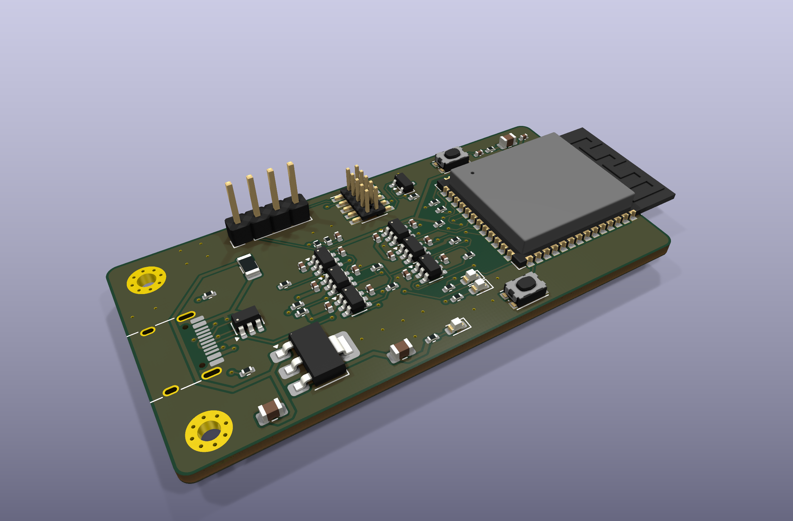
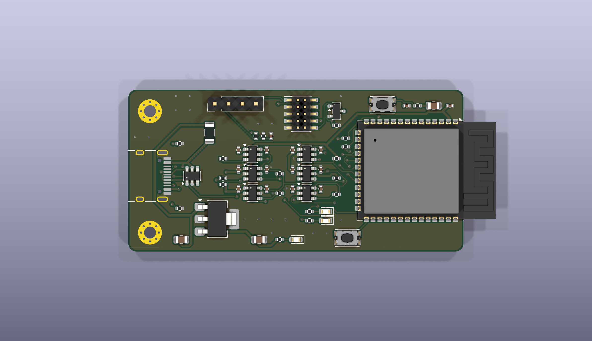
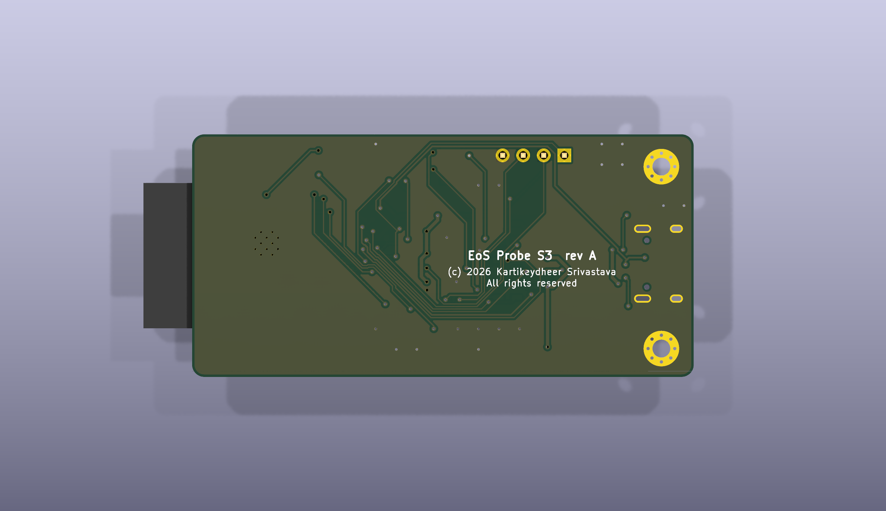

# EoS Probe S3

An ESP32-S3 debug probe for Arm SWD/JTAG targets and their UART, 62 × 30 mm, two layers.
Designed by Kartikeydheer Srivastava. All rights reserved: not open source, and not under this repository's MIT licence.
Anyone may view it, clone this repository and run its tests; anything more needs
Kartikeydheer Srivastava's written permission (kartikeydheer@gmail.com). EmbeddedOS (EoS) Research Foundation has a limited, revocable
permission. See [LICENSE.txt](LICENSE.txt) and [the licence summary](../README.md#licence).



| | |
|---|---|
|  |  |

The probe talks to the target at the target's own I/O voltage (1.65–5.5 V, read from VTref),
through one SN74LVC1T45 per line.

## How each part is set

| Part | Set from the datasheet |
|---|---|
| ESP32-S3-WROOM-1-N8R2 | 22 µF + 0.1 µF on 3V3; EN delay R = 10 kΩ, C = 1 µF, plus a reset button; boot button pulls IO0 (weak internal pull-up) to GND; USB D−/D+ to IO19/IO20 through 0 Ω positions; strapping pins IO3, IO45, IO46 left at their defaults; IO26–IO32 (the module's flash and PSRAM) unused, and IO33–IO37 too, which octal-PSRAM variants of the module take. Source: Espressif ESP32-S3-WROOM-1 datasheet, section 9. |
| Supply | Espressif requires at least 0.5 A at 3.0–3.6 V. The AP7361C-33 (Diodes Inc.) gives 1 A from 5 V USB; its input range is 2.2–6.0 V. 4.7 µF on input and output, as its typical application shows. |
| SN74LVC1T45 ×6 | VCCA = 3.3 V (ESP32-S3 side), VCCB = VTref (target side). DIR high sends A to B; DIR is referenced to VCCA. If either supply is off, both ports go high-impedance, so an unpowered target is never driven. 0.1 µF on each VCC. Source: TI SCES515. |
| Inputs that could float | TI notes the data inputs are always active, so each gets a 100 kΩ pull: on the target side when nothing is plugged in, and on the ESP32-S3 side while it boots. |
| SWDIO | The one bidirectional line. IO10 sets its direction; it defaults to "read" (pulled low), so the probe never drives the target at power-up. |
| nRESET | Open drain, through a 2N7002 held off at power-up. |
| VTref sense | 100 kΩ / 100 kΩ into IO1 (ADC1_CH0): a 5.5 V target reads as 2.75 V. |
| USB-C | 5 V sink (5.1 kΩ on CC1 and CC2), USBLC6-2SC6 ESD protection, 500 mA polyfuse. |

| ESP32-S3 pin | Line | Direction |
|---|---|---|
| IO12 | SWCLK / TCK | probe to target |
| IO11, IO10 | SWDIO / TMS, and its direction | both |
| IO9 | SWO / TDO | target to probe |
| IO13 | TDI | probe to target |
| IO14 | nRESET (open drain) | probe to target |
| IO17, IO18 | UART TX, RX | probe to target, target to probe |
| IO1 | VTref sense (ADC) | in |
| IO15, IO16 | status and activity LEDs | out |

Target connectors:

- **Arm 10-pin Cortex Debug header**, 1.27 mm (J2).
- **UART**, 1×4, 2.54 mm (J3): 1 VTref, 2 TX (probe out), 3 RX (probe in), 4 GND.

The module sits on the right edge with its antenna past the board edge, so Espressif's antenna
keep-out falls off the board.

## Build results

| Check | Result |
|---|---|
| Schematic ERC | 0 violations |
| DRC errors | 0 |
| Unconnected items | 0 |
| Schematic ↔ board parity | 0 differences |
| DRC warnings | 4: silkscreen past the board edge (the module's outline over its antenna, and the USB-C connector, which is meant to sit on the edge) |

## Fabrication

2 layers, 1.6 mm thick, ground poured on both sides. Measured from the board file:

- **Tracks:** 0.15 mm, narrowing to 0.112 mm at fine-pitch pins; 0.4 mm on the supplies.
- **Vias:** 0.6 mm with a 0.3 mm drill.
- **Smallest drill:** 0.2 mm, in the module footprint's thermal vias under its ground pad.

Outputs:

- Gerbers and drill files: [fab/gerbers](fab/gerbers)
- Bill of materials: [fab/eos-probe-s3-bom.csv](fab/eos-probe-s3-bom.csv)
- Pick-and-place: [fab/eos-probe-s3-placement.csv](fab/eos-probe-s3-placement.csv)
- STEP model: [fab/eos-probe-s3.step](fab/eos-probe-s3.step)
- Schematic: [eos-probe-s3-schematic.pdf](eos-probe-s3-schematic.pdf)
- KiCad project: [hardware](hardware)

## What has not been done

- **No probe has been made or tested.** The design passes KiCad's electrical and design rule
  checks only.
- **No firmware is included.** The pin assignment above is meant for CMSIS-DAP probe firmware
  on the ESP32-S3, but none has been ported or run on this board.

## Rebuild

```
python3 tools/eos_boards/build.py eos_probe_s3
```

The design file is [tools/eos_boards/boards/eos_probe_s3.py](../../../tools/eos_boards/boards/eos_probe_s3.py).
