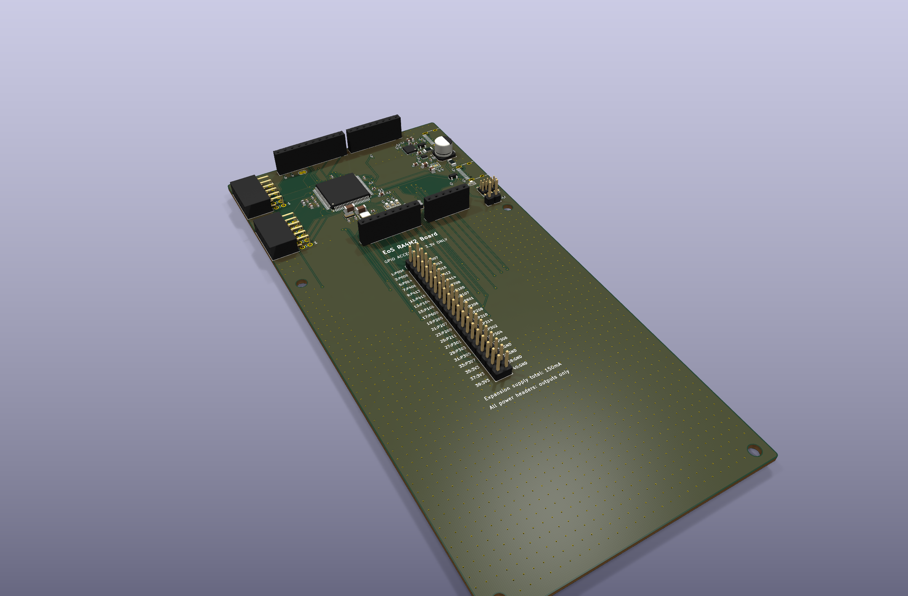
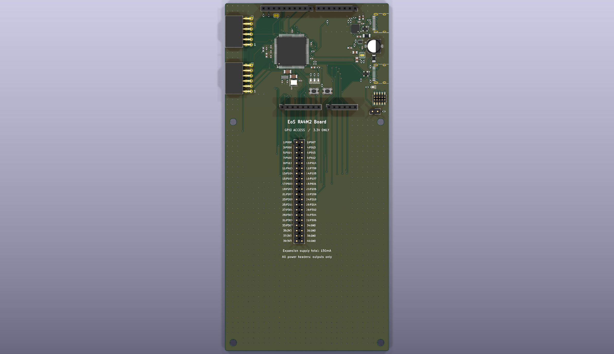
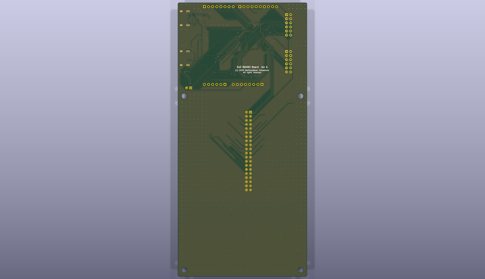

# EoS RA4M2 Board

An 80 × 170 mm, two-layer RA4M2 development board with Uno R3 shield sockets,
SPI and I²C Pmod ports, a GPIO access header, USB device, USB-UART and SWD.
Designed by Kartikeydheer Srivastava.
All rights reserved: not open source, and not under this repository's MIT licence.
Anyone may view it, clone this repository and run its tests; anything more needs
Kartikeydheer Srivastava's written permission (kartikeydheer@gmail.com). EmbeddedOS (EoS) Research Foundation has a limited, revocable
permission. See [LICENSE.txt](LICENSE.txt) and [the licence summary](../README.md#licence).

A board for the same job as Renesas EK-RA4M2; an original design, not a copy:
no design file of the vendor's was used; the header positions come from the
published Uno R3 relative dimensions in Matthew Beckler's dimension drawing
v1.05 and Digilent's Pmod Interface Specification 1.3.0, with original placement
on the board. The 80 × 170 mm overall dimensions come from the EK-RA4M2 user
manual, R20UT4815EG0100 §3. Its mounting and connector coordinates are not
dimensioned there, so this board does not claim enclosure or mounting-pattern
compatibility. The MCU assignments are original and require their own firmware
configuration.



| Top | Bottom |
|---|---|
|  |  |

## What is on it

| Block | Parts, values and source |
|---|---|
| MCU | Renesas R7FA4M2AD3CFP, Cortex-M33, 100 MHz, 512 KB code flash, 8 KB data flash, 128 KB SRAM, LQFP-100. Pins: R01DS0367EJ0150 Table 1.17, LQFP100 column. |
| Digital supply | 100 nF at each VCC pin and VCC_USB; 220 nF C0G at VCL; VBATT tied to 3.3 V. R01UH0892 Table 45.1 and R01AN5988 Table 1. |
| Analog supply | Bourns MH1608-221Y 220 Ω ferrite; 10 µF + 10 nF bulk/filter capacitors, 100 nF at AVCC0 and VREFH0; VREFH also tied to this supply. R01UH0892 Figure 37.34. |
| Clocks | NDK NX3225GA 16 MHz, CL 8 pF, with two 6 pF loads; Abracon ABS07 32.768 kHz, CL 9 pF, with two 15 pF loads. R01AN7202 Rev.1.02 Group 1 Tables 4.1.1/4.2.1; select 8.1–16 MHz main drive and standard CL sub-clock drive. |
| Device USB (J1) | RA4M2 USBFS, USB-C sink, 5.1 kΩ on each CC pin, 27 Ω on D+/D−, SP0503BAHTG ground-only ESD and 500 mA PTC. VBUS sense uses 18 kΩ/30 kΩ plus 1 µF, adapted from R01UH0892 Figure 26.3 for a 5.5 V maximum input. |
| Debug USB (J2) | CP2102N-A02-GQFN24 on SCI9 P109/P110, also the ROM serial boot pins. Powered by board 3.3 V with VREGIN tied to VDD; 100 nF local bypass and 4.7 µF bulk capacitors, 1 kΩ reset pull-up. VBUS divider 22.1 kΩ/47.5 kΩ and 5.1 kΩ bleed; SP0503BAHTG ESD. CP2102N data sheet Figures 2.3/2.6, R01UH0892 Table 44.27. |
| Power selection | TPS2116 prefers J2, otherwise J1, with reverse blocking between ports. 27 kΩ/10 kΩ PR1 divider, MODE to VIN1, 1 µF per input and 100 µF polymer output. TI SLVSFG1A §§7.3.4, 7.6.1.1 and 9. |
| Regulator | TPS7A9101, 3.57 kΩ/1.15 kΩ feedback for nominal 3.283 V, 22 µF input, 10 µF output, 10 nF NR/SS for calculated 0.80–2.2 ms ramp. TI SBVS282A Table 7-1, Equation 6 and §7.1.3; RA4M2 Table 2.9. |
| Debug and boot | Standard Arm 10-pin SWD header J9, replacing the proprietary on-board probe. 10 kΩ RES/NMI pull-ups, reset button, no reset capacitor. JP1 grounds MD through 1.5 kΩ for boot mode; otherwise its internal pull-up selects normal execution. R20UT4686 Figures 2.7/2.9 and R01AN5988 §§3/6. |
| User interface | User button P408/IRQ7 with 10 kΩ pull-up; red P409, green P410 and yellow P411 LEDs, about 2 mA each using 750/680/680 Ω. Green supply LED uses 680 Ω. Kingbright DSAO7432/7433/7434. |
| Expansion | Uno R3 sockets, Type 2A SPI Pmod and Type 6A I²C Pmod; 2.2 kΩ I²C pull-ups, removable by cutting JP2. TI SLVA689A gives 161 pF maximum bus capacitance for 400 kHz with these pulls. J10 exposes 33 remaining GPIOs. |

Both USB ports and the MCU share the same 3.3 V supply. The UART bridge therefore
cannot be unpowered while MCU TX is driven. Its separate VBUS sense prevents an
asserted USB pull-up after its cable is unplugged. The ground-only ESD parts do
not create a D+ to VBUS path. Configure CP2102N descriptors and MCU USB firmware
for the board's actual power consumption.

The device-port divider produces at most 3.47 V at 5.5 V with 1% resistor
extremes, below the MCU's 3.6 V limit when VCC is absent. At 4.4 V it produces at
least 2.729 V, above the worst-case 2.658 V input-high threshold for this supply.

## Headers and firmware

All logic is **3.3 V**. J5's 3V3, IOREF and 5V pins, both Pmod supplies and J10's
3V3 pins are outputs. Do not apply external power through them. AREF and VIN are
unconnected. Do not drive GPIOs while the board is unpowered.

| Shield signal | RA4M2 port/function |
|---|---|
| D0, D1 | P113 RXD2, P112 TXD2 |
| D2, D3, D4 | P111, P114 GTIOC2B, P609 |
| D5, D6, D7 | P608 GTIOC4B, P115 GTIOC4A, P610 |
| D8, D9, D10 | P603, P602 GTIOC7B, P103 |
| D11, D12, D13 | P101 MOSI0, P100 MISO0, P102 SCK0 (SCI0 simple SPI) |
| SDA, SCL | P401 SDA0_A, P400 SCL0_A (IIC0) |
| A0–A5 | P005–P000, respectively (AN005–AN000) |

J3, pin 1 to 10: D8, D9, D10, D11, D12, D13, GND, AREF (open), SDA, SCL.
J4, pin 1 to 8: D0–D7. J5, pin 1 to 8: NC, IOREF, RESET, 3V3, 5V, GND, GND,
VIN (open). J6, pin 1 to 6: A0–A5.

| Pmod pin | J7 Type 2A SPI | J8 Type 6A I²C |
|---|---|---|
| 1 | P500, GPIO chip select | P403, interrupt |
| 2 | P101, MOSI0 | P402, reset |
| 3 | P100, MISO0 | P400, SCL0_A |
| 4 | P102, SCK0 | P401, SDA0_A |
| 5, 11 | GND | GND |
| 6, 12 | 3V3 | 3V3 |
| 7 | P501, interrupt | P404 |
| 8 | P502, reset | P405 |
| 9 | P503, second chip select | P505 |
| 10 | P504, third chip select | NC |

Pmod numbering differs from KiCad's odd/even connector-pad numbering. These
are the Pmod mating pin numbers; the schematic part description records the
pad conversion. Each socket's square pad is the footprint's pad 1, which is
Pmod pin 6 (3V3), not Pmod pin 1. Pmod pin 1 is pad 11, marked by a silkscreen
"1" beside it. The SPI and I²C signals are shared with the shield sockets.
Avoid two peripherals using the same chip-select or I²C address.

J9 uses the standard Cortex Debug SWD pinout: 1 VTref, 2 SWDIO/P108, 3 GND,
4 SWCLK/P300, 5 GND, 6 SWO/P109, 7 key/open, 8 open, 9 GND detect, 10 RES.
SWO and the UART's TXD9 share P109: select one function in firmware. SWO trace
bytes can reach the UART receiver when trace is selected; this is not a second
independent console.

J9 follows the Arm pinout, not Renesas's combined debug and serial pinout
(R01UH0892 Table 44.32), which puts P201/MD on pin 4 and P110/RXD9 on pin 8. SWD
on J9 flashes and debugs the MCU. The TrustZone IDAU boundary settings can be
written only through the serial programming interface (R01UH0892 §44), so an
E2 or E2 Lite on J9 cannot set them. To program them, fit JP1, reset the board,
and run Renesas Flash Programmer over the CP2102N on J2 in SCI boot mode.

J10 follows ordinary odd/even 2×20 numbering, pin 1 marked on the PCB:

| Odd pin | Signal | Even pin | Signal |
|---:|---|---:|---|
| 1 | P006 | 2 | P007 |
| 3 | P008 | 4 | P013 |
| 5 | P014 | 6 | P015 |
| 7 | P406 | 8 | P412 |
| 9 | P413 | 10 | P414 |
| 11 | P415 | 12 | P708 |
| 13 | P104 | 14 | P105 |
| 15 | P106 | 16 | P107 |
| 17 | P600 | 18 | P601 |
| 19 | P205 | 20 | P206 |
| 21 | P207 | 22 | P208 |
| 23 | P209 | 24 | P210 |
| 25 | P211 | 26 | P214 |
| 27 | P301 | 28 | P302 |
| 29 | P303 | 30 | P304 |
| 31 | P305 | 32 | P306 |
| 33 | P307 | 34 | GND |
| 35 | 3V3 | 36 | GND |
| 37 | 3V3 | 38 | GND |
| 39 | 3V3 | 40 | GND |

J10 pins 1–6 are PORT0 pins (P006, P007, P008, P013, P014, P015). While the
ADC's high-precision channels are in use, do not use PORT0 pins as digital
outputs (R01UH0892 §37.6.12). A0–A5 are on P000–P005, also PORT0.

Hold RESET, fit JP1, then release RESET to enter SCI/USB boot mode; remove JP1
and reset to run the application. The board includes no automatic DTR reset.

J9 and JP1 sit right of the Uno shield outline (x > 68.58 mm from the left
edge), so a fitted shield covers neither. The RESET and USER buttons (SW1, SW2)
and the user LEDs D2–D4 lie under a fitted shield. With a shield on, reset
through the shield's own RESET (J5 pin 3 is RES) or through J9 pin 10.

## Power budget

C5 is [Murata GRM31C5C1H224JE02L](https://www.murata.com/en-us/products/productdetail?partno=GRM31C5C1H224JE02%23),
220 nF, ±5%, 50 V C0G, 1206. This retains the nominal value specified for VCL
without the large voltage-dependent loss of the original X7R part. Murata's
[DC-bias guidance](https://www.murata.com/en-eu/support/faqs/capacitor/ceramiccapacitor/char/0005)
distinguishes C0G from high-permittivity ceramics. The MCU manual does not state
an allowed effective-capacitance interval; regulator stability remains a
prototype check.

C22 is polarized [Panasonic 16SVPC100M](https://industrial.panasonic.com/ww/products/pt/OS-CON/models/16SVPC100M),
100 µF, ±20%, 16 V polymer, 24 mΩ ESR, replacing the nominal 100 µF ceramic whose
typical model fell to about 38 µF at 5.5 V. The initial tolerance floor is 80 µF;
including the SVPC series' 20% endurance-change limit gives 64 µF at the
specified measurement conditions. TPS2116 §7.3.4 recommends about 100 µF;
it does not specify a guaranteed minimum for every load. Transient performance
must therefore be checked with the actual cables and loads. Fit pad 1 to +5V
and pad 2 to ground. Its body (x 69.4–76.0 mm) lies outside the Uno shield
outline (x ≤ 68.58 mm); its 5.9 mm height matters only for an enclosure.

TPS2116 §8.2.2 estimates capacitor charging current as C × V / soft-start time.
At 5 V and the typical 1.7 ms ramp, C22 alone draws about 294 mA nominal or
353 mA at +20% capacitance, and C23 (22 µF) adds about 65 mA nominal. The
regulator then charges about 30 µF on 3.3 V (C24, C9, C18, C19 and nine 100 nF
capacitors) over its 0.80–2.2 ms soft start, 45–124 mA; the two ramps can
overlap. The ramp is not a guaranteed minimum, and the mux is not a USB current
limiter. The +5V side alone stores about 0.6 mC (122 µF at 5 V), about 12
times what the 10 µF that USB 2.0 §7.2.4.1 allows a device to present would
hold, and the 3.3 V side adds about 0.1 mC; the TPS2116 slew spreads the
current, not the charge. USB-IF inrush compliance is therefore not expected,
and these numbers do not establish a 500 mA total peak. Validate startup
current, suspend, switchover and output overshoot on a prototype.

The expansion connectors share **150 mA total**, across all 3.3 V and 5 V pins;
the limit is not per connector. A 120 mA board allowance makes the steady-state
budget 270 mA; it excludes capacitor charging during startup.
The allowance covers 65 mA maximum digital MCU consumption and 10 mA USB
consumption (RA4M2 Table 2.7), analog circuits, CP2102N, LEDs and pull-ups.

At 270 mA, the fuse's specified 0.70 Ω post-trip resistance gives 0.189 V loss
and the mux's 60 mΩ maximum gives 0.016 V. The fuse holds 420 mA at 40 °C,
above this budget, and a configured 500 mA USB source has margin. Before USB
enumeration, firmware must keep the entire load below the default unit-load
limit; expansions must be disconnected or held inactive. USB suspend behavior,
inrush and source switchover need bench validation.

With every expansion load on 3.3 V and 5.5 V input, the LDO dissipates about
0.60 W. Its 62.5 °C/W figure is for a JEDEC multilayer test board and predicts a
37.5 °C rise. This two-layer board, with no via in the thermal pad, will run
hotter by an amount not measured, so check the regulator's temperature in that
case on a prototype. The regulator's 1 A silicon rating is not this board's
expansion allowance. The supply ramp is calculated, not measured.

## Parts notes

- Every resistor without a named part (all but R18 and R19) is generic: 1%,
  0402, thick film, rated 62.5 mW or more. The largest dissipation is about
  6 mW (R15 at 5.5 V), so any vendor's part meeting that line will do.
- JP1 is a [Samtec TSW-102-07-G-S](https://www.samtec.com/products/tsw-102-07-g-s)
  1×2 2.54 mm header, fitted with a
  [Samtec SNT-100-BK-G](https://www.samtec.com/products/snt-100-bk-g) shunt.
- C1 is a [Samsung CL31B104KBCNNNC](https://www.lcsc.com/product-detail/C24497.html),
  100 nF ±10% 50 V X7R 1206; the 1206 body lets the 16 MHz crystal lines pass
  between its pads (see Layout).
- C22's lifecycle status is unknown: Panasonic's page gives no lifecycle field.
  A second source in the same C6 land must match its ESR and ripple-current
  rating; none has been checked.

## Not on this board

- Renesas/SEGGER's on-board J-Link probe and debug-out function: replaced by the
  external SWD header and CP2102N UART.
- USB host/OTG source power, QSPI memory, capacitive-touch electrode, mikroBUS,
  Grove and Qwiic sockets: no implementation is claimed. I²C and spare MCU
  signals are available on the documented headers.
- Battery backup, MCU current-measurement jumpers, a perfboard grid and 20-pin
  ETM/JTAG trace. VBATT follows the main 3.3 V supply.
- Vendor connector placement, mounting pattern, firmware examples and debugger
  firmware. Only the published overall outline and expansion standards are
  retained.
- I²C on A4/A5. P001 and P000 have no IIC function (R01DS0367 Table 1.17), so
  older shields that take I²C from A4/A5 (the Uno R3 bridges them to SDA/SCL)
  will not work; I²C is on the SDA/SCL pins only.
- A 2×3 ICSP header. Shields that take SPI only from ICSP get none; SPI is on
  D11–D13 (SCI0 simple SPI).
- An interrupt on D3. P114 has no IRQ function (Table 1.17, pin 57), where the
  Uno's D3 is INT1. D2 (P111) is IRQ4.

## Layout

- **Oscillators** (R01AN7202 §6.1). The bottom pin row runs VCL 9, XCIN 10,
  XCOUT 11, VSS 12, XTAL 13, EXTAL 14, VCC 15. VSS 12 drops straight onto C5's
  ground pad and on to C1's: a ground spine between the two oscillators. C5
  (VCL) and C1 (VCC) are 1206 parts whose bodies straddle the clock pairs,
  XCIN/XCOUT under C5 and XTAL/EXTAL under C1, so both ground pads sit on the
  spine. Between the pads the clock lines keep 0.20 mm from them (0.63 mm from
  C1's supply pad). The clock lines are 0.15 mm, on the top layer, with no via:
  XTAL 9.2 mm, EXTAL 7.4 mm, XCIN 6.4 mm and XCOUT 5.5 mm from pin to crystal
  pad. No other net crosses them or lies inside either crystal's courtyard, on
  either layer, and no other net's track runs under the clock-side pins 9–15.
  The bottom layer under those pins, the clock lines and both crystals, to
  beyond the load capacitors, is kept free of tracks, so its ground pour is
  solid there. A top-layer keep-out keeps other lines off the 32.768 kHz
  crystal's outer side.
- **VSS 12 and the oscillator ground.** A 0.15 mm top-layer line runs from pin
  12's inner end under the MCU to VSS 63 (14.7 mm), and VSS 83, VSS 45 and
  VSS_USB 26 each have a line inward to it. VSS 12 reaches the other VSS pins
  through 10.7–16.0 mm of ground copper. The oscillator ground (the spine and
  the crystals' and load capacitors' ground pads) is part of the board's main
  top ground pour. It joins the rest of ground at VSS 12, through the pour
  around the oscillator area (openings up to 7.75 mm wide), and through the nine
  vias that tie the bottom pour under the crystals to it. So no single track or
  via carries it, but it is not isolated as a shield; see below.
- **Accepted for rev A, near the oscillators** (R01AN7202 §6.1):
  - EXTAL runs 0.20 mm from the VCC 15 → C1 supply line for 2.8 mm, beyond the
    pad row (§6.1.4 asks that no adjacent line run beside a clock line).
  - Between C1's and C5's pads, each clock pair is 0.20 mm apart: XTAL/EXTAL
    for 4.6 mm and XCIN/XCOUT for 1.5 mm (§6.1.1(4) asks for at least 0.3 mm).
    That adds roughly 0.15 pF across the main crystal, small against its
    load.
  - XCIN passes 0.20 mm from C5's VCL pad for 1.0 mm; VCL escapes outward
    beside it rather than under the MCU.
  - The oscillator ground is not an isolated shield. The main and sub-clock
    grounds are one fill, that fill is the board's main top pour, and it also
    carries C1's and C5's decoupling return. §6.1.2 shows separate shields that
    branch from ground at the VSS pin, and §6.2(5) warns that a shield not
    isolated there carries the MCU's current. A later revision could ring the
    shield with a top-layer keep-out open only at pin 12.
  - The VSS 12 lines and the shield spine are 0.15 mm; the generator can't yet
    give one route a wider track.
- **Decoupling.** Each MCU decoupling capacitor has a ground line from its VSS
  pin beside its supply line. Ground copper from pad to pin: C1 4.6 mm, C2 2.1,
  C3 1.8, C4 2.7, C5 2.3, C6 4.4 (it crosses under the USB pair through two
  vias), C7 2.5 and C8 2.9 mm. The CP2102N's 100 nF capacitors reach its
  exposed pad's vias through a patch of bottom pour kept free of tracks: C16
  4.3 mm and C17 4.4 mm. C1's supply side is 5.2 mm, longer than the others,
  because its 1206 supply pad sits beyond the main-crystal lines.
- **CP2102N 4.7 µF capacitors.** C19 sits 3.5 mm (centre to pin) from VREGIN
  and C18 4.5–5.2 mm from the VIO, VDD and VREGIN pins, each joined on the top
  layer with no via. C16, C17, the reset and VBUS-sense resistors and the debug
  USB pair take the nearer places; this placement is accepted.
- **USB device pair.** The trunk leaves J1's B row, where D+ lies above D− as at
  the MCU, so the pair never crosses itself. Both lines run on the top layer
  with no via, and the A-row contacts join round either side.
- **ESD parts.** U2's common pin has a ground via 1.0 mm away. U3's has a ground
  line to J2's ground contacts, with a via beside each end.
- **Debug lines.** The RES pull-up R1 sits 2.7 mm of track from pin 38. With J9
  and JP1 beyond the shield outline, MD, SWDIO and SWCLK run 46–48 mm, and RES
  65 mm from J9 and 74 mm from the shield's reset pin J5.3, mostly on the
  bottom layer.
- **CP2102N supply.** Its 3.3 V comes straight from the regulator's output
  capacitor C24: 24.5 mm of copper from U5's output to VDD.
- **3.3 V to the MCU and the shield.** From U5's output the copper runs 77 mm
  to VCC 15 and 75 mm to VBATT 8, each with two vias, and 101 mm to the
  shield's 3.3 V pin J5.4. These are DC feeds: C1's supply line to VCC 15 is
  still 5.2 mm.
- **USB return paths.** Bottom-layer tracks cross under the device USB pair at
  38 points from 19 nets, and a 3.3 V track runs along D− on the bottom layer,
  within 0.3 mm of it, for about 4 mm. Other tracks cross the debug pair at 6
  points. Accepted for full speed (12 Mbit/s).
- **A loose patch of bottom pour.** Right of the LEDs, under R22, 53.5 mm² of
  bottom ground pour carries no pad and joins the rest of ground through one
  via, C6's. The device USB pair crosses its narrow end for 0.7 mm per line.
  Builds that added ground vias at nearby ground pads left other nets
  unrouted, so it is accepted for rev A.
- **Single-via grounds.** C10 (the AVCC0 10 nF), the debug connector's ESD
  part U3 with R10 and R11, and R17 each reach the ground pour through one via.

## Build results

The numbers below are from `build-report.json` and `drc.json` in this folder.

| Check | Result |
|---|---|
| Schematic ERC | 0 violations |
| DRC errors | 0 |
| Unconnected items | 0 |
| Schematic ↔ board parity | 0 differences |
| DRC warnings | 4: silkscreen within the board-edge clearance, the outline of J1 (USB-C) and J2 (USB-C), which sit at the board edge |

## Fabrication

2 layers, 1.6 mm FR-4, ground poured on both sides. Design rules use 0.15 mm
signal tracks and clearance, 0.2 mm USB tracks, 0.3 mm fine-pitch supply tracks
and 0.4 mm USB VBUS tracks. Some tracks are narrowed where space is tight,
down to 0.1124 mm (at the MCU's and USB-C receptacles' pins and on R10/R11's
ground), and supply tracks narrow to 0.18–0.225 mm in places; the DRC minimum
is 0.1 mm. Choose a fab process that allows 0.11 mm tracks and 0.15 mm
spacing. Vias are 0.6 mm with 0.3 mm drills; the smallest drill is 0.3 mm.

Via treatment: every via is tented (covered by solder mask) on both sides; none
is plugged, filled or capped. No via sits in a pad except the four in U6's
(CP2102N) exposed pad, the generator's 2 × 2 thermal vias. Every other via
keeps at least 0.1 mm of solder mask from the nearest pad.

U5's (TPS7A91) 1.2 × 2.0 mm thermal pad has no via in it. It joins the top
ground pour at both ends, and three ground vias within 1.6 mm of its edge
(beside U5 pin 6 and beside the ground pads of C24 and R19) tie that pour to
the bottom one; four more, C23's and C25's among them, lie within 5 mm.

Mounting holes are 3.2 mm, at original positions (4,58), (4,166), (76,58),
(76,166) mm from the top-left corner. They do not reproduce the EK-RA4M2 holes.
Use standoffs that clear nearby connectors.

## What has not been done

No board has been fabricated, powered or tested. No firmware is included.
Oscillator startup, USB signal integrity, differential impedance, ESD/EMC,
ADC noise, supply ramp, USB power negotiation/suspend, thermal behavior and
power switching have not been measured. KiCad checks cannot establish those
properties. Clock loads are starting values from the manufacturer's matching
study and must be checked on assembled hardware. Component stock and lifetime
availability have not been audited.

## Sources

Only component data sheets, application notes and published mechanical/pinout
facts were used. The Littelfuse SP05xxBA link is a mirror of the manufacturer
data sheet; the official download could not be retrieved during this work.

| Source | Document |
|---|---|
| MCU pin map, electrical limits | [Renesas RA4M2 data sheet](https://www.renesas.com/en/document/dst/ra4m2-group-datasheet), R01DS0367EJ0150 |
| MCU circuits, boot and peripherals | [RA4M2 hardware manual](https://www.renesas.com/en/document/mah/ra4m2-group-users-manual-hardware), R01UH0892EJ0150 |
| Supply/reset/debug guidance | [RA4 Quick Design Guide](https://www.renesas.com/en/document/apn/ra4-quick-design-guide), R01AN5988 Rev.1.04; [E2 RA connection notes](https://www.renesas.com/en/document/mat/e2-emulator-e2-emulator-lite-additional-document-users-manual-notes-connection-ra-devices), R20UT4686 |
| Clock matching values | [Clock circuit design guide](https://www.renesas.com/en/document/apn/design-guide-main-clock-circuits-and-sub-clock-circuits-rev101), R01AN7202, locally read Rev.1.02 |
| Overall dimensions only | [EK-RA4M2 user manual](https://www.renesas.com/en/document/man/ek-ra4m2-v1-users-manual), R20UT4815EG0100 §3 |
| Relative shield positions | [Beckler Uno R3 dimensions](https://www.wayneandlayne.com/files/common/arduino_uno_drawing.svg), v1.05 |
| Pmod geometry/pin numbering | [Digilent Pmod specification](https://digilent.com/reference/_media/reference/pmod/pmod-interface-specification-1_3_0.pdf), v1.3.0 |
| USB-UART | [Silicon Labs CP2102N data sheet](https://www.silabs.com/documents/public/data-sheets/cp2102n-datasheet.pdf), Rev.1.5 |
| Power mux | [TI TPS2116](https://www.ti.com/lit/ds/symlink/tps2116.pdf), SLVSFG1A |
| Regulator | [TI TPS7A91](https://www.ti.com/lit/ds/symlink/tps7a91.pdf), SBVS282A |
| I²C pulls | [TI SLVA689A](https://www.ti.com/lit/an/slva689/slva689.pdf) |
| USB-C Rd | [TI SLVSFJ9](https://www.ti.com/lit/ds/slvsfj9/slvsfj9.pdf), §10.3.14.2 |
| ESD and fuses | [Littelfuse SP05xxBA](https://datasheet.octopart.com/SP0504BAJTG-Littelfuse-datasheet-8328482.pdf), SP0503BAHTG; [Littelfuse 1206L](https://www.littelfuse.com/assetdocs/littelfuse-ptc-1206l-datasheet?assetguid=2b6a1515-d4ee-4c83-8bd4-152b4901b8f5) |
| Crystals | [NDK NX3225GA](https://www.ndk.com/images/products/catalog/c_NX3225GA_e.pdf); [Abracon ABS07](https://abracon.com/Resonators/ABS07.pdf) |
| Ferrite | [Bourns MH1608](https://www.bourns.com/docs/product-datasheets/mh1608.pdf) |
| LEDs | [Kingbright red](https://www.kingbrightusa.com/images/catalog/SPEC/APTD1608LSURCK.pdf), [green](https://www.kingbrightusa.com/images/catalog/SPEC/APTD1608LCGCK.pdf), [yellow](https://www.kingbrightusa.com/images/catalog/SPEC/APTD1608LSYCK.pdf) |

## Rebuild

```
python3 tools/eos_boards/build.py eos_ra4m2_board
```

The design file is [tools/eos_boards/boards/eos_ra4m2_board.py](../../../tools/eos_boards/boards/eos_ra4m2_board.py).
