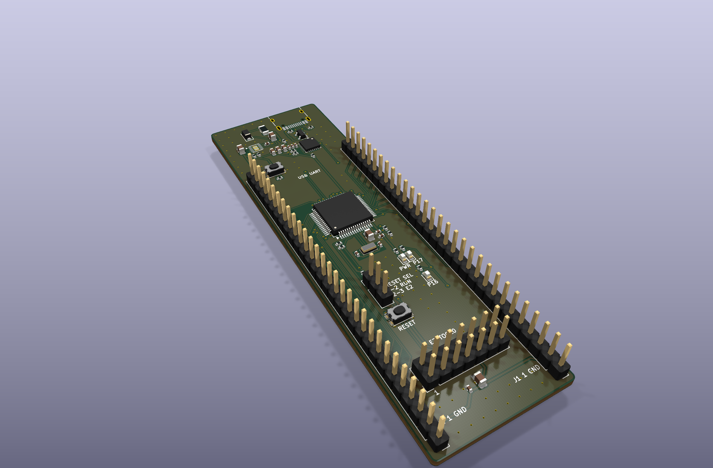
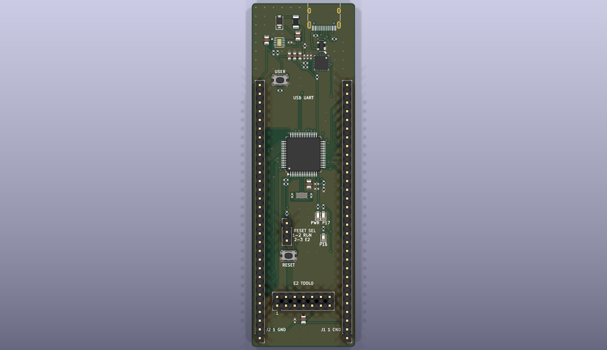
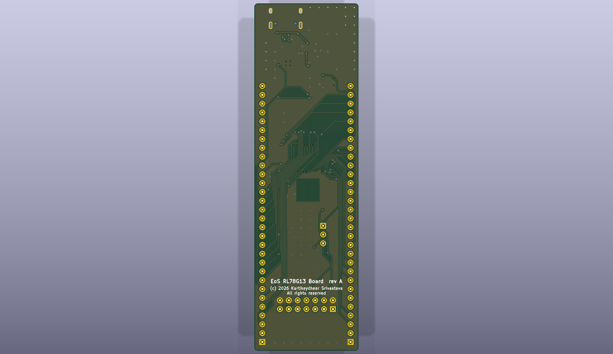

# EoS RL78G13 Board

An original R5F100LEAFB RL78/G13 development board, 30 × 100 mm, two layers, with two
30-pin expansion headers, a USB-C serial port and an external TOOL0 debug connector.
Designed by Kartikeydheer Srivastava.
All rights reserved: not open source, and not under this repository's MIT licence.
Anyone may view it, clone this repository and run its tests; anything more needs
Kartikeydheer Srivastava's written permission (kartikeydheer@gmail.com). EmbeddedOS (EoS) Research Foundation has a limited, revocable
permission. See [LICENSE.txt](LICENSE.txt) and [the licence summary](../README.md#licence).

A board for the same job as the Renesas YRPBRL78G13; an original design, not a copy:
no design file of the vendor's was used; the header positions come from the 25.4 mm
separation and 30 × 100 mm envelope dimension callouts in
[Renesas R01UH0243ED0000 Rev.1.0, page 70](https://www.renesas.com/en/document/mah/rl78g13-stick-yrpbrl78g13),
with the 2.54 mm pitch and pin functions from pages 18–20. The undimensioned distance
along the board is an original choice: both pin-1 centres are 2.54 mm from the bottom edge.
No schematic, copper layout, Gerber or BOM from that board was used. Mechanical drop-in
compatibility is unverified. This board uses 3.3 V I/O; VDD is not the reference board's 5 V.



| | |
|---|---|
|  |  |

## What is on it

| Block | Parts, settings and source |
|---|---|
| MCU | Renesas [R5F100LEAFB#10](https://www.renesas.com/en/products/rl78-g13/part-details/r5f100leafb-10), LFQFP-64, 64 KB code flash, 4 KB data flash, 4 KB RAM. Internal high-speed oscillator supports 32 MHz at this supply; select HS flash mode in firmware. [R01DS0131EJ0380](https://www.renesas.com/en/document/dst/rl78g13-data-sheet), §§1.1–1.3.11 and electrical characteristics. |
| MCU supply | VDD and EVDD0 share the nominal 3.283 V rail; VSS and EVSS0 share ground. Each supply has 100 nF; REGC has a specified 680 nF, 35 V, ±10% X7R 0805 capacitor to ground (C3; see capacitance budget below). Unused X1/X2 inputs have individual 10 kΩ pull-downs. [R01UH0146EJ0380](https://www.renesas.com/en/document/man/rl78g13-users-manual-hardware), §2.2, Table 2-3 and §23.1. |
| RTC subclock | NDK NX3215SA-32.768K-STD-MUA-14, 32.768 kHz, CL = 6 pF, ESR ≤70 kΩ, with two 7 pF C0G loads. This combination appears in the RL78 hardware manual's §5.7 resonator table (R01UH0146EJ0380, Resonator and Oscillator Constants). [NDK NX3215SA](https://www.ndk.com/images/products/catalog/c_NX3215SA_e.pdf). Start with normal oscillation mode; measure frequency and startup on hardware before using a lower-power setting. |
| USB-C | HRO TYPE-C-31-M-12, 5.1 kΩ on each CC pin ([USB Type-C specification](https://www.usb.org/usb-type-cr-cable-and-connector-specification), Rd), SP0503BAHTG common-anode TVS on D+, D− and VBUS. There are no data-line steering diodes to VBUS. USB layout and bridge values follow [CP2102N Rev.1.5, §§2.1–2.3](https://www.silabs.com/documents/public/data-sheets/cp2102n-datasheet.pdf). |
| Supply | Littelfuse 1206L050YR 500 mA fuse, Nexperia PMEG6010CEH Schottky, TPS7A9101DSKR LDO. 3.57 kΩ / 1.15 kΩ, both 0.1%, set 3.283 V; 10 µF input, 10 µF output, 10 nF NR/SS. [TI TPS7A91 SBVS282A](https://www.ti.com/lit/ds/symlink/tps7a91.pdf), Table 7-1 and §7.1.3. |
| USB UART | CP2102N-A02-GQFN24R: TXD → P14/RxD2, RXD ← P13/TxD2. VIO, VDD and VREGIN share the board supply, each with 4.7 µF and 100 nF bypass. RSTb has 1 kΩ pull-up. VBUS sense uses 22.1 kΩ / 47.5 kΩ, plus 1.5 kΩ VBUS bleed. CP2102N Rev.1.5 Figs.2.3/2.5. |
| Debug | Unshrouded, unkeyed 2×7, 2.54 mm connector with the Renesas E1/E2/E2 Lite TOOL0 pinout (see the keying warning below); 1 kΩ TOOL0 pull-up, a reset-choice jumper (Fig.2-10) and a 10 kΩ RESET pull-up (Fig.2-11 asks 1–10 kΩ where RESET_OUT alone drives RESET). [R20UT1994, Table 2-2 and Figs.2-5, 2-10 and 2-11](https://www.renesas.com/en/document/mat/e1e20e2-emulator-e2-emulator-lite-additional-document-users-manual-notes-connection-rl78). |
| User I/O | Reset switch, P137/INTP0 user switch with 10 kΩ pull-up, red P17 LED with 750 Ω and yellow P16 LED with 680 Ω. Both LEDs are active high and share their expansion pins. [Kingbright red](https://www.kingbrightusa.com/images/catalog/SPEC/APTD1608LSURCK.pdf), [yellow](https://www.kingbrightusa.com/images/catalog/SPEC/APTD1608LSYCK.pdf) and [green power LED](https://www.kingbrightusa.com/images/catalog/SPEC/APTD1608LCGCK.pdf) specify typical VF at 2 mA. |

C3 is **Murata GCM21BR7YA684KA55L**, 680 nF, 35 V, ±10%, X7R, 0805.
The RL78 hardware manual §23.1/Table 23-1 requires 0.47–1 µF on REGC, whose
operating voltage is 1.8 or 2.1 V. [Murata electrical characteristic data](https://ds.murata.com/simserve/characteristics?ReqType=TechPDF&partnumber=GCM21BR7YA684KA55&lang=en&techpdfname=technical_pdf_Capacitor01)
and [SimSurfing](https://ds.murata.com/simsurfing/mlcc.html?partnumbers=%5B%22GCM21BR7YA684KA55%22%5D)
provide the part's bias and temperature models. A model sweep at 0.01 Vrms, −40 to
+85 °C in 5 °C steps, and 0–3.325 V gave 0.652–0.691 µF; DC-bias change relative
to zero bias stayed within ±0.74%. With the full ±10% tolerance and ±15% X7R
limits, a separate 3% bias/AC allowance and 5% aging reserve give a calculated
0.479–0.886 µF envelope. These allowances are design reserves, not manufacturer
guarantees: the models are typical. Qualify production lots and substitutions at
REGC voltage and temperature, including aging, against the 0.47–1 µF requirement.
C3 is placed next to REGC with a short ground return.

## Power and operation

Power the board through USB-C only. J1.2 and J2.2 are **3.3 V outputs**. Do not inject
power there or enable target power from an attached debug probe. The MCU and USB bridge
always share a rail, so a powered MCU cannot drive an unpowered bridge. The Schottky and
VBUS bleed also keep the sense input from reporting a host through leakage.

External loads on J1.2 and J2.2 share one **150 mA** budget. Reserve 40 mA for the board,
for a total below 190 mA. The board itself takes about 31 mA from data-sheet typical and
maximum values: MCU IDD1 ≤ 7.0 mA (R01DS0131), CP2102N 9.5 mA typical, the three LEDs
6.2 mA, the feedback divider 0.70 mA and the P137 button 0.33 mA on 3.3 V, plus the LDO's
ground current ≤ 3.5 mA and the 3.33 mA VBUS bleed on 5 V. **With an E1, E2 or E2 Lite
fitted**, the probe draws about 20 mA from VDD at 3.3 V (R20UT1994 §2.5.4) and a low TOOL0
adds 3.3 mA through R16: the board then needs about 54 mA, so keep external loads at or
below **130 mA** while a probe is connected. Before using that allowance, program the CP2102N Max Power
descriptor to 0xFA (500 mA), and let the USB host configure the device; its factory value
0x32 requests 100 mA (CP2102N Table 7.1). With the factory descriptor, or before USB
configuration, keep external loads at or below 50 mA. This is a design budget, not a
measured load limit or USB certification.

The board does not implement CP2102N SUSPEND-controlled load switching or MCU suspend
firmware. The MCU, power LED and VBUS bleed remain powered when the host suspends.
**This board does not meet the USB 2.0 suspend current limit:** the VBUS bleed alone draws
5.0 V / 1.5 kΩ = 3.33 mA, above the 2.5 mA allowed. Changing Max Power alone does not make
this a compliant high-power USB device: attach current, enumeration and attach inrush are
unverified. The 10 µF LDO
input capacitor has positive tolerance, and downstream capacitors (about 35 µF on 3.3 V,
including the 10 µF at the header supply) also charge during startup; the fuse and Schottky are not an active inrush limiter. Validate these cases
on a prototype and add load/inrush control before claiming USB power compliance.

At 190 mA, a 4.75 V source, fuse R1max = 0.70 Ω, and conservative diode drop 0.53 V leave
at least 4.087 V at the LDO. Its specified maximum dropout is 0.20 V at 1 A. Ignoring the
upstream drops, worst-case dissipation is approximately `(5.25 − 3.283) × 0.190 = 0.374 W`.
The LDO's 62.5 °C/W JEDEC figure predicts about 24 °C rise; the thermal resistance of this
two-layer board has not been measured. Verify temperature and supply droop on a prototype.
The fuse's 0.42 A hold rating at 40 °C exceeds this budget. See the
[Littelfuse 1206L product data](https://www.littelfuse.com/~/media/files/littelfuse/technical%20resources/documents/product%20catalogs/littelfuse_polyfuse_pptcs.pdf)
and [Nexperia PMEG6010CEH](https://assets.nexperia.com/documents/data-sheet/PMEG6010CEH.pdf).

JP1 uses **one shunt**:

| Position | Operation |
|---|---|
| 1–2 | Normal run: reset switch and J2.19 connect to MCU RESET. |
| 2–3 | External probe: its RESET_OUT connects to MCU RESET; the switch and J2.19 feed the probe's RESET_IN. |

Connect the debug cable with both systems powered off, align its pin 1, select JP1 2–3,
and disable probe target power. After debugging, power off, unplug the cable and return
JP1 to 1–2. Hot plugging is unsupported because the reset capacitance used for that mode
would change the interface. R15, 10 kΩ, pulls MCU RESET up: R20UT1994 Figure 2-11 asks
for 1–10 kΩ where RESET_OUT alone drives RESET, as it does with JP1 at 2–3. It draws
0.33 mA while RESET is held low and also keeps RESET from floating while JP1 is open; it
does not replace the operating shunt. Order one 2.54 mm two-position jumper shunt with JP1.

**J4 is not keyed.** It is a plain 2×7 pin header, because a keyed 25.0 mm box header
(R20UT1994 Figure 2-4) does not fit across this board between J1 and J2. Check pin 1 every
time: it is the square pad at J4's lower left, marked "1" on the silkscreen. A cable plugged in the
wrong way round puts probe pin k on board pin 15 − k. The probe's RESET_OUT (13) then
lands on board ground (2), and its TOOL0 (5) and ground (2) both land on E2_RSTOUT (pins 10
and 13), so the probe's TOOL0 is tied to its own ground. R20UT1994 §2.2 warns that a
cable connected the wrong way may be damaged. With J1 and J2 fitted on the top side, the
free span between their 2.54 mm housings is about 22.86 mm. A 14-way IDC socket is about
22.4 mm long (distributor data for 3M 89114-0101, not a 3M drawing), about 0.2 mm clear on
each side. The fit of the E2 Lite cable's own plug has not been checked.

| J4 pin | Signal | J4 pin | Signal |
|---|---|---|---|
| 1 | NC | 2 | GND |
| 3 | NC | 4 | NC |
| 5 | TOOL0 | 6 | RESET_IN |
| 7 | NC | 8 | VDD sense |
| 9 | TOOL0 supply sense | 10 | RESET_OUT |
| 11 | NC | 12 | GND |
| 13 | RESET_OUT | 14 | GND |

USB carries UART2, not native MCU USB. Configure P13 as TxD2 and P14 as RxD2. Do not drive
P14 from expansion hardware while the bridge is fitted: it is already driven by CP2102N
TXD. P11/P12 remain expansion GPIO/UART0. The board has no COM-port programming/debug
support; use J4 for programming. Firmware must configure unused expansion GPIO inputs
with pull-ups or as safe outputs to prevent floating inputs.

## Expansion pinout

With USB at the top, J1 is the right row and J2 the left row. Both are fitted on the top
side, with the components. Pin 1 is at the bottom, marked by a square pad, and numbering
proceeds toward USB. Rows are 25.4 mm apart.
The published signal assignment is retained; VDD is 3.3 V on this design.

| Pin | J1 | J2 |
|---|---|---|
| 1 | GND | GND |
| 2 | VDD output | VDD output |
| 3 | P10 | P140 |
| 4 | P11 | P141 |
| 5 | P12 | P00 |
| 6 | P13 / UART TX | P01 |
| 7 | P14 / UART RX | P02 |
| 8 | P15 | P03 |
| 9 | P16 / yellow LED | P04 |
| 10 | P17 / red LED | P130 (output only) |
| 11 | P55 | P20 / AVREFP |
| 12 | P54 | P21 / AVREFM |
| 13 | P53 | P22 |
| 14 | P52 | P23 |
| 15 | P51 | P24 |
| 16 | P50 | P25 |
| 17 | P60 / SCLA0 | P26 |
| 18 | P61 / SDAA0 | P27 |
| 19 | P62 | User reset |
| 20 | P63 | P120 |
| 21 | P31 | P43 |
| 22 | P77 | P42 |
| 23 | P76 | P41 |
| 24 | P75 | P137 / button (input only) |
| 25 | P74 | P146 |
| 26 | P73 | P147 |
| 27 | P72 | P06 |
| 28 | P71 | P05 |
| 29 | P70 | P30 |
| 30 | NC | NC |

P60–P63 are open-drain ports; supply suitable external pull-ups when using them as outputs.
Use 3.3 V peripherals and check the MCU's pin-specific limits. P20/P21 can be ADC reference
inputs; firmware must choose the intended ADC reference before use.

## Not on this board

- The vendor's proprietary on-board debug probe, its firmware, demonstration software and
  virtual-UART implementation. Standard TOOL0 and CP2102N replace those functions.
- A 5 V MCU supply, USB Mini-B, an MCU-only current-measurement jumper or an external
  supply input. All powered logic shares the regulated rail.
- A main-clock crystal. The internal high-speed oscillator supplies the CPU clock; the
  fitted 32.768 kHz crystal supplies the subsystem clock.
- The vendor's 9 mm USB-end corner radii. The original outline retains the 30 × 100 mm
  envelope with 1 mm corners; no enclosure-fit claim is made.

## Layout

The figures below were measured on the routed board with the independent review's scripts:
copper paths run through pads, tracks, vias and both pours on a 0.05 mm grid, and the
resistances assume 35 µm copper.

**3.3 V distribution.** The LDO's output capacitor C14 is the star point. Three branches leave
it, all laid as fixed routes before the autorouter runs:
- The headers and the debug connector: 85.1 mm down the free strip outside J2 to J2.2, then
  27.0 mm along the bottom edge through their own 10 µF + 100 nF (C22, C23) to J1.2. J4's VDD
  pins and the reset/TOOL0 pull-ups join this bus.
- The CP2102N: through the feedback divider's sense end (R8) to its bypass row, 9.0 mm.
- The MCU: from the same point through R11 and a trunk inside the MCU's right pad row to C1 and
  C2, 53.5 mm to VDD.

No header current passes the MCU's or the bridge's capacitors. With the MCU cluster's copper
removed the headers stay fed, and with the header feed removed the MCU stays fed. The nearest
3.3 V copper is 1.59 mm from the crystal and its load capacitors. The tracks stay 0.30 mm wide: a wider
track cannot enter the 0.5 mm-pitch pins of U1, U3 and U4, and the board generator gives every
track of a net the same width. At 150 mA the header feed drops about 21 mV at J2.2 (0.14 Ω) and
28 mV at J1.2 (0.18 Ω).

**Sub-clock crystal.** R01UH0146EJ0380 Figure 5-13(d) forbids a power or ground pattern under
the XT1/XT2 wiring and the resonator. Pour keep-outs leave both layers bare there: on each layer
the ground pour covers 0 % of the XT-line strip (x 13.9–15.1, y 50.4–55.0 mm) and of Y1's
footprint, and no via sits under the crystal. The load capacitors' ground loop (C4 to C5) joins
the MCU's ground at C2's ground pad by one route (Figure 5-13(f)). Router keep-outs on the loop's
other three sides stop the autorouter joining any other ground to it: with that one route cut,
the loop has no copper path to ground. The MCU's VSS/EVSS0 node reaches ground through the top
pour and C2's ground via, 0.81 mm from C2's pad, without using the loop. That is its only via:
there was no clear spot for one beside C1.

**CP2102N bypass.** Each capacitor's ground reaches the bridge's ground through a via into the
solid bottom pour:

| Capacitor | Copper path to U3.2 (GND) | To U3's exposed pad | Straight line to U3.2 |
|---|---|---|---|
| C21 100 nF | 5.06 mm | 5.12 mm | 3.86 mm |
| C17 100 nF | 5.55 mm | 5.60 mm | 4.81 mm |
| C19 100 nF | 6.50 mm | 6.55 mm | 5.75 mm |
| C16 4.7 µF | 7.75 mm | 7.80 mm | 7.05 mm |
| C18 4.7 µF | 9.30 mm | 9.35 mm | 8.59 mm |
| C20 4.7 µF | 10.85 mm | 10.90 mm | 10.13 mm |

C21, C17, C18 and C20 have their own via, 0.81–0.97 mm from the ground pad. C19 and C16 reach
their neighbours' vias through short top-layer tracks: the autorouter moved the vias placed for
them. Most of each path is the straight-line distance, so only re-placing the row could bring it
under 5 mm. The row stays west of the chip because the supply pins (5–7) are at its top-left
corner, the USB lines leave its top edge and the VBUS-sense and reset lines leave its left edge.

**TOOL0.** TOOL0 runs 43.6 mm on the top layer with no via. Its only long neighbour within 1 mm
is the 3.3 V feed of its own pull-up (23.2 mm), a DC rail. RESET runs 4.4 mm beside it where both
leave the MCU's pins, a slow line; the other runs are 1.9 mm or less, at the MCU's pins and just
below JP1. It no longer runs beside P04/SCK10 (R20UT1994 §2.5.2).

**USB connector.** The ESD array's common anode (U2.1) has its own ground via 1.0 mm away. Its
copper path is 7.14 mm to the receptacle's A1 ground contact and 12.69 mm to B1. VBUS still
crosses under the A-row D+ and D− on the bottom layer at y = 8.44 mm, at right angles: joining
the receptacle's two VBUS contact groups has to cross the pair somewhere. Full-speed USB should
tolerate a short crossing; its effect has not been measured.

**LDO.** The input capacitor C13 has a ground via 1.22 mm from its ground pad, with 8.98 mm of
copper to U4's thermal pad. C15 (NR/SS) has a via 0.78 mm from its ground pad. The TPS7A91's
1.2 × 2.0 mm thermal pad has **no vias**, although TI SBVS282A §7.4.1 asks for an array of
them. The board generator puts vias only in exposed pads over 1.5 mm across, and no spot beside
U4's ground pins was clear of other copper. Its heat spreads through the top pour; the nearest
ground via is 2.63 mm from the pad's centre. Measure the regulator's temperature on a prototype
before relying on the 0.374 W case above.

## Build results

The numbers below are from `build-report.json` and `drc.json` in this folder.

| Check | Result |
|---|---|
| Schematic ERC | 0 violations |
| DRC errors | 0 |
| Unconnected items | 0 |
| Schematic ↔ board parity | 0 differences |
| DRC warnings | 2: silkscreen within the board-edge clearance, the outline of J3 (USB-C), which sits at the board edge |

## Fabrication

Two layers, 1.6 mm FR-4, ground pours on both sides. Design rules use 0.15 mm clearance,
0.15 mm default signal tracks, 0.20 mm USB tracks, 0.25 mm ground tracks, 0.30 mm
regulated-supply tracks and 0.40 mm VBUS tracks; allowed minimum track width is 0.10 mm.
VBUS narrows to 0.30 mm for its last 0.9 mm into R7's 0402 pad, and +5V to 0.225 mm for
0.41 mm at C13; both carry under 0.2 A. Standard vias are 0.60 mm
with 0.30 mm drill, with a 0.25 mm minimum drill rule. The four vias in the CP2102N's
exposed pad (U3) sit inside its paste apertures, where tenting cannot cover them: order them
**filled and capped (IPC-4761 Type VII)**, so solder does not wick down them. The board
file asks for tenting only (plugging, filling and capping are "no"), so name this in the
fabrication order. Confirm
the fabrication files and actual minimum features before ordering.

## What has not been done

- **No board has been fabricated or tested.** Digital rule checks do not establish analog,
  USB, thermal, ESD, debug or crystal performance.
- No firmware, CP2102N configuration image, USB certification or hardware debug session
  is included. The Max Power descriptor change above is a setup requirement.
- The public drawing does not dimension the longitudinal header offset. Exact mechanical
  interchangeability, enclosure fit and cable clearance are unverified.

## Rebuild

```sh
python3 tools/eos_boards/build.py eos_rl78g13_board
```

The source is [tools/eos_boards/boards/eos_rl78g13_board.py](../../../tools/eos_boards/boards/eos_rl78g13_board.py).
