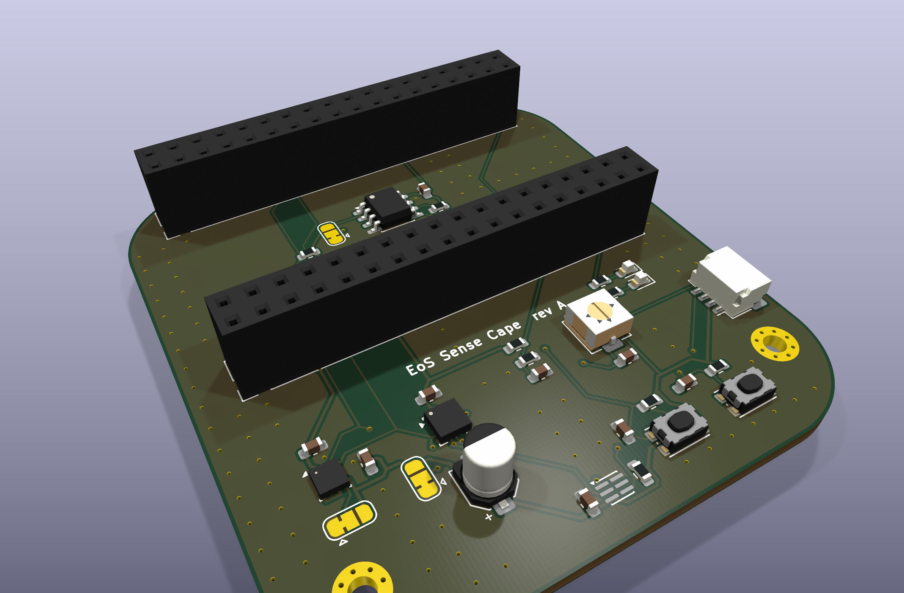
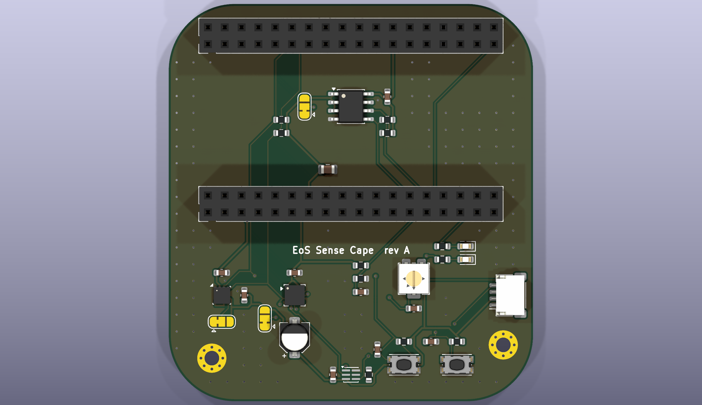
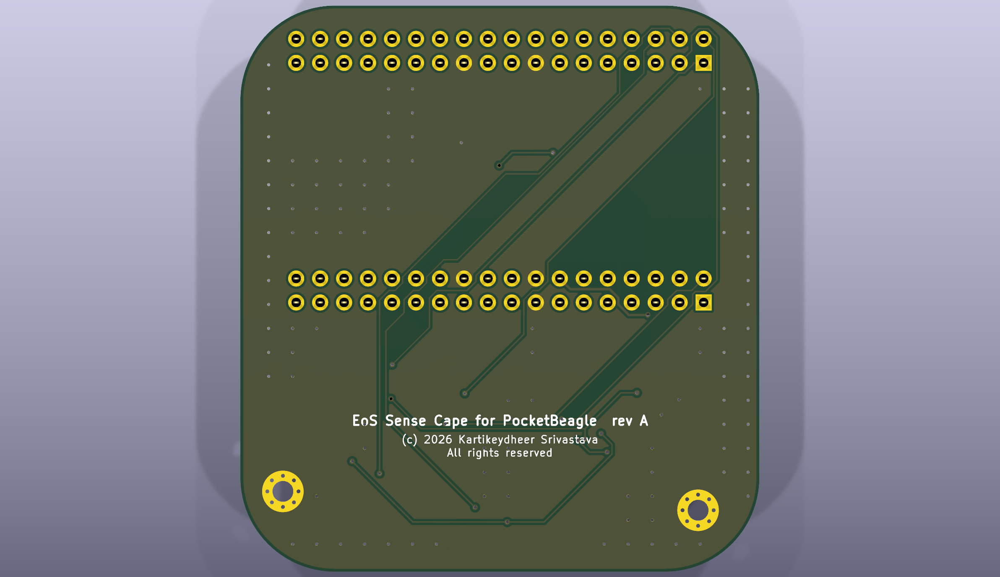

# EoS Sense Cape for PocketBeagle

A sensor cape for BeagleBoard.org PocketBeagle, 55 × 60 mm, two layers. Designed by
Kartikeydheer Srivastava. All rights reserved: not open source, and not under this repository's MIT licence.
Anyone may view it, clone this repository and run its tests; anything more needs
Kartikeydheer Srivastava's written permission (kartikeydheer@gmail.com). EmbeddedOS (EoS) Research Foundation has a limited, revocable
permission. See [LICENSE.txt](LICENSE.txt) and [the licence summary](../README.md#licence).



| | |
|---|---|
|  |  |

PocketBeagle plugs in on top through two 2×18 sockets. The cape runs 25 mm further down than
PocketBeagle, so its sensors, LEDs and buttons stay uncovered.

## It fits, to the nanometre

The socket positions and PocketBeagle's outline (55 × 35 mm, 10 mm corners) are read from
BeagleBoard.org's own PocketBeagle board file
([github.com/beagleboard/pocketbeagle](https://github.com/beagleboard/pocketbeagle), © 2017 Jason
Kridner (Texas Instruments), Aron Phillips (GHI Electronics) and Michael Welling (QWERTY
Embedded), [CC BY 4.0](https://creativecommons.org/licenses/by/4.0/)). Only the positions are
used, unchanged. `tests/unit/test_eos_boards.py` checks
every one of the 72 socket pads against PocketBeagle's matching header pin, pin for pin, and
passes with no difference at KiCad's 1 nm resolution.

## What is on it

| Part | On | Address / pin | Set from the datasheet |
|---|---|---|---|
| BME280: temperature, humidity, pressure | I2C1 | 0x76 | CSB tied directly to VDDIO selects I2C; SDO to GND gives 0x76; 100 nF on VDD and on VDDIO (Bosch BST-BME280-DS002) |
| LIS3DH accelerometer | I2C1 | 0x18, INT1 to P2.03 | CS tied high selects I2C; SA0 to GND gives 0x18; RES (pin 10) to GND; 100 nF ceramic and 10 µF aluminium at pin 14 (ST DocID 17530) |
| APDS-9306-065 ambient light | I2C1 | 0x52, INT to P2.06 | 1 µF bypass; 10 kΩ pull-up on the open-drain INT (Broadcom AV02-4755EN) |
| 24LC256 EEPROM, cape identity | I2C2 | 0x57 | A0-A2 tied high; WP must not float, so a solder jumper ties it to GND (writable) as delivered (Microchip DS20001203) |
| 10 kΩ NTC, Murata NCP18XH103F03RB | AIN5 (P2.35) | | 10 kΩ 0.1 % resistor from 3.3 V |
| 10 kΩ trimmer | AIN6 (P1.02) | | across 3.3 V |
| Two buttons | P2.02, P2.04 | | 10 kΩ pull-up, 100 nF debounce |
| Two LEDs | P1.36 (PWM0A), P2.01 (PWM1A) | | 680 Ω, about 2 mA |
| Qwiic / STEMMA QT | I2C1 | | pin 1 GND, 2 3.3 V, 3 SDA, 4 SCL |

Two things that are easy to get wrong:

- **PocketBeagle has no I2C1 or I2C2 pull-ups.** No resistor touches those nets in its board
  file, so the cape fits 4.7 kΩ on each line.
- **Only AIN5 and AIN6 take a 3.3 V signal.** PocketBeagle feeds each through its own
  10 kΩ + 10 kΩ divider (its R5 array), so 0-3.3 V reaches the processor as 0-1.65 V, under the
  1.8 V limit. The 1.8 V-only inputs (AIN0-4 and AIN7) carry nothing from the cape.

Both address pins reach GND through 3-pad solder jumpers (JP2, JP3). Re-bridge them to 3.3 V and
the sensors answer at 0x77 and 0x19.

### What AIN5 reads

The divider below includes the 20 kΩ load of PocketBeagle's own divider. It uses the thermistor's
B25/50 value of 3380 K; the simple B-value model is an approximation away from 25-50 °C. ADC
counts assume the AM335x's 12-bit converter with a 1.8 V reference.

| Temperature | NTC (kΩ) | AIN5 pin (V) | At the processor (V) | ADC count |
|---|---|---|---|---|
| -20 °C | 75.02 | 2.020 | 1.010 | 2298 |
| 0 °C | 28.22 | 1.780 | 0.890 | 2024 |
| 10 °C | 18.23 | 1.611 | 0.805 | 1832 |
| 20 °C | 12.13 | 1.420 | 0.710 | 1615 |
| 25 °C | 10.00 | 1.320 | 0.660 | 1502 |
| 30 °C | 8.29 | 1.220 | 0.610 | 1387 |
| 40 °C | 5.81 | 1.024 | 0.512 | 1165 |
| 50 °C | 4.16 | 0.845 | 0.423 | 962 |
| 70 °C | 2.26 | 0.557 | 0.279 | 634 |
| 85 °C | 1.50 | 0.403 | 0.202 | 459 |

With the thermistor open, the processor sees 1.1 V; with it shorted, 0 V. Both are inside the
limit.

Power comes from PocketBeagle's 3.3 V output (P1.14, P2.23). The cape draws under 15 mA with
both LEDs lit.

## Build results

| Check | Result |
|---|---|
| Schematic ERC | 0 violations |
| DRC | 0 errors, 0 warnings |
| Unconnected items | 0 |
| Schematic ↔ board parity | 0 differences |

## Fabrication

2 layers, 1.6 mm thick, ground poured on both sides. Measured from the board file: 0.15 mm
signal tracks, 0.25 mm on 3.3 V, 0.6 mm vias with a 0.3 mm drill.

- Gerbers and drill files: [fab/gerbers](fab/gerbers)
- Bill of materials: [fab/eos-sense-cape-bom.csv](fab/eos-sense-cape-bom.csv)
- Pick-and-place: [fab/eos-sense-cape-placement.csv](fab/eos-sense-cape-placement.csv)
- STEP model: [fab/eos-sense-cape.step](fab/eos-sense-cape.step)
- Schematic: [eos-sense-cape-schematic.pdf](eos-sense-cape-schematic.pdf)
- KiCad project: [hardware](hardware)

The sockets go on the top side; PocketBeagle plugs into them from above. Their pads use KiCad's
2×18 pin-header footprint because its pin numbering matches PocketBeagle's when both boards face
up. The 3D model is a socket's.

## What has not been done

No cape has been made or tested. The design passes KiCad's electrical and design rule checks,
and its fit is checked against PocketBeagle's board file; no hardware has been built.

## Rebuild

```
python3 tools/eos_boards/build.py eos_sense_cape
```

The design file is [tools/eos_boards/boards/eos_sense_cape.py](../../../tools/eos_boards/boards/eos_sense_cape.py).
