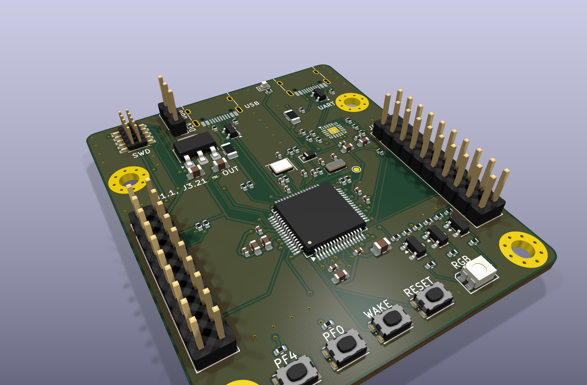
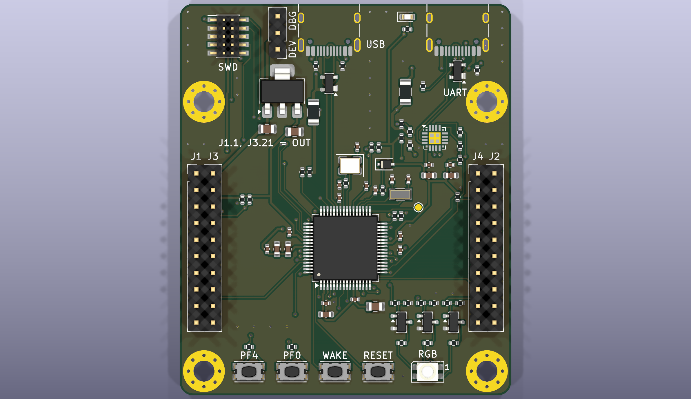
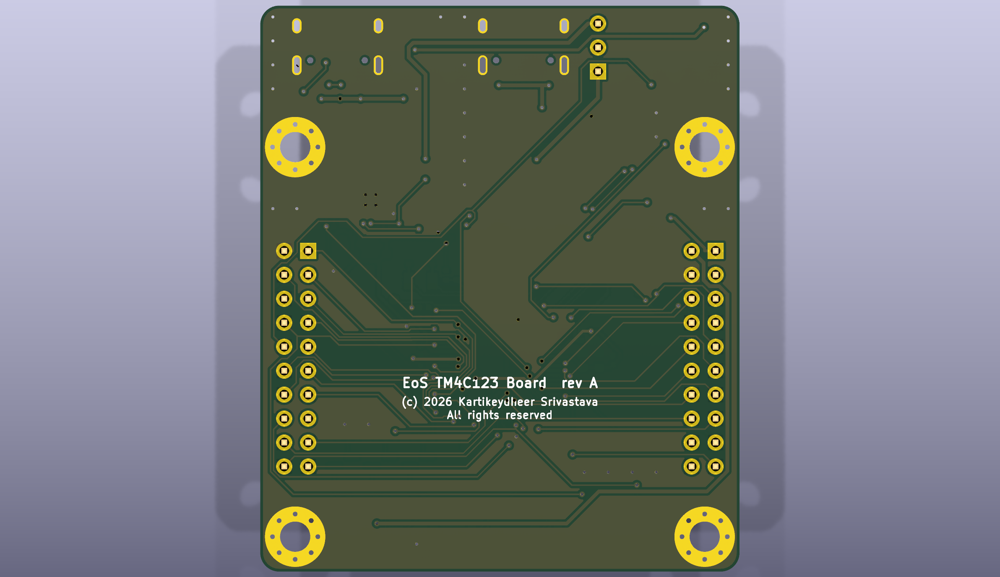

# EoS TM4C123 Board

A BoosterPack-compatible (40-pin) development board for the TI TM4C123GH6PM (Arm Cortex-M4F,
LQFP-64), 50.8 × 60 mm, two layers.
Designed by Kartikeydheer Srivastava. All rights reserved: not open source, and not under this repository's MIT licence.
Anyone may view it, clone this repository and run its tests; anything more needs
Kartikeydheer Srivastava's written permission (kartikeydheer@gmail.com). EmbeddedOS (EoS) Research Foundation has a limited, revocable
permission. See [LICENSE.txt](LICENSE.txt) and [the licence summary](../README.md#licence).

A board for the same job as TI's EK-TM4C123GXL; an original design, not a copy: no file of the
vendor's board was used. "BoosterPack" names TI's plug-in module format to say which modules fit
(nominative use); this board is not a TI product. No design file of TI's (schematic, layout, CAD, Gerbers, BOM) was used;
the header positions come from TI's BoosterPack Pinout Standard (updated Sept 1, 2013) and the
40-pin figure of TI's BoosterPack Standards and Design Guide (processors.wiki.ti.com, archived
2017-11-03). Every circuit value comes from the chip makers' data sheets listed below.



| | |
|---|---|
|  |  |

## What is on it

| Block | What and why | Source |
|---|---|---|
| TM4C123GH6PM | 80 MHz Cortex-M4F, 256 kB flash, USB 2.0 full speed, hibernation module, LQFP-64. Turned 90° so its USB and oscillator pins face up, its PA/PF side faces J4/J2 and its analog side faces J1/J3. | TI SPMS376E (data sheet), Tables 10-2 and 23-2 |
| Decoupling | 0.1 µF at each VDD pin (11, 26, 42, 54): C1 is joined straight to VDD pin 11 and GND pin 12 before the autorouter runs, and C3 sits straight above pin 42 (1.3 mm of track). Pin 42 is also joined to pin 11 under the chip, inside the pad ring, because the USB pair and the oscillator lines close it in outside. VDDA on the VDD net with 1 µF + 10 nF; 10 µF bulk (VDD + VDDA bulk is "typically between 2 µF and 22 µF"). | TI SPMA059 3.5.3 ("adjacent to each VDD power and ground pin pair") and Table 9 |
| VDDC (core LDO) | 2.2 µF + 1 µF + 0.1 µF closest to pin 56, 0.1 µF at pin 25: 3.4 µF, inside CLDO = 2.5–4.0 µF even at ±10 %. Nothing else on VDDC. | SPMS376E Table 24-12; SPMA059 3.5.2 |
| 16 MHz crystal | NDK NX3225GA-16.000M-STD-CRG-2 (CL 8 pF, ESR ≤ 80 Ω, drive ≤ 200 µW), one of the crystals TI simulated: C1 = C2 = 12 pF, Rs = 2 kΩ (worst-case drive 188 µW). Check: 12 ∥ 12 + C0 1.0 + 0.5 + 0.5 = 8 pF. USB needs this crystal. Layout: Rs straight above OSC1 (pin 41), the crystal above it, C13 beside Rs, C12 beside pad 1; laid first on the top layer with no via: OSC1 3.9 mm to Rs and 0.9 mm on to the crystal, OSC0 8.4 mm (up between the crystal's pads), at least 0.8 mm from the USB pair. | SPMS376E Tables 24-18, 24-19, section 18.3; SPMA059 3.7.2; NDK NX3225GA sheet |
| 32.768 kHz crystal | Abracon ABS07-32.768KHZ-T (CL 12.5 pF, ESR ≤ 70 kΩ, C0 ≤ 2 pF, drive ≤ 0.5 µW). TI's guide puts a typical board's stray at 2–4 pF: C = (12.5 − 3) × 2 = 19 pF → 20 pF, so CL is 12–14 pF (11 pF with the data sheet's nominal 1 pF of stray). Above 18 pF firmware sets OSCDRV, which allows ESR to 75 kΩ. GNDX to ground. The RTC's real error is not measured; trim it in firmware if needed. | SPMA059 3.7.1.2 (Eq. 5); SPMS376E Table 24-17, Table 7-1; Abracon ABS07 |
| Hibernation | VBAT from 3.3 V through a BAT54J Schottky (≤ 240 mV at 0.1 mA), then 51 Ω + 0.1 µF next to pin 37 (VBATRMP ≤ 0.7 V/µs). WAKE: 1 MΩ to VBAT's supply, and the button to ground through 470 Ω placed at the pin, so the long line to the button is behind the resistor. HIB to test point TP1. | SPMS376E 7.3, Figures 5-3, 7-2/7-3, Tables 24-25/24-26; SPMA059 3.5.6, 3.6, 4.10; Nexperia BAT54J |
| Reset | 10 kΩ pull-up, 10 nF at the pin, reset button through 470 Ω. C16 is 4.2 mm from pin 38 and the 470 Ω 10.0 mm, both laid before the autorouter on the chip's side of the device USB pair, so the run to the bottom-edge button is on the button's side of it, not on RST itself. Also on the debug header and J2.16. | SPMS376E Figure 5-3; SPMA059 3.6 |
| USB ESD (both ports) | SP0503BAHTG at each connector, on VBUS, D+ and D−: three TVS diodes to ground, 5.5 V standoff, ≤ 100 nA leakage, 30 pF. It is the part the CP2102N data sheet shows, and it has no path from D+/D− into VBUS, so a D+ pull-up left on after a host leaves cannot hold VBUS up and hide the unplug. | Littelfuse SP05xxBA; CP2102N Rev. 1.5 Figures 2.5 and 2.6; SPMA059 4.1 |
| USB device (J6) | USB-C, 5.1 kΩ Rd on CC1/CC2, 500 mA polyfuse. D+/D− straight to PD5/PD4 (the PHY has its own 1.5 kΩ pull-up). The pair is laid first, on the top layer with no via, from J6's B6/B7 through U3's pads (no stub) down a channel 1 mm left of the chip's pins, 0.7 mm apart (0.5 mm gap), stepping right into pins 44/43 at the chip; that leaves the column above pins 43/42 for C3 and C13. As laid, D+ is 24.91 mm and D− 24.82 mm from contact to pin. U3's channels are swapped (pin 3 D+, pin 2 D−) so the lines do not cross. The second contacts join on the top layer: A6 to B6 behind A7 (2.66 mm), A7 to B7 in front of A6 (1.96 mm). VBUS sense on PB3 through 10 kΩ / 15 kΩ (5.5 V → 3.3 V, 4.4 V → 2.64 V > VIH); the divider's 25 kΩ also bleeds VBUS, so PB3 reads low with no host. | SPMS376E chapter 18, 24.13; SPMA059 4.1, 4.1.1; Rd: TI SLVSFJ9 10.3.14.2 |
| Debug (J7) | Arm Cortex Debug 10-pin, 1.27 mm, keyed (Samtec FTSH-105-01-L-DV-K), so a reversed cable cannot short VTref to ground: SWD/JTAG on PC0–PC3 and RST, VTref on 3.3 V. The autorouter lays these lines; the last full build measured 34–42 mm, under the 2 in (51 mm) beyond which an external TCK pull is needed, and the next build's lengths need the same check. Replaces TI's in-circuit debug interface (ICDI), whose firmware is TI's. | SPMA059 3.8, Table 11 |
| USB-UART (J5) | CP2102N-A02-GQFN20 on UART0 (PA0/PA1), on the board's 3.3 V with its regulator unused, so it is powered whenever the MCU is and neither drives an unpowered chip's pins. Its USB pair is laid first like the device pair, receptacle to ESD part (pads inline) to CP2102N, top layer, no via: 17.29 mm (D+) and 17.36 mm (D−) as laid. The CP2102N numbers D+ (pin 4) before D− (pin 5) counter-clockwise, the opposite of the TM4C123's pins 44/43, so only the receptacle's middle contacts (A7 D−, A6 D+) give the pair its order; U2 is turned so its pads 3 and 2 face them. B6 joins A6 on the top layer behind A7; B7 can reach A7 only by crossing D+, so that one join goes through the bottom layer (two vias, 3.63 mm), in the signal path only with the plug the other way up. 4.7 µF + 0.1 µF on VREGIN and on VDD, which are tied: C23, a 0.1 µF, is the nearest capacitor to pins 6 and 7, while C21 is reached through C22 and C20; 1 kΩ RSTb pull-up, 1 kΩ in TXD and RXD; 100 kΩ pull-up on U0Tx, so the bridge sees an idle line until the MCU's ROM boot loader drives it. VBUS sense: the self-powered data sheet figure's 22.1 kΩ / 47.5 kΩ divider from the debug port's VBUS (5 V reads 3.41 V, above VIH 2.7 V) plus a 5.1 kΩ bleed to ground, so with no host the pin stays under VIL = 0.6 V unless over 185 µA is pushed into that VBUS, which nothing on the board can do; so its D+ pull-up comes on only with a host present. The bleed costs 1.0 mA from a host. | Silicon Labs CP2102N Rev. 1.5, Figures 2.3, 2.6, section 2.3, Tables 3.7, 3.10; SPMS376E 8.2.2.1; SPMA059 4.3 |
| Power | JP1 chooses 5 V: 1-2 device port, 2-3 debug port. Either port can power the board; JP1 takes one shunt, which bridges 1-2 or 2-3 but never 1-3, so one host never feeds the other. Removed, 5 V can come in on J3.21; fitted, J3.21 is an output and must not be fed. J1.1 (3.3 V) is always an output: fed while 5 V is absent, it would lift the LDO's OUT above IN + 0.3 V, its absolute maximum. The silkscreen says "J1.1, J3.21 = OUT". AP7361C-33 LDO (1 A, 2.2–6.0 V in) with 4.7 µF in and out; at 300 mA from 5 V it dissipates 0.51 W (56 °C rise at 110 °C/W). That 300 mA is the 3.3 V budget: the board takes up to about 72 mA (MCU 54.9 mA max, CP2102N 13.7 mA, LEDs), leaving about 225 mA for BoosterPacks on J1.1. Green power LED at 2.1 mA. | Diodes DS37274 Rev. 5-2 (p. 4 absolute maximum, p. 5 θJA); SPMS376E Table 24-41; CP2102N Table 3.2; Littelfuse 1206L; Kingbright DSAO7432 |
| RGB LED | Würth 150141M173100 (common anode) on PF1 red, PF2 blue, PF3 green. Green and blue need up to 3.6 V, more than a 3.3 V pin gives, so the anode is on 5 V and an MMBT3904 per colour switches the cathode: 4.7 kΩ base, 47 kΩ base–emitter (dark at reset), 1 kΩ / 1 kΩ / 470 Ω for about 2.8 / 1.6 / 3.4 mA. | Würth WL-SFTW datasheet; onsemi MMBT3904LT1/D Rev. 14; SPMS376E Table 24-6 |
| Buttons | PF4 and PF0 to ground (internal pull-ups), each through 1 kΩ because the pins also reach the BoosterPack; reset; WAKE. | SPMS376E Tables 24-6, 24-29 |
| BoosterPack headers | Samtec SSW-110-23-F-D, female with long male leads, so the board stays usable under a stack of BoosterPacks. PA3 (SSI0Fss, J2.18) has a 10 kΩ pull-up, so a BoosterPack's SPI device sees no access before firmware sets the pins up. | TI BoosterPack Pinout Standard (Sept 1, 2013) p. 2 ("must use female headers with long male leads"; recommended part numbers); SPMA059 4.2 |

### BoosterPack pin map

Positions and signal names follow TI's 40-pin standard: 0.1 in grid, J1 and J2 (outer) 1.8 in
apart, J3 and J4 (inner) 1.6 in apart, all pin-1 rows level. On the board, part J1 holds the J1
and J3 columns and part J2 holds J4 and J2; the silkscreen names all four.

| Pin | Standard | TM4C123 | | Pin | Standard | TM4C123 |
|---|---|---|---|---|---|---|
| J1.1 | 3.3 V | +3V3 | | J2.20 | GND | GND |
| J1.2 | analog | PB5 / AIN11 | | J2.19 | PWM | PA6 / M1PWM2 |
| J1.3 | UART RX (into the MCU) | PB0 / U1Rx | | J2.18 | SPI CS (wireless) | PA3 / SSI0Fss |
| J1.4 | UART TX (from the MCU) | PB1 / U1Tx | | J2.17 | GPIO** | PF0 (button, NMI-locked) |
| J1.5 | GPIO | PD6 | | J2.16 | RST | RST |
| J1.6 | analog | PE4 / AIN9 | | J2.15 | SPI MOSI | PA5 / SSI0Tx |
| J1.7 | SPI CLK | PA2 / SSI0Clk | | J2.14 | SPI MISO | PA4 / SSI0Rx |
| J1.8 | GPIO | PB6 | | J2.13 | SPI CS (display) | PE1 |
| J1.9 | I2C SCL | PD0 / I2C3SCL | | J2.12 | SPI CS (other) | PB7 |
| J1.10 | I2C SDA | PD1 / I2C3SDA | | J2.11 | GPIO | PF4 (button) |
| J3.21 | 5 V | +5V | | J4.40 | PWM | PF3 / M1PWM7 (green LED) |
| J3.22 | GND | GND | | J4.39 | PWM | PF2 / M1PWM6 (blue LED) |
| J3.23 | analog | PB4 / AIN10 | | J4.38 | PWM | PF1 / M1PWM5 (red LED) |
| J3.24 | analog | PE5 / AIN8 | | J4.37 | PWM | PA7 / M1PWM3 |
| J3.25 | analog | PD2 / AIN5 | | J4.36 | timer capture | PC4 / WT0CCP0 |
| J3.26 | analog | PD3 / AIN4 | | J4.35 | timer capture | PC5 / WT0CCP1 |
| J3.27 | analog | PE3 / AIN0 | | J4.34 | GPIO | PC6 |
| J3.28 | analog | PE2 / AIN1 | | J4.33 | GPIO | PC7 |
| J3.29 | reserved | not connected | | J4.32 | GPIO | PD7 (NMI-locked) |
| J3.30 | reserved | not connected | | J4.31 | GPIO | PE0 |

Notes for firmware and BoosterPack designers:

- **PF0 and PD7 are locked at reset** (NMI-capable pins, data sheet Table 10-1). To use either,
  write 0x4C4F434B to the port's GPIOLOCK register (offset 0x520), set the pin's bit in GPIOCR
  (offset 0x524), then program GPIODEN, GPIOPUR and the rest (section 10.2.4). Port F's APB base
  is 0x40025000, port D's 0x40007000.
- **PB0, PB1, PD4 and PD5 are not 5 V tolerant** (section 10.1). PB0, PB1 and PE3 need a
  1–10 kΩ external pull-up as inputs (Table 24-31): PB0 and PB1 have 4.7 kΩ on board; a
  BoosterPack using PE3 (J3.27) as a digital input must add one.
- **USB:** run the controller as a forced device (USBGPCS, section 18.2 note) and watch VBUS on
  PB3, dropping the D+ pull-up when it goes (section 18.3); the board can be powered from the
  debug port while the device port is unplugged.
- **Hibernation clock:** set OSCDRV in HIBCTL (20 pF load capacitors, Table 24-17).
- **Power on J1.1 and J3.21:** both are outputs. J1.1 carries the board's 3.3 V, up to about
  225 mA for all BoosterPacks together; never feed it. J3.21 carries the selected port's 5 V
  with JP1 fitted; feed 5 V into it only with JP1 removed.
- **PA3 (J2.18, SPI CS wireless)** has a 10 kΩ pull-up on board (SPMA059 4.2). **PA1 (U0Tx)**
  has a 100 kΩ pull-up for the ROM boot loader (section 8.2.2.1).
- PB2 is the one spare GPIO and is not connected. The buttons need the internal pull-ups
  (GPIOPUR) enabled.
- There are no I2C pull-ups on this board: a BoosterPack with I2C parts brings its own.

## Not on this board

- **TI's in-circuit debug interface (ICDI).** Its firmware is TI's, so it is replaced by the
  standard Cortex 10-pin SWD/JTAG header (J7) and a separate USB-UART bridge (CP2102N, J5). Any
  CMSIS-DAP, J-Link or similar probe connects to J7.
- **A backup battery.** VBAT comes from 3.3 V through a diode, so the RTC and battery-backed
  memory last only while USB power is present (VDD3ON mode, section 7.3.3), and HIB cannot be
  used to switch the supply off. This keeps a lithium cell and its holder off a development board.
- **J3.29 and J3.30**, which the 2013 standard marks reserved, are not connected.
- **ESD parts on the BoosterPack lines** (SPMA059 3.10.3 offers them as layout options): the
  BoosterPack headers are a board-to-board connection, not an exposed one.
- Nothing else of TI's board was looked at: no EK-TM4C123GXL document was opened, so this list
  covers only what the brief named.

## Build results

The numbers below are from `build-report.json` and `drc.json` in this folder.

| Check | Result |
|---|---|
| Schematic ERC | 0 violations |
| DRC errors | 0 |
| Unconnected items | 0 |
| Schematic ↔ board parity | 0 differences |
| DRC warnings | 4: silkscreen within the board-edge clearance, the outline of J5 (USB-C) and J6 (USB-C), which sit at the board edge |

## Fabrication

2 layers, 1.6 mm thick, ground poured on both sides. SPMA059 3.3.2 accepts two layers when no
interface is timing-critical, the USB runs are short and power and ground are routed with care;
its Table 13 lists TI's EK-TM4C123GXL, for this chip, as a two-layer board. The MCU's USB pair is
laid before the autorouter, about 25 mm long, and so is the debug port's pair, about 17 mm, with
the 16 MHz and 32.768 kHz lines, HIB, VBAT, the reset parts' links, C1's and C3's tracks and the
CP2102N's ground pin to its pad. Design rules: 0.15 mm clearance; the autorouter lays 0.15 mm
tracks (0.4 mm on VBUS and 5 V, 0.3 mm on 3.3 V and VDDC, which enter the 0.5 mm-pitch LQFP and QFN
pads, 0.2 mm on USB) but necks them to enter fine-pitch pads, and the generator widens any neck
below the board's 0.10 mm minimum to 0.10 mm: the last build had five 0.11 mm segments and two
0.225 mm segments on 3.3 V. So the smallest track is 0.10 mm. Vias 0.6 mm with a 0.3 mm drill; the
smallest drill is 0.3 mm, in the vias.

Both USB-C receptacles (HRO TYPE-C-31-M-12) sit where HRO's recommended layout puts them: the
board edge 5.79 mm in front of the locating pegs, so the shell stands about 0.46 mm proud of the
edge and a plug's overmold meets the shell, not the board. Their footprint's silkscreen still
crosses the edge (a fab clips it there).

## What has not been done

- **No board has been made or tested.** The layout changes after the second review (the debug
  port's pair, the 16 MHz group, the device port 1 mm left, the reset and VBAT parts) are routed in
  this revision's full build (see Build results) and were measured by a third reviewer. Lengths
  quoted here are from the pre-laid copper; the autorouter's lines (SWD, RST to J7) can differ
  from one build to the next.
- **No firmware is included.** The duties above (unlocking PF0/PD7, forced-device USB with VBUS
  on PB3, OSCDRV, button pull-ups) are not implemented anywhere yet.
- **The TM4C123GH6PM symbol is new.** KiCad 10 ships TM4C1230/TM4C1231 symbols but no
  TM4C123G part, so U1 uses EoS_MCU:TM4C123GH6PM, drawn from the data sheet's Table 23-2. Its
  pins were checked against Table 10-2 and against KiCad's TM4C1231H6PM (same LQFP-64 pinout).
- **Not verified:** that the VDDC capacitors and their traces stay within the 10–100 mΩ ESR
  window of Table 24-12 (Murata's reference sheets for C8, C9 and C10 give no ESR); the crystals' real load
  once board strays are known (measure the clock); the LED currents, which use forward voltages
  given only at 20 mA; the USB pairs' impedance, which two layers cannot hold at 90 Ω; the effect
  of the ESD array's 30 pF per line on full-speed signal quality (Silicon Labs recommends the
  part, but nothing was measured); a 3D check of a plug in the receptacles; J7's footprint (KiCad's
  generic 1.27 mm SMD header) against Samtec's FTSH land pattern; distributor stock and lifecycle
  for the parts named here.
- **Ground pour continuity** around the MCU can only be judged on the routed board. The generator
  stitches the pours on a 2.54 mm grid where nothing else is near and gives a pour fragment a via
  only where one fits inside it, so a small fragment that holds pads can stay joined only through
  them: the last build had one, with C5 and C6 (VDDA's capacitors), reaching the main pour only
  through tracks to GNDA pin 3. This design file cannot add stitching vias of its own.
- **Bottom-layer nets under the device USB pair.** The reset parts now sit on the chip's side of
  the pair, so RST no longer crosses it to reach them, but RST still has to reach J7 on the other
  side, and the 3.3 V rail has to reach the parts on the right from the LDO on the left: the
  autorouter decides where those two cross, on the bottom layer. A bottom-layer keep-out along the
  pair in the generator would stop it; until then, check the routed board. Each receptacle also
  has VBUS contacts on both sides of its D+/D− contacts, so its two VBUS pads are joined across its
  pair by the autorouter, on the bottom layer near the connector.
- **Back-feed into a USB host.** With JP1 fitted, a BoosterPack that drives 5 V into J3.21 pushes
  current back through JP1 and the polyfuse into the selected host's VBUS. The silkscreen and this
  README only warn against it. Two fixes, left to Kartikeydheer Srivastava: (a) a Schottky such as
  Nexperia PMEG6010CEH (as on EoS RA2E1 Board) from JP1 pin 2 (anode) to +5V (cathode), about
  0.35–0.46 V of drop at 0.3–0.5 A, plus a 5.1 kΩ bleed on VDEV like R31 on VDBG, because the
  diode's reverse leakage (about 100 µA typical at 85 °C) would otherwise lift PB3's divider above
  its 77 µA margin; or (b) a reverse-blocking power mux such as TI TPS2116 (1.6–5.5 V, 2.5 A,
  reverse current blocking, per TI SLVSFG1A as the review quotes it; not re-read here) in place
  of JP1, which also picks the port by itself.
- **The board index** (`boards/eos/README.md`) has no row for this board yet, and the unit-test
  log of the earlier fix (`test_each_readme_states_the_checks_its_build_recorded` failing for want
  of a build-results section) predates the full build; both wait for the orchestrator's build.
- **16 MHz crystal lifecycle.** NX3225GA-16.000M-STD-CRG-2 is the crystal TI simulated (SPMS376E
  Table 24-19, which spells it NX3225GA-16.000MHZ-STD-CRG-2), but whether NDK still makes it under
  that code is not confirmed. The same table's other 16 MHz parts need their own values and
  footprint, for example ECS-160-9-42-CKM-TR (4 × 2.5 mm, C1 = C2 = 12 pF, Rs = 0.5 kΩ).
- **USB attach inrush is not assessed.** Behind each port's VBUS sit 4.7 µF on 5 V and about
  26 µF on 3.3 V, which the LDO charges as fast as it starts up (DS37274: tST 150 µs typical with
  2.2 µF, current limit 1.1 A minimum); that is about 110 µC in all. USB 2.0's limit on attach
  charge was not re-read for this board. If that limit is below this charge, a soft-start load
  switch or less bulk capacitance would be needed; this revision has neither.
- **BOM.** The capacitors and the headers J1, J2 and J7 have manufacturer part numbers (Murata
  reference sheets; Samtec parts named by TI's standard and the Cortex-10 keyed variant). The
  resistors are specified by value, 1 % and 0402 only, and JP1 and its shunt by pitch only. The
  BAT54J's orderable packing code is not given: Nexperia's data sheet (v.2) and product page name
  the type only.
- **The CP2102N's exposed-pad vias sit in its paste openings.** The generator puts a 2 × 2 via
  array into the 1.8 mm centre pad, into the bottom ground pour, besides the pad's joins through
  pin 3 (laid first, since the USB pair passes it) and pin 12 (Table 5.3: "Center GND"). Solder can
  wick into them; order them tented or plugged if that matters.
- **The symbol's VDDC pins are power inputs.** VDDC is the core regulator's output (Table 23-2),
  so the schematic needs a power flag on it and the electrical rule check cannot catch another
  source tied to VDDC. Changing the pin type is a change to the shared symbol library.

## Rebuild

```
python3 tools/eos_boards/build.py eos_tm4c123_board
```

The design file is [tools/eos_boards/boards/eos_tm4c123_board.py](../../../tools/eos_boards/boards/eos_tm4c123_board.py).
